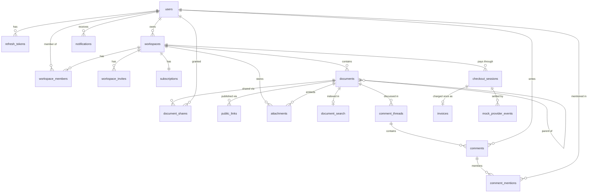
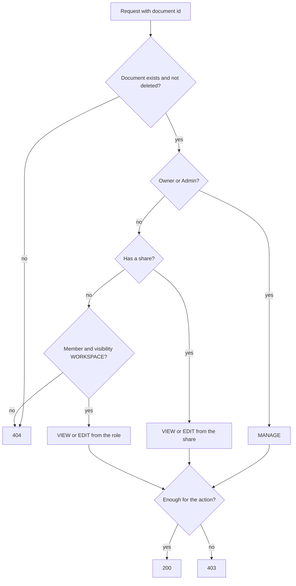
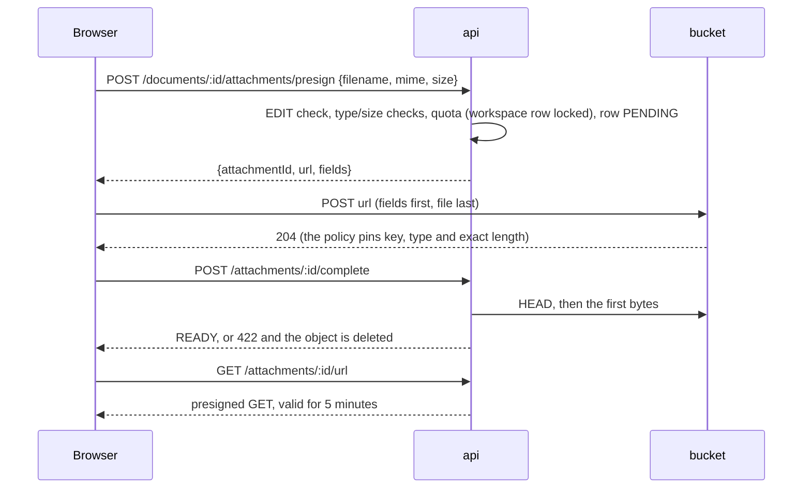
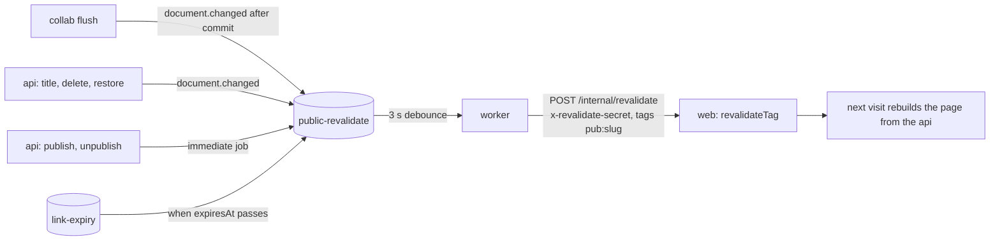
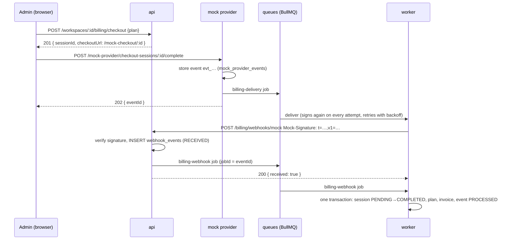

# Collab Docs

Collaborative workspace with real-time document editing: workspaces, nested documents, CRDT-based
co-editing, sharing and publishing, search, comments and billing.

> Work in progress. Sections below are filled in as the project grows.

## Architecture

pnpm monorepo:

| Path              | Purpose                                                                 |
| ----------------- | ----------------------------------------------------------------------- |
| `apps/web`        | Next.js 15 (App Router, Tailwind). Route groups `(public)` and `(app)`. |
| `apps/api`        | NestJS REST API (`GET /health`).                                        |
| `apps/collab`     | NestJS WebSocket server for document co-editing (Yjs), `GET /health`.   |
| `packages/shared` | Framework-free shared code with entry points `.` and `./content`.       |
| `packages/nest`   | Server-only NestJS building blocks shared by `api` and `collab`.        |
| `packages/db`     | Prisma schema, migrations, seed and integration-test harness.           |

`@collab-docs/nest` is server-only; ESLint forbids importing it (and `@collab-docs/db`) in
`apps/web`.

## Run

### With Docker (no setup)

Requires Docker with Compose v2. From a clean clone, without any `.env` file:

```bash
docker compose up --build --wait
```

Compose carries development-only defaults for every variable, so nothing else is needed. Copy
`.env.example` to `.env` to override values.

| Service    | URL / port                                  | Notes                                                                                    |
| ---------- | ------------------------------------------- | ---------------------------------------------------------------------------------------- |
| `proxy`    | http://localhost:3000                       | nginx, the only public HTTP entry point; sets `X-Forwarded-For` for `web`                |
| `web`      | - (behind `proxy`)                          | Next.js                                                                                  |
| `api`      | http://localhost:4000 (`/health`, `/ready`) | NestJS REST API                                                                          |
| `worker`   | -                                           | Background jobs (same image as `api`)                                                    |
| `collab`   | `localhost:4001` (`/health`)                | Public WebSocket port. Internal port `4002` is only reachable inside the compose network |
| `postgres` | `localhost:5432`                            | Database `collab`                                                                        |
| `redis`    | `localhost:6379`                            |                                                                                          |
| `minio`    | http://localhost:9000, console `:9001`      | S3 storage; bucket created by `minio-init`                                               |
| `mailpit`  | http://localhost:8025, SMTP `:1025`         | Catches outgoing email                                                                   |
| `migrate`  | -                                           | One-shot job that runs before the apps                                                   |

Host ports can be changed with `WEB_PORT`, `API_PORT`, `POSTGRES_PORT`, etc. (see `.env.example`).

MinIO's official images are no longer published, so `docker/minio/Dockerfile` builds the server and
the `mc` client from the last tagged source releases.

Only infrastructure for local development: `docker compose up -d postgres redis minio minio-init mailpit`.

### Staging profile

```bash
cp .env.staging.example .env.staging   # fill in every value
docker compose --env-file .env.staging -f docker-compose.yml -f docker-compose.staging.yml up -d
```

The override sets `APP_ENV=staging` and `NODE_ENV=production`, hides database, cache and console
ports, restarts services automatically, and requires every secret. On startup `api` and `collab`
validate their environment and refuse to run with missing values or `dev-only` placeholders.

### Without Docker

Requires Node.js >= 22.12 (see `.nvmrc`) and pnpm 10, plus the infrastructure services above.

```bash
pnpm install
pnpm dev
```

## Continuous integration

`.github/workflows/ci.yml` runs on every push to `main` and every pull request: lint and typecheck,
unit and integration tests (Postgres and Redis service containers plus the compose `minio` image, which is built
from source and reuses the layer cache of the image build job), Docker image builds for `web`, `api`,
`collab` and `minio`, and the Playwright `e2e` job against the compose stack (see [Running e2e](#running-e2e)).

## Development

| Command                   | What it does                                                                                                                                  |
| ------------------------- | --------------------------------------------------------------------------------------------------------------------------------------------- |
| `pnpm lint`               | ESLint (flat config) for the whole repo                                                                                                       |
| `pnpm typecheck`          | `tsc --noEmit` in every package                                                                                                               |
| `pnpm test`               | Jest (api, collab) and Vitest (web, shared, nest)                                                                                             |
| `pnpm test:integration`   | Integration tests (needs Postgres and Redis; set `MAILPIT_URL=http://localhost:8025` with Mailpit running to include the email delivery test) |
| `pnpm build`              | Builds shared libraries, then every app                                                                                                       |
| `pnpm format`             | Prettier                                                                                                                                      |
| `pnpm --filter api start` | Runs the built API                                                                                                                            |

Libraries in `packages/*` are built before type checking and testing (`pnpm build:libs`, run
automatically by `typecheck` and `test`).

### Module system

`jose` is ESM-only, so the choice below was verified with smoke tests in every runtime:

- `packages/shared` is a dual package (`"type": "module"`, built with tsup to ESM `.js` and CJS
  `.cjs`, with matching type declarations) exposed through conditional `exports`. It has no NestJS code.
- `packages/nest` is CommonJS and built with `tsc`, because decorator metadata is only emitted by `tsc`
  (and by swc), not by esbuild; it requires ESM-only `jose` the same way the apps do.
- `apps/api` and `apps/collab` stay CommonJS (NestJS). At runtime Node loads ESM-only `jose`
  through `require(esm)`, which is why Node >= 22.12 is required.
- Dependency injection is type-based: constructors name the class and Nest reads it from the decorator
  metadata emitted by `tsc` (build) and `@swc/jest` (tests, `apps/api/.swcrc`). `@Inject()` stays only for
  `Symbol` tokens (`REDIS_CLIENT`, `DOCUMENT_STORE`) and for the one property injection in the throttler guard. A class used in a constructor must be a value
  import, never `import type`; the `consistent-type-imports` rule is configured to respect that. Vitest
  (esbuild) emits no metadata, so tests of injectable classes belong in the Jest suites.
- Jest runs through `@swc/jest`; `transformIgnorePatterns` lets `jose` be transformed to CommonJS.
- Vitest (web, shared) and `next build` import the package natively as ESM.

## Data model

Postgres, managed with Prisma 7 in `packages/db` (`prisma/schema.prisma`, migrations in
`prisma/migrations`). Tables and columns are snake_case, ids are UUID v7.



Notes:

- **Documents form a tree** (`parent_id`) ordered by `position`, a fractional-indexing key. The column
  is created `COLLATE "C"` so keys compare bytewise; the database default collation would sort mixed
  case differently and break the ordering.
- **Soft delete**: `deleted_at` marks a document, `deleted_root_id` the document where the deletion
  started, so a restore brings back only that deletion's subtree.
- **`revision`** is incremented atomically on every change that derived data (search index, public
  pages) must follow.
- **Indexes**: the tree listing uses a partial index `documents_tree_idx (workspace_id, parent_id,
position) WHERE deleted_at IS NULL`; the rest are plain b-tree indexes on foreign keys and unique
  lookups (emails, slugs, token hashes, one share per user and document, one public link per document
  and mode). Partial indexes, `COLLATE "C"` and the `pg_trgm`/`unaccent` extensions are written by hand
  in the first migration; the partial index keeps the name declared in the schema, so
  `pnpm --filter @collab-docs/db db:drift` still reports no drift. The search migration adds the
  `cd_unaccent` function, the generated `tsv` column of `document_search` and the `cd_headline` text search
  configuration by hand, and the schema mirrors the generated column (`dbgenerated`) for the same reason
  (see [Search](#search--index-consistency)).
- **Comments and notifications**: a thread belongs to a document and anchors on a `block_id`, the id the editor
  gives the block. It is not a foreign key, because blocks live inside the CRDT state; see
  [Comments & notifications](#comments--notifications). `notifications.dedupe_key` is unique, which is what
  makes creating a notification idempotent. Besides `(user_id, read_at, created_at)` there is an index on
  `(user_id, created_at DESC, id DESC)` that serves the newest-first list.
- **Billing**: `checkout_sessions` (a payment in progress; `PENDING` becomes `COMPLETED` or `FAILED` once),
  `webhook_events` (one row per provider event id, `RECEIVED` or `PROCESSED`, unique `event_id`), `invoices`
  (unique `checkout_session_id`: a session is charged once) and `mock_provider_events` (what the mock provider
  issued, so any event can be delivered again). `subscriptions.last_event_at` orders events; see
  [Billing & idempotency](#billing--idempotency). Billing records are `RESTRICT`, so a workspace with a payment
  history is never deleted implicitly.
- **Foreign keys**: rows that make no sense without their parent (memberships, refresh tokens, shares,
  public links, the subscription, threads, comment mentions, notifications) cascade; workspace owners, document authors and workspaces that
  still hold documents are `RESTRICT`, so content is never deleted implicitly.
- Emails are stored lower-case (normalised by the application) and are unique.

### Database commands

| Command                                    | What it does                                                                                                       |
| ------------------------------------------ | ------------------------------------------------------------------------------------------------------------------ |
| `pnpm --filter @collab-docs/db db:migrate` | Create/apply migrations in development                                                                             |
| `pnpm --filter @collab-docs/db db:deploy`  | Apply existing migrations (what the `migrate` job runs)                                                            |
| `pnpm --filter @collab-docs/db db:seed`    | Idempotent demo data (dev only): `alice`, `bob`, `carol` `@example.test`, password `password123`, workspace `acme` |
| `pnpm --filter @collab-docs/db db:reset`   | Drop, re-migrate and re-seed                                                                                       |
| `pnpm --filter @collab-docs/db db:drift`   | Fails if migrations and `schema.prisma` diverge                                                                    |
| `pnpm test:integration`                    | Integration tests against a real Postgres                                                                          |

All of them read `DATABASE_URL`. Integration tests use `createTestDb()` from
`@collab-docs/db/testing`: each Jest worker creates its own throwaway database on that server,
applies the migrations and truncates tables between tests.

## API platform

Shared by `api`, its queue worker and (later) `collab`: it lives in `@collab-docs/nest`, and each
app only plugs the modules in (`PlatformModule` for HTTP services, `WorkerPlatformModule` for the worker).

- **Configuration**: `@nestjs/config` (`ConfigModule`, global) validates the process environment with the zod
  schema in `@collab-docs/nest` before anything starts, so a missing or malformed variable stops the process
  with the full list of problems (`APP_ENV=staging` additionally rejects development placeholders). Services
  inject `ConfigService<AppConfig, true>` and read `config.get('NAME', { infer: true })`. Env files are loaded by
  the runtime (`node --env-file`, Docker Compose), never by the app.
- **Prefix**: routes live under `/api`; `/health`, `/ready`, `/metrics` and `/docs` are served without it.
- **Validation**: a global `ValidationPipe` (`whitelist`, `forbidNonWhitelisted`, `transform`; registered as an `APP_PIPE` provider), `ParseUuidPipe`
  for ids, and base DTOs for pagination and id params. Request/response contracts are zod schemas in
  `@collab-docs/shared`; response DTO classes `implements` the inferred types, and integration tests parse
  real responses with the same schemas, so backend and frontend cannot drift apart silently.
- **HTTP hardening**: `helmet`, a CORS allowlist (`WEB_ORIGIN` plus `CORS_ALLOWED_ORIGINS`), `cookie-parser`,
  a JSON/urlencoded body limit (`HTTP_BODY_LIMIT`, default `1mb`) and `trust proxy` restricted to
  `TRUSTED_PROXY_CIDRS` (empty means `x-forwarded-for` is never trusted).
- **Rate limiting**: `@nestjs/throttler` with a Redis store, keyed by the real client IP. A generous global
  limit (`RATE_GLOBAL_PER_MIN_IP`) applies everywhere; `RateLimit.login()`, `.register()` and `.guestTicket()`
  are per-IP presets whose limits come from the `RATE_*` variables. `RateLimit.user('ticket' | 'publicLink')` counts
  per signed-in user instead (the same throttler and Redis store, keyed by `request.user` in a route-level
  `UserThrottlerGuard`), for what people do rather than what addresses do: collab tickets are fetched on every reconnect of every tab, and a person creating public links
  should not get a fresh budget from another IP. If Redis is unavailable both guards fail open and log the error.
- **OpenAPI**: Swagger UI at `/docs`, JSON at `/docs/json`. `pnpm --filter @collab-docs/api openapi:export`
  writes the committed `docs/openapi.json` (the app is built without connecting to anything).

### Error model

Every error response has the same shape, produced by one global `AllExceptionsFilter` (an `APP_FILTER` provider):

```json
{
  "statusCode": 400,
  "code": "VALIDATION_FAILED",
  "message": "Request validation failed",
  "details": [
    { "field": "name", "messages": ["name must be longer than or equal to 1 characters"] }
  ],
  "correlationId": "6f1c3f0e-…"
}
```

`code` comes from the catalog in `@collab-docs/shared` (`VALIDATION_FAILED`, `UNAUTHENTICATED`, `FORBIDDEN`,
`NOT_FOUND`, `CONFLICT`, `RATE_LIMITED`, `PLAN_LIMIT_EXCEEDED`, `PAYLOAD_TOO_LARGE`, …) and clients branch on
it, never on `message`. Application code throws `AppException(code, message, { details })`. Framework and
library errors are mapped: validation errors become 400, Prisma `P2002` 409, `P2025` 404, throttling 429,
oversized or malformed bodies 413/400. Anything unrecognised is a 500 with a generic message — the real
error is logged with the correlation id but never returned.

### Logging & correlation

Logs are JSON (`nestjs-pino`). Each request gets a correlation id: the incoming `x-correlation-id` if it is a
short, log-safe token, otherwise a new UUID. It is stored in `AsyncLocalStorage`, added to every log line,
returned in the `x-correlation-id` response header and in every error body. When code enqueues a job the id
is written into the job data, and the worker restores it before running the processor, so one id follows a
change from the browser through the API into background work (and later the collab server). Secrets are
redacted from logs (`authorization`, `cookie`, `set-cookie`, passwords, tokens). Classes get their logger by
injection (`@InjectPinoLogger(MyService.name)`), which adds a `context` field; business events are logged with
`logEvent(this.logger, 'document.published', { … })` (an `event` field plus the same name as the message).

### Observability

- `GET /health` — liveness (checks nothing, so a database outage never restarts the container; the Docker
  healthchecks use it). `GET /ready` — readiness: pings Postgres and Redis (2 s each) and answers `503` when one is
  down. Both use the standard `@nestjs/terminus` body, `{ status, info, error, details }`; a failing dependency
  shows up as `{ status: 'down' }` under `error` and `details`, without the underlying error message.
- `GET /metrics` — Prometheus: default process metrics, `http_request_duration_seconds{route,method,status}`
  (labelled by route pattern, not raw URL) and queue metrics (`queue_jobs{queue,state}`,
  `queue_jobs_processed_total{queue,result}`). The endpoint is unauthenticated, so keep it off public ingress.

### Queues

BullMQ queues (`search-sync`, `public-revalidate`, `mail`, `billing-webhook`, `billing-delivery`, `link-expiry`, `version-prune`, `attachment-cleanup`)
are registered once with `@nestjs/bullmq` (`BullModule.registerQueue`), with default retries (5 attempts,
exponential backoff) and bounded history. Producers inject a queue (`@InjectQueue(name)`) or use `QueueService`;
either way `addJob` stamps the ambient correlation id into the job. Consumers are `@Processor(name)` classes that
extend `QueueProcessor`: it restores the correlation context, counts results and logs failed jobs, and the class
only implements `handle(job)`. The worker runs from the same image as the API (`node dist/main.worker.js`) and
shuts down gracefully, finishing active jobs. `enqueueDebounced(queue, documentId, delayMs)` coalesces bursts of
changes into one delayed job using BullMQ deduplication; the job reads the latest state when it runs, and a
change made while it is processing schedules a new job. A fixed `jobId` per document is deliberately not
used, because BullMQ remembers finished ids and would drop later changes.

## Authentication

Own JWT auth in the API (`apps/api/src/auth`), no external identity provider.

| Endpoint                  | Purpose                                                                                       |
| ------------------------- | --------------------------------------------------------------------------------------------- |
| `POST /api/auth/register` | Create an account and sign in (409 if the email exists)                                       |
| `POST /api/auth/login`    | Sign in                                                                                       |
| `POST /api/auth/refresh`  | Rotate the refresh token, issue a new access token                                            |
| `GET /api/auth/refresh`   | Same rotation for browser navigations; `302` to `?next=` (relative paths only) or to `/login` |
| `POST /api/auth/logout`   | Revoke the refresh-token family, clear the cookies                                            |
| `GET /api/auth/me`        | The signed-in user (read from the database)                                                   |

Register, login and refresh answer `{ user, accessToken, expiresIn }` and set two cookies. The access token
is also accepted as `Authorization: Bearer` (Swagger, tests, non-browser clients).

| Cookie  | Content                       | Attributes                               |
| ------- | ----------------------------- | ---------------------------------------- |
| `cd_at` | access JWT, 15 min            | `HttpOnly; SameSite=Lax; Path=/`         |
| `cd_rt` | opaque refresh token, 30 days | `HttpOnly; SameSite=Lax; Path=/api/auth` |

Both are `Secure` when `APP_ENV=staging`. The browser reaches the API same-origin through the web app's
`/api/*` rewrite, so the cookie paths match.

For other modules: every route requires a valid access token unless it is marked `@Public()`; the user is
available through `@CurrentUser()` (`{ id, jti }`). The guard verifies the JWT locally and never touches the
database. The API issues and verifies the token with `@nestjs/jwt` (`AccessTokenService`, `JwtModule` configured
from `JWT_ACCESS_SECRET`). Next's Edge middleware cannot use it, so `verifyAccessToken()` in `@collab-docs/shared`
verifies the same token with `jose` (Web APIs only). The two implementations are tied together by a contract test
(`access-token.service.spec.ts`): a token from either side must verify on the other with the same claims, and
expired, tampered, wrong-audience, wrong-algorithm and incomplete tokens must be rejected by both. The collab
ticket stays on `jose` (`signCollabTicket`/`verifyCollabTicket`), because the API signs it and collab verifies
it with the same code, so there is no second implementation to keep in step.

### Auth design & rationale

**Why our own JWT instead of Auth.js.** The API is a separate NestJS service that also guards a WebSocket
gateway and server-to-server calls, so identity has to be verifiable outside Next. A signed access token that
any service can check with one shared secret does that; Auth.js sessions live inside the Next runtime. Owning
the flow also keeps rotation, reuse detection and rate limits in one place and testable at the HTTP level.

**Access + refresh.** The access JWT is short-lived (15 min; `sub`, `jti`, `aud=api`) and checked without a
database read. The refresh token is 256 random bits; only its SHA-256 is stored (`refresh_tokens.token_hash`),
so a database leak does not yield usable tokens. Passwords use argon2id (`@node-rs/argon2`; memory, time and
parallelism come from `ARGON2_*`, defaults follow the OWASP minimum). A wrong password and an unknown email
produce the same response and cost the same time.

**Rotation and the 30 s grace.** Each refresh replaces the token (`rotated_at`, `replaced_by`) inside one
family (`family_id`). The rotation claim is a single conditional `UPDATE ... WHERE rotated_at IS NULL`, so of
two parallel refreshes with the same token exactly one rotates. A rotated token that is presented again within
30 s (parallel requests, several tabs, a response lost on the wire) only yields a new access token and no
second rotation, so the user is not logged out by a race. Presented later, a rotated token means it was
copied: the whole family is revoked, the request gets `401`, and `auth.refresh_reuse_detected` is logged.
Logout revokes the family too.

**CSRF.** `SameSite=Lax` plus a global guard: a state-changing request authenticated by cookies (`cd_at` or
`cd_rt`, so refresh and logout included) must carry `Origin` equal to `WEB_ORIGIN`, otherwise `403
CSRF_REJECTED`. Bearer requests are exempt (browsers do not attach that header on their own), as are
requests without auth cookies such as login and webhooks.

**Rate limits.** Login: 5/min per (client IP, email) and 20/min per IP; register: 10/h per IP (`RATE_*` in
`.env.example`). Exceeding them returns `429 RATE_LIMITED` with `Retry-After`. The client IP is `req.ip`,
which honours `x-forwarded-for` only from `TRUSTED_PROXY_CIDRS`.

**HS256 vs ES256/JWKS.** HS256 with a dedicated secret (`JWT_ACCESS_SECRET`) is the simplest thing that works
for services we deploy together; every verifier holds the secret. The cost is that every verifier could also
mint tokens. To move to ES256 with a JWKS endpoint, the API would sign with a private key and publish the
public key; `AccessTokenService` and `verifyAccessToken` are the only places that change, and `jose` already supports
`createRemoteJWKSet`. Rotating keys then needs only a `kid`, with no secret redistribution.

## Workspaces, members and invites

`apps/api/src/workspaces`. A user creates a workspace and becomes its `OWNER`; the workspace starts on the
`FREE` plan. Roles: `OWNER`, `ADMIN`, `EDITOR`, `VIEWER`.

| Endpoint                                       | Minimum role | Purpose                                              |
| ---------------------------------------------- | ------------ | ---------------------------------------------------- |
| `POST /api/workspaces`                         | any user     | Create a workspace (slug is generated from the name) |
| `GET /api/workspaces`                          | any user     | Workspaces the caller belongs to                     |
| `GET /api/workspaces/:id`                      | `VIEWER`     | One workspace                                        |
| `PATCH /api/workspaces/:id`                    | `ADMIN`      | Rename                                               |
| `GET /api/workspaces/:id/usage`                | `VIEWER`     | Members, documents, storage against the plan limits  |
| `GET /api/workspaces/:id/members`              | `VIEWER`     | Members                                              |
| `PATCH /api/workspaces/:id/members/:userId`    | `ADMIN`      | Change a role                                        |
| `DELETE /api/workspaces/:id/members/:userId`   | `VIEWER`     | Leave (own id) or remove a member (`ADMIN`)          |
| `POST /api/workspaces/:id/invites`             | `ADMIN`      | Invite an email (never as `OWNER`), emailed          |
| `GET /api/workspaces/:id/invites`              | `ADMIN`      | Pending invites                                      |
| `DELETE /api/workspaces/:id/invites/:inviteId` | `ADMIN`      | Revoke                                               |
| `GET /api/invites/:token`                      | public       | Preview (workspace, email, role) for the accept page |
| `POST /api/invites/:token/accept`              | signed in    | Join; the account email must equal the invited email |

Rules enforced on the server: an admin can neither change or remove an owner nor grant `OWNER`; the last
owner can be neither demoted nor leave (`409`); a role change or removal publishes `perm.changed` on Redis
once the transaction has committed (the real-time server listens to it). Both rules run under the workspace
row lock, so two concurrent demotions cannot leave a workspace without an owner.

**Invites.** The token is 256 random bits, valid for 7 days, and only its SHA-256 is stored. Inviting an
address that already has a pending invite re-issues it (new token, new expiry, the old link stops working);
inviting an existing member is `409`. The email is sent by the `mail` queue (nodemailer to SMTP, Mailpit in
development at <http://localhost:8025>); the worker retries with exponential backoff and the HTML template
escapes every user-supplied value. The queue payload carries the accept link, so Redis holds a valid token
until the job is removed (one hour after success).

**Plan limits.** `PLAN_CATALOG` in `@collab-docs/shared` (Free 3 members / 20 documents / 100 MB, Pro
10 / 500 / 5 GB, Team 50 / unlimited / 50 GB). Members are accepted members plus pending invites; people who
only have a document shared with them (guests) do not count. Every check runs in a transaction that first
takes `SELECT ... FOR UPDATE` on the workspace row, so N parallel invites at the limit produce exactly the
allowed number of successes. Exceeding a limit returns `403` with
`{ code: 'PLAN_LIMIT_EXCEEDED', details: { kind, limit, current, plan } }`. After a downgrade, existing
members stay and new ones are blocked, including accepting an invite that was issued earlier.

## Permission model

Access is decided by pure functions in `packages/shared/src/permissions.ts`, so the API, the collab server
and the tests share one definition. `PermissionsService` (`apps/api/src/permissions`) loads the minimal
context (membership, share, visibility) and calls them. **Nothing is cached**: a revoked permission applies
to the next request. Routes declare their requirement with `@WorkspaceRole('ADMIN')` or
`@DocumentAccess('EDIT')`.

Document access, evaluated top to bottom:

| #   | Condition                                | Access                                       |
| --- | ---------------------------------------- | -------------------------------------------- |
| 1   | Document is deleted                      | `NONE` (restore: Owner/Admin, Editor-author) |
| 2   | Role is `OWNER` or `ADMIN`               | `MANAGE`                                     |
| 3   | The user has a `document_share`          | share `EDITOR` -> `EDIT`, `VIEWER` -> `VIEW` |
| 4   | Member and visibility is `WORKSPACE`     | `EDITOR` -> `EDIT`, `VIEWER` -> `VIEW`       |
| 5   | Anything else (non-member, `RESTRICTED`) | `NONE`                                       |

An explicit share overrides the workspace role in both directions. Public links are a separate path: a
`VIEW` link allows anonymous reading of the published page, a live `EDIT` link grants `EDIT` on that one
document to a guest who cannot comment.



**404 vs 403.** No access at all (not a member, `RESTRICTED` without a share, deleted, unknown id, malformed
id) gives `404`, so the response never confirms that a resource exists; access that is too low for the action
gives `403`. A member of a workspace also gets `403` where a non-member gets `404`.

Creating a document needs `EDITOR` and `EDIT` on the parent; the child copies the parent's visibility and
shares at that moment (a snapshot, not live inheritance). Moving needs `EDIT` on the document and on the new
parent, the same workspace and no cycle. Only `EDITOR` and above can comment.

## Documents & hierarchy

Documents form a tree per workspace (`documents.parent_id`); siblings are ordered by a fractional-indexing key
in `documents.position` (`COLLATE "C"`), so a reorder rewrites one row and never rebalances. Endpoints live in
`apps/api/src/documents`; every route that takes a document id declares `@DocumentAccess(...)`, and restore
(which must see deleted rows) resolves access itself.

- **Permissions are not inherited.** A child copies the parent's visibility and shares when it is created and is
  independent afterwards. The consequence is a tree with holes: `GET /workspaces/:id/documents/tree` returns a
  flat list filtered for the caller, and a visible document under a hidden parent is returned with
  `parentId: null` so the id of the hidden ancestor is never disclosed (`GET /documents/:id` does the same).
- **Move** needs `EDIT` on the document and the new parent, the same workspace, and no cycle (`409`). Creates,
  moves, deletes and restores in one workspace take the workspace row lock (`SELECT ... FOR UPDATE`), which also
  serialises the plan-limit check and makes a cycle from two racing moves impossible, including moves into the
  root where there is no parent row to lock.
- **Soft delete** marks the whole live subtree in one recursive statement and stamps every node with
  `deleted_root_id`, including descendants the caller cannot see. The trash lists the root of each deletion.
  **Restore** brings back exactly the nodes of that deletion (a child deleted earlier stays in the trash), needs
  room under the plan's document limit (`403 PLAN_LIMIT_EXCEEDED`), and returns the document to the root when its
  parent is still deleted. Only a deletion root can be restored; restoring a node that was deleted with its
  parent is `409`.
- **Sharing** is by email for registered users only (`404` for unknown addresses). A guest sees only the
  documents shared with them (`GET /me/shared-documents`), not the tree or the workspace. A share overrides the
  workspace role in both directions.
- **Recent documents** (`GET /workspaces/:id/documents/recent?limit=`, default 8, max 20) feed the dashboard:
  newest change first, visibility filtered in SQL so the limit applies to documents the caller may open.
- **Who may do what:** create `EDITOR`+ with `EDIT` on the parent; edit title/icon, move and delete `EDIT`;
  change visibility or manage shares `MANAGE` or `EDIT` as the author; restore Owner/Admin or the author.

## Caching & invalidation

The document tree is cached in Redis as `tree:{workspaceId}:{version}` (5 minute TTL as a safety net). Every
mutation that can change the tree (create, rename, move, delete, restore, visibility, share) commits first and
then increments `tree:ver:{workspaceId}`; the old entry is simply never read again. A reader that loaded the
database before a concurrent commit stores its result under the old version, so a stale tree cannot be
served after the bump. **Permissions are not cached**: the cache holds the unfiltered live rows and each request
applies the caller's role and shares (one small query) after reading it. If Redis is down the tree is read from
Postgres. Hits, misses and errors are exported as `tree_cache_lookups_total{result}`.

After the bump the api publishes on Redis:

| Channel / queue                                 | When                                          | Consumers                                                                                                      |
| ----------------------------------------------- | --------------------------------------------- | -------------------------------------------------------------------------------------------------------------- |
| `realtime.events` -> `GET /events/stream` (SSE) | tree changed                                  | browsers of that workspace                                                                                     |
| `perm.changed`, `doc.deleted`, `doc.restored`   | visibility/share change, delete, restore      | collab re-evaluates open sockets                                                                               |
| `public-revalidate` (3 s), `search-sync` (5 s)  | content, create, title, icon, delete, restore | page revalidation ([Publishing](#publishing-sanitization--isr)), search ([Search](#search--index-consistency)) |

Everything is published only **after** the transaction commits, so a rolled-back request (for example a
rejected plan limit) emits nothing. The queues are debounced with BullMQ `deduplication` keyed by document id
(never `jobId = documentId`, which would silently drop later changes); the job reads the latest state when it
runs. A failed enqueue is logged and counted (`queue_enqueue_failures_total`) but never fails the request.

`GET /events/stream?workspaceId=` is server-sent events: members only (`404` otherwise), a heartbeat every 25 s
that also re-checks membership, `Cache-Control: no-cache, no-transform` and `X-Accel-Buffering: no` so a
rewrite proxy does not buffer it. One connection per browser tab carries the workspace's `tree.changed` events
and the caller's personal events.

## Content model

`@collab-docs/shared/content` is the single definition of what a document may contain; the editor, the
publishing endpoints, search and comments all build on it, and it imports neither `/nest` nor `@collab-docs/db`.

- **Allowlist as data** (`schema.ts`): nodes `paragraph`, `heading` (1-3), `bulletList`, `orderedList`, `listItem`,
  `taskList`, `taskItem`, `image`, `codeBlock`, `hardBreak`, `mention`; marks `bold`, `italic`, `code`, `link`;
  each with its attributes. The editor configuration and the sanitiser read the same table.
- **Storage format**: a `Y.XmlFragment` named `content` inside the `Y.Doc`, the field the Tiptap Collaboration
  extension must be configured with (`field: 'content'`; its default is `'default'`). `yDocToContentJson` reads
  it with `@tiptap/y-tiptap`, the library Tiptap v3 itself uses, so the XML shape is the editor's own.
- **`sanitizeContent`** turns any JSON into a valid document: unknown nodes are unwrapped (their text survives
  as text), unknown marks and attributes are dropped, `link.href` must be an absolute `http`, `https` or `mailto`
  URL (everything else, including `javascript:`, `data:` and relative references, loses the link mark) and gets
  `rel="noopener noreferrer nofollow ugc"`, images keep only `attachmentId` (a UUID) and `alt`, code languages come
  from a list, control and bidirectional-override characters are removed, and depth, node count and text length
  are capped (the walk over hostile input is bounded too). Anything that leaves the server as content goes through it.
- `extractPlainText`, `extractMeta` (description of at most 160 characters, first image), `extractMentions` and
  `extractBlockIds` serve search, social previews, notifications and comment anchors.

The tests include an XSS corpus and a round trip ProseMirror JSON -> `Y.Doc` -> encoded update -> JSON.

## Collaboration service

`apps/collab` owns document content. A document is a `Y.Doc` held in a room while someone has it open; clients
exchange Yjs updates with the room over a WebSocket, and nothing else writes content. The wire protocol,
close codes and the `persisted` / `access` / `deleted` room events are specified in
[docs/collab-protocol.md](docs/collab-protocol.md).

- **Transport.** `ws/collab-ws.adapter.ts` extends Nest's stock `WsAdapter` (`@nestjs/platform-ws`) in two
  places so the gateway can take binary frames on `/ws/<documentId>`: upgrades are routed by path prefix
  (the stock adapter matches the exact path) and message handlers are not bound (the stock adapter expects JSON
  messages, the `y-websocket` protocol is binary). The server is `ws` + `y-protocols`, the client is
  `y-websocket`.
- **Authentication and permissions.** The api issues a 60 s ticket (`POST /documents/:id/collab-ticket`, at
  least `VIEW`, limited per user); collab verifies it and reads the document permissions **from the database**
  with the same pure resolver as the api (`resolveDocumentAccess`), so the ticket cannot carry stale rights. A
  user below `EDIT` is connected read-only: their updates are dropped before they touch the document.
- **Permission changes** reach open sockets through the Redis events of the api and a 60 s re-check
  (see the protocol document); downgrade, revoke and delete all take effect without a reconnect.
- **Hot path.** A client update goes through size and permission checks, `Y.applyUpdate` inside `try/catch`, a
  duplicate check, and out to the other sockets and the `DocumentStore`: no HTTP call, no database read.
- **Presence.** Cursors are relayed; the server sets `user.id`, `name` and `color` from the authenticated
  identity, so a client cannot impersonate anybody.
- **Limits** (env, defaults from the spec): 200 messages per 10 s per connection, 1 MB per update, 10 MB per
  document, 100 connections per document, 4 KB per presence state. Violations are rejected, counted and logged
  as `collab.update_rejected` without disturbing the other clients.
- **Metrics** (`/metrics`): `collab_connections`, `collab_rooms`, `collab_updates_applied_total`,
  `collab_updates_duplicate_total`, `collab_updates_rejected_total{reason}`, `collab_rate_limited_total`,
  `collab_ws_close_total{code}`, `collab_access_changes_total{outcome}`, plus the platform metrics.
- **Internal port 4002** is a TCP microservice of the same application (`connectMicroservice`, so it shares the
  rooms and the store through one DI container), never published by compose; every message carries
  `INTERNAL_API_TOKEN` and the caller's correlation id.
- **Persistence.** Rooms talk to storage only through the `DocumentStore` interface (`load`, `enqueue`,
  `onPersisted`, `flush`, `release`, `close`); the Postgres implementation is described in the next section.

### Scaling the collab service

One instance is supported, deliberately: a document's room lives in the memory of one process, which makes
ordering and the `persisted` acknowledgement simple. To run several instances you would route every connection
for a document to the same instance (consistent hashing on the document id at the load balancer), or give every
instance a room per document and fan updates and awareness out between them over Redis pub/sub, with the stored
update log as the source of truth for a room that starts cold. Both need a decision about who persists and who
acknowledges, which is why the second is more work than it looks. The rest of the service is already
stateless: tickets are verified with a shared secret, permissions are read from Postgres, and permission events
arrive through Redis, which every instance would subscribe to.

## CRDT persistence strategy

A document is stored as a **log of Yjs updates plus one compacted state** (`document_updates`,
`document_states`), the shape a CRDT wants: updates are small, idempotent and commutative, so appending them in
any order reproduces the document, and the log is folded into a snapshot now and then so it stays short.

**Write path** (`PostgresDocumentStore`, collab):

1. A room hands every applied update to the store synchronously (`enqueue`); nothing waits for the database.
2. Updates are buffered per document and flushed when the document has been quiet for 1 s, and at the latest 5 s
   after the first buffered update however busy it is (`COLLAB_FLUSH_INTERVAL_MS`, `COLLAB_FLUSH_MAX_WAIT_MS`).
3. A flush merges the buffer with `Y.mergeUpdates` into **one row** (unique on `(document_id, sha256 of the
bytes)`, `ON CONFLICT DO NOTHING`, so a retried flush cannot insert twice) and, in the **same transaction**,
   does `revision = revision + 1, content_updated_at = now()`. A consumer that sees the new revision therefore
   finds the content.
4. After the commit the store tells the room, which sends `persisted {sv}` to its clients, and (fire-and-forget)
   queues `document.changed` for search (5 s debounce) and page revalidation (3 s). A Redis outage is logged and
   counted, and editing continues.

**Failures.** If the write fails, the buffer is kept in order and retried with backoff (1, 2, 5, 10, then every
30 s); a room whose updates are not written is not unloaded, and loading a document first writes whatever the store
still holds for it. Shutdown (`SIGTERM`) flushes every buffer before the database connection is closed.

**Saved means durable.** `y-websocket` does not acknowledge updates, so the server reports what is in the database
as a state vector (`persisted`, also once on connect) and the client computes `hasUnsyncedChanges =
!covers(persistedSV, localSV)` (`stateVectorCovers` in `@collab-docs/shared`). The same check gates publishing:
"publish only saved changes".

**The loss window.** If the process is killed (`kill -9`, power) the server loses at most the updates buffered since
its last flush, up to 5 s. They are not lost for good while the author's tab is open: the browser keeps its `Y.Doc`
and, on reconnect, answers the server's sync step 1 with everything the server lacks. What cannot be recovered is
a tab closed inside that window, which is why the editor is designed to show "Saving…" until `persisted` covers the
local state and to warn before the page is left with unsaved changes.

**Cold start.** `load` reads the compacted state and every log row with `id > last_update_id` in one
repeatable-read transaction (a compaction between two separate reads could otherwise hide rows), merges them and
hands the result to the room. A row that cannot be decoded is skipped, logged and counted
(`collab_bad_log_rows_total`); the room still opens with everything else.

**Compaction.** When the tail reaches 100 rows or 512 KB (`COLLAB_COMPACT_MAX_ROWS`, `COLLAB_COMPACT_MAX_BYTES`),
and whenever a room is unloaded, one transaction folds state + tail into a new state (`encodeStateAsUpdate`),
upserts `document_states` with the highest folded id and deletes the folded rows. Concurrency is handled with
a per-document advisory lock: compaction takes it exclusively, appends take it shared. Without that, an append
holding a lower `bigserial` id but committing later than a higher one could fall below `last_update_id` and be
deleted unseen. Two compactions at once just run one after the other. Ten thousand one-character updates leave at
most 100 rows (tested); `collab_compaction_*` metrics show duration and rows folded.

**Versions** (`document_versions`, whole document as one update):

| Kind          | Created                                                                                        |
| ------------- | ---------------------------------------------------------------------------------------------- |
| `AUTO`        | by collab after a flush, at most every 10 min (`AUTO_VERSION_INTERVAL_MS`) and only if changed |
| `MANUAL`      | `POST /documents/:id/versions {label?}` (EDIT); collab is asked to flush first (2 s limit)     |
| `PRE_RESTORE` | automatically, before a restore replaces the content                                           |

`GET /documents/:id/versions` lists them, `GET .../:versionId` returns the content as **sanitised** ProseMirror JSON
for a preview. Retention (hourly job in the worker): 50 automatic snapshots per document and 100 snapshots in all;
automatic and pre-restore ones go first, manual ones are only limited when created (`409` at 100).

**Restore** (`POST /documents/:id/versions/:versionId/restore`, EDIT): the api checks access and hands the work to
collab (the `collab.restore` message on port 4002), because only the service that owns the live document can
change it safely. Collab loads the room if nobody has it open, writes its buffer, saves the `PRE_RESTORE` snapshot,
then replaces the children of the content fragment with clones of the version's in **one Yjs transaction** made by
the server and flushes. Connected clients receive it like any other update and converge; the edit history is not
rewritten, so a restore can itself be undone from the pre-restore snapshot. If collab is unavailable the api answers
`503` rather than pretend.

**Deleting a document while it is edited.** The api's `doc.deleted` event (or the `collab.close` message on port 4002)
makes collab write the buffer first, since restore needs the content, then send `deleted` and close the sockets with 4410.

Internal messages on port 4002 (TCP; `token` is `INTERNAL_API_TOKEN`): `collab.flush { documentId }` (answers
`{ revision }`), `collab.restore { documentId, versionId, userId }`, `collab.close { documentId }`. See
[docs/collab-protocol.md](docs/collab-protocol.md).

## Storage and attachments

Images live in an S3-compatible bucket (MinIO in development) and never pass through the api: the browser
uploads them with a presigned POST. A document refers to an image by `attachmentId` only (see
[Content model](#content-model)); external URLs and SVG are not part of the model.



| Endpoint                                  | Needs | Notes                                                                                                                                                               |
| ----------------------------------------- | ----- | ------------------------------------------------------------------------------------------------------------------------------------------------------------------- |
| `POST /documents/:id/attachments/presign` | EDIT  | `{filename, mime, size}` → `{attachmentId, url, fields, expiresAt}`; `413` over the per-file limit, `403 PLAN_LIMIT_EXCEEDED` with `kind: 'storage'` over the quota |
| `POST /attachments/:id/complete`          | EDIT  | idempotent; `422` with `details.reason` (`not_uploaded`, `size_mismatch`, `type_mismatch`, `content_mismatch`)                                                      |
| `GET /attachments/:id/url`                | VIEW  | only completed uploads; the access check runs on every call, so a revoked role or a deleted document stops it at once                                               |

**Three layers refuse anything that is not png, jpeg, webp or gif.**

1. _Presign_: the type is an allowlist, the file name's extension has to belong to it, the size is capped
   (`ATTACHMENT_MAX_BYTES`, 10 MB by default). `image/svg+xml`, `text/*` and the rest are `400`.
2. _Bucket policy_: the form is signed with conditions on the key, the `Content-Type` and
   `content-length-range` set to the declared size, so the bucket itself answers `EntityTooLarge`,
   `EntityTooSmall` or `403` for anything else, however the client was modified.
3. _Sniffing on completion_: the stored size and content type are compared with what was declared and the
   first bytes are checked against the magic numbers of the four formats. A text file called `fake.png`
   passes layers 1 and 2 and stops here; the object and its row are deleted.

**Quota.** `SUM(size)` over the workspace's attachments (completed and pending) has to stay within the plan
(100 MB / 5 GB / 50 GB). The check and the insert run in one transaction under `SELECT ... FOR UPDATE` on the
workspace row, the same lock the member and document limits use, so two parallel presigns cannot both take
the last bytes. `GET /workspaces/:id/usage` reports the same figure.

**Two S3 clients.** The server talks to `S3_ENDPOINT` (the compose network name, `minio:9000`); URLs given to
browsers are signed for `S3_PUBLIC_ENDPOINT` (`localhost:9000`), because a signature covers the host. The
bucket's CORS origin is `WEB_ORIGIN` (`MINIO_API_CORS_ALLOW_ORIGIN` in `docker-compose.yml`).

**Lifecycle.** Objects are stored as `ws/{workspaceId}/doc/{documentId}/{uuid}`. A `PENDING` row older than
`ATTACHMENT_PENDING_TTL_HOURS` (24) is removed by an hourly worker job together with its object. The job
claims rows with `DELETE ... RETURNING` before touching the bucket, so a completion racing the sweep fails
with `404` and never leaves a `READY` row without a file. Deleting a document is a soft delete and keeps its
attachments; purging them is not done (see [Not done](#not-done)).

## Publishing, sanitization & ISR

A document can be shared outside the workspace in two ways, both through a row in `public_links` (one per
document and mode, see [Data model](#data-model)):

| Mode   | Address      | Grants                                                    | Identified by                                |
| ------ | ------------ | --------------------------------------------------------- | -------------------------------------------- |
| `VIEW` | `/p/<slug>`  | anonymous reading of the sanitised page (SSR/ISR)         | `slug`: title words and 6 hex digits, public |
| `EDIT` | `/e/<token>` | `EDIT` on that one document, as a guest, without comments | a 256-bit secret; only its SHA-256 is stored |

Both can have an optional expiry (at most five years ahead). Managing links needs `MANAGE`, or `EDIT` as the
document's author, like sharing. Everything below is API; the pages that use it are described with the frontend.

| Endpoint                                     | Notes                                                                                                                                                                       |
| -------------------------------------------- | --------------------------------------------------------------------------------------------------------------------------------------------------------------------------- |
| `GET /documents/:id/public-links`            | the links with `status` (`active`, `expired`, `revoked`); never the EDIT secret                                                                                             |
| `POST /documents/:id/public-links`           | `{mode, expiresAt?}`; **10 per hour per user** (`RATE_PUBLIC_LINK_PER_HOUR_USER`). `VIEW` is idempotent, `EDIT` returns the secret once (`token`) and replaces the old link |
| `PATCH /documents/:id/public-links/:linkId`  | `{expiresAt}`, `null` removes it; a revoked link is `409`                                                                                                                   |
| `DELETE /documents/:id/public-links/:linkId` | revokes (`revoked_at`); revoking again is a no-op                                                                                                                           |
| `GET /public/documents/:slug`                | `{title, description, content, updatedAt}`; **one `404`** for never published, unpublished, expired and deleted                                                             |
| `GET /public/media/:attachmentId?slug=`      | `302` to a presigned URL (5 min) when the image belongs to the document the slug publishes                                                                                  |
| `GET /public/links/:token`                   | state of an EDIT link for `/e/<token>`: `404` unknown or replaced, `410 LINK_EXPIRED` expired or revoked, `410 DOCUMENT_DELETED`                                            |
| `POST /public/links/:token/ticket`           | collab ticket for a guest (`{docId, linkId}`, no user); **30 per minute per IP** (`RATE_GUEST_TICKET_PER_MIN_IP`)                                                           |

**Life cycle of a link.** The `VIEW` slug is created once and never changes: unpublishing sets `revoked_at`,
publishing again clears it, so the address (and whatever links to it) comes back. Renaming the document does not
move the page. The `EDIT` link is the opposite: enabling it always creates a **new row with a new secret** and drops
the old one, whether the old one was live, revoked or expired. A leaked URL therefore never comes back to life, and
because collab ties a guest's socket to the link id, the sockets opened through the old URL are closed at once
(`perm.changed` with reason `link_changed`) instead of at the next 60 s check. Calling `POST` on a live `EDIT` link
is how it is regenerated.

**What the public endpoint returns.** The api reads the stored state with `DocumentStateReader` (one consistent
snapshot of state and tail), converts it with `yDocToContentJson`, and **always** passes it through
`sanitizeContent` before it leaves: only the allowlisted nodes, marks and attributes, `http`/`https`/`mailto`
links with a forced `rel`, images by `attachmentId` only, capped depth and size, no control or bidi characters
(see [Content model](#content-model)). The description for the meta tags is the first 160 characters of the text;
the title comes from `documents.title`. The response has no user id, workspace id, document id or email, and the
tests assert that for a document written by a named user in a named workspace. The web app renders this JSON with
React elements, so no HTML string is ever built from user content.

**Publishing with unsaved changes.** The page is built from what is in the database, and the editor's latest
keystrokes may not be there yet (edge case "publish with local changes"). Two layers cover it:

1. _Client contract_ (implemented with the share dialog): the Publish action is enabled only while
   `!hasUnsyncedChanges`, i.e. when the `persisted` state vector covers the local one (see
   [CRDT persistence](#crdt-persistence-strategy)). While the editor says "Saving…" the button waits; offline it
   explains why it is disabled.
2. _Server_: publishing a `VIEW` link first asks collab to write its buffer (`collab.flush`, 2 s limit). If collab
   is slow or down the page is published from the stored state and the response says `flushed: false`, which the
   client shows as a warning. Publishing never fails because collab is unavailable.

**On-demand revalidation without slowing the editor.** The published page is cached by Next (ISR, tag
`pub:<slug>`, one hour as the fallback). Nothing on the editing path calls the web app:



- Content, title, icon, delete and restore go through `emitDocumentChanged`, which queues a delayed job per
  document with BullMQ deduplication (`REVALIDATE_DEBOUNCE_MS`, 3 s): a burst of keystrokes becomes one call.
  Publish, unpublish and expiry are queued at once and not debounced, because a page that must disappear should
  not wait three more seconds, and a page published right after someone visited the address must not keep the
  cached "not found".
- The job looks up the document's `VIEW` link when it runs and posts the tag of that slug. Any `VIEW` link row
  counts, not only a live one: the last invalidation after an unpublish, an expiry or a delete is exactly the one
  for a link that is no longer live. Documents that were never published cost one indexed lookup.
- A failed call (network, timeout 5 s, non-2xx) throws and BullMQ retries with exponential backoff (5 attempts, 1 s
  base). Logs: `revalidate.sent` and `revalidate.failed` with the document, slug, reason and attempt. After the last
  attempt the page waits for its TTL. Enqueue failures are logged and counted, never raised to the editor.
- Contract of `POST {WEB_INTERNAL_URL}/internal/revalidate`: header `x-revalidate-secret`, body
  `{tags: ["pub:<slug>"]}` (`revalidateRequestSchema` in `@collab-docs/shared`, up to 20 tags).
- Because the tag is derived from the slug, the web app needs nothing but the slug to cache or invalidate a page.

**Expiry.** Moving or setting `expiresAt` plans a delayed job in `link-expiry` (one per link and expiry time;
the old one is removed). When it runs it logs `public_link.expired`, then invalidates the page of a `VIEW` link or
tells collab to re-read the guests of an `EDIT` link. A job that fires after the link was changed or revoked sees a
different `expiresAt` and does nothing. The authority is always the database: `GET /public/*` and collab check
`revoked_at` and `expires_at` on every request, so a failure of the job only delays the cleanup (page TTL, 60 s
socket check).

**Guests.** `/e/<token>` asks `GET /public/links/:token` and, for a live link, `POST …/ticket`. The ticket carries
`{docId, linkId}` and no user. Collab resolves the link from the database when the socket opens and on every
re-evaluation, gives the guest `EDIT` (never comments), and names them `Guest 1`, `Guest 2`, … in the presence list
in order of arrival. Revoking, replacing or expiring the link closes their sockets with `4403`.

**Logs** (all with the correlation id): `document.published`, `document.unpublished`, `public_link.created`,
`public_link.revoked`, `public_link.updated`, `public_link.expired`, `revalidate.sent`, `revalidate.failed`.

**Consistency.** The page is eventually consistent by design: a change reaches new visitors after roughly the
debounce plus the time to rebuild (a few seconds), and the TTL bounds the worst case. Who may publish and
whether a link is live are strongly consistent (read from Postgres on every request, never cached).

## Search & index consistency

`GET /workspaces/:workspaceId/search?q=&limit=&cursor=` finds documents of a workspace by title and text. It is
for members only (a guest with a share gets `404`, like for every other workspace route), limited per user
(`RATE_SEARCH_PER_MIN_USER`, 60 a minute by default) and returns
`{ items: [{ id, title, snippet: [{ text, match }], updatedAt }], nextCursor }`, best match first. The web page is
`/w/:id/search?q=`: a Server Component behind a plain GET form, snippets drawn as text and `<mark>` elements
(never HTML), loading, empty and error states, and arrow-key navigation between the field and the results.

**Why Postgres full-text search and not Meilisearch.** The data is already in Postgres, the volume is a few
thousand documents per workspace, and the one thing that must never be wrong is who may see a result. In SQL the
permission check is a join in the same statement, on the same snapshot, as the match; an external engine would
need the access rules copied into its documents and kept in step on every share, role or visibility change, and a
second service to run, back up and keep consistent. Meilisearch would give typo tolerance and better ranking
out of the box; at this size neither is worth a second source of truth. If the volume grew by two orders of
magnitude, the `search-sync` queue is the seam where an engine could be put in.

**Indexing is asynchronous.** Everything that changes searchable text announces `document.changed` after its
transaction commits: the collab service after a flush, the api after create, rename, delete and restore. The
`search-sync` job is debounced for 5 s (`SEARCH_DEBOUNCE_MS`; BullMQ deduplication, never `jobId = documentId`),
so a burst of edits is one run. The worker reads the **current** stored state of the document, not the event:

1. it reads `documents.revision`, then the CRDT state (`DocumentStateReader`), sanitises the content and extracts
   its text (`extractPlainText`; whitespace collapsed, control characters replaced, at most 200 000 characters,
   because a `tsvector` is limited to 1 MB and a longer text would fail the job);
2. it upserts `document_search` with `WHERE indexed_revision < EXCLUDED.indexed_revision`, so a duplicate or a
   late job of an older run changes nothing. The revision is read before the state on purpose: if a flush lands
   in between, the text is newer than its stamp, which costs one more run; the other order could stamp a revision
   the text does not have, and the run for it would then be skipped for good;
3. it looks at the document once more: a deleted document loses its row, and if `revision` moved while the job was
   running, another run is queued. A thrown error is retried by the queue with backoff.

`document_search` holds `title`, `body`, `indexed_revision` and a generated `tsv`
(`setweight(to_tsvector('simple', cd_unaccent(title)), 'A') || setweight(…body…, 'B')`) with a GIN index, a
trigram GIN index on the title and a b-tree on `workspace_id`. `unaccent()` is `STABLE`, which Postgres refuses in
a generated column, so the migration pins the dictionary in `cd_unaccent(text)`, an `IMMUTABLE` wrapper; the query
applies the same function to its words. Each run logs `search.indexed` (with the lag of the change). The api's
`/metrics` exports `search_index_lag_seconds` (the age of the oldest change that is not in the index yet, `0`
when it is up to date) and `search_index_pending_documents`; they are read from the database when scraped, because
the worker process serves no endpoint, and a job that keeps failing shows up as a lag that keeps growing.

**Consistency.** The index is **eventually consistent**: a change is searchable roughly 5 s plus the job time
after it was stored, and a document just created is found by its title only after that too. **Permissions are
not part of the index.** Every request evaluates them in SQL: the caller must be a member, the document must not be
deleted, and it must be visible to them: owner/admin, or `visibility = WORKSPACE`, or an explicit share (the
same rules as `resolveDocumentAccess`, spec §4). So a removed share, a restricted document, a deleted document or a
removed member stops matching on the next request, however far the index lags behind. The text of a result
comes from the index, the title from the document, so a rename shows at once in titles and is searchable after
the job.

**Query semantics.** The query is split into words (`[\p{L}\p{N}]+`, at most 8 words of at most 50 characters);
nothing else reaches the `tsquery`, and the words are bound parameters of a `Prisma.sql` statement (no string
is built from user input). Every word is a prefix term and all are required (`a:* & b:*`), ranked with
`ts_rank_cd` (title above body), ties broken by id, paged with a keyset cursor (rank, id). Highlights come from
`ts_headline`, which marks matches with the control characters `\u0001` and `\u0002` that cannot occur in the
indexed text; the api splits on them and the client renders the parts.

| Language / input                  | Behaviour                                                                                                                                                                                                                                                                                               |
| --------------------------------- | ------------------------------------------------------------------------------------------------------------------------------------------------------------------------------------------------------------------------------------------------------------------------------------------------------- |
| Latin with diacritics             | Case and accents are ignored both ways: `cafe` finds `café`, `CAFÉ` finds `cafe`; `straße` and `strasse` are the same.                                                                                                                                                                                  |
| Ukrainian and Russian             | Case-insensitive prefix matching. There is no stemming (Postgres has no Ukrainian dictionary), so `документ` finds `документи` but not the other way round. `ё` folds to `е`, but `й` and `ї` are separate letters in the unaccent rules: `їжак` does not find `ижак`, and `йшов` does not find `ішов`. |
| Typos                             | Not corrected. The trigram index on the title is in place for a `similarity()` fallback (not wired up).                                                                                                                                                                                                 |
| E-mail addresses, URLs, `foo-bar` | Postgres' parser keeps an address or a URL as one token: `john` finds `john@example.com`, `example` does not. A hyphenated word is indexed whole and in parts.                                                                                                                                          |

The `simple` configuration is used on purpose: it needs no per-language setup, works for the mixed English and
Ukrainian content the product is meant for, and never drops a word as a stop word. Highlighting reads the
original text again, so `ts_headline` uses a text search configuration `cd_headline` (`simple` plus the
`unaccent` dictionary, the arrangement the `unaccent` documentation shows) to mark `café` for `cafe`.

**Operations.** `pnpm --filter @collab-docs/api build && pnpm --filter @collab-docs/api reindex -- --workspace=<id>`
(or `--all`) rebuilds the rows from the stored documents and drops those of deleted ones; with Docker:
`docker compose exec api node dist/scripts/reindex.js --workspace=<id>`. Run it with `--all` once after
upgrading (documents that existed before the index have no row, and the lag metric shows them as pending), after a
change of the text extraction, or to repair an index after a Redis loss (a job that could not be queued is logged and counted in
`queue_enqueue_failures_total`; the document is then indexed with its next change).

**Query plan.** For a prefix query Postgres has no better estimate than a fixed share of the table, so on a
small table it rightly prefers the b-tree on `workspace_id` or a sequential scan. The tests check that the match
can be answered from the GIN index (the planner uses it when sequential scans are disabled) and that no
step of the statement hides the column from it.

## Comments & notifications

Threads of comments are anchored on a block of a document, people are mentioned with `@`, and a mention becomes an
in-app notification (pushed live over SSE) and an email. All routes are under `/api`:

| Route                                                   | Needs on the document     | What it does                                                                                     |
| ------------------------------------------------------- | ------------------------- | ------------------------------------------------------------------------------------------------ |
| `GET /documents/:id/threads?status=open\|resolved\|all` | view                      | Threads, oldest first, each with its comments; `orphaned` marks a thread whose block is gone.    |
| `POST /documents/:id/threads { blockId, body }`         | comment                   | Starts a thread and its first comment.                                                           |
| `POST /threads/:id/comments { body }`                   | comment                   | Replies.                                                                                         |
| `PATCH /comments/:id { body }`                          | comment, and author       | Edits (author only); sets `editedAt`.                                                            |
| `DELETE /comments/:id`                                  | view, and author or admin | Deletes; the author, or an owner/admin of the workspace.                                         |
| `POST /threads/:id/resolve`, `…/reopen`                 | comment                   | Idempotent.                                                                                      |
| `GET /documents/:id/mentionable?q=`                     | comment                   | People who can view the document, by the start of a name or an email; at most 10 (the `@` menu). |
| `GET /notifications?limit=&cursor=&unread=`             | (own)                     | The caller's notifications from every workspace, newest first, keyset-paged.                     |
| `GET /notifications/unread-count`                       | (own)                     | The number the badge shows; counts exactly what the list would show as unread.                   |
| `POST /notifications/read { ids } \| { all: true }`     | (own)                     | Marks as read; ids that are not the caller's are ignored.                                        |

"Comment" is the access level between view and edit of the permission model: editors, admins and owners have it,
viewers do not (a viewer reads the threads and gets `403` when writing), and neither does a guest on an edit link.
A guest with an `EDITOR` share has it. Routes that carry a thread or comment id resolve the document from the row
and check access on **that** document, again inside the write transaction, so an id from another workspace, a
restricted document without a share, a revoked share and a document in the trash are all `404`, the same as for
a document id. A malformed id is `400`.

**Body.** Plain text of 1 to 4000 characters, trimmed. It is never interpreted as HTML: the api returns it as
written, clients draw it as text, and the email escapes it. A mention is the token `@[<user id>]`, which the client
inserts when a name is picked from `mentionable`; anything else after an `@` is text.

**Mentions.** The server parses the tokens (well-formed ids only, each user once, at most 20), and keeps those whose
user exists **and may view the document** (the same predicate as search, evaluated in SQL: owner/admin, or a
workspace member of a workspace-visible document, or a share). A mention of anyone else would tell them the title
and an excerpt, so it is dropped: the token is removed from the stored text and the response lists it in
`warnings` (`MENTION_IGNORED`, or `MENTION_LIMIT` over the cap). A comment that is nothing but refused mentions is
rejected as empty. The kept mentions are stored in `comment_mentions` and returned with names, so a client never
has to resolve an id. Mentioning yourself is allowed and notifies nobody.

**Notifications.** In the same transaction as the comment, every mentioned user except the author gets a row with
`type = MENTION`, a payload (workspace, document and its title, thread, comment, author, an excerpt of the text as one
line) and `dedupe_key = comment:<commentId>:<userId>`. Creation is `INSERT … ON CONFLICT DO NOTHING`, so saving a
comment again, an edit that keeps a mention, or a retried request notifies nobody twice; an edit that adds a
mention notifies only the new person, one that removes a mention withdraws that person's notification, and what
was read stays read. Deleting a comment removes its notifications (they quote it). After the commit the api
publishes `notification.created { notificationId }` to the recipient's personal channel, and queues the email.
The list, and the unread count, hide a notification whose document the user can no longer open (revoked share,
restricted, deleted); it comes back if they get access again. Notifications keep a snapshot of the title and the
excerpt, so they read correctly even if the document is renamed.

**Live events.** `notification.created` travels on the SSE connection a tab already has open
(`GET /events/stream?workspaceId=`), which carries the workspace's `tree.changed` events and the user's personal
events from **every** workspace. The Redis envelope is addressed to a user id and the stream filters on it, so only
the recipient receives it, whichever workspace tab they have open. It carries the id only; the client refetches
the count or the list, which is where the access rules apply.

**Email.** One `mail` job per notification (`jobId = mention-<notificationId>`, so enqueueing twice is one job; the
id is never reused, unlike a per-document id). The worker renders the email when it runs, from the stored
notification: a notification that was deleted meanwhile, or whose recipient lost access to the document, sends
nothing. Names, title and excerpt are HTML-escaped in the HTML part and the subject cannot carry line breaks. It
links to `/w/<workspace>/d/<document>?thread=<thread>`. SMTP failures retry with the queue's backoff; sending
is at-least-once, so a crash between SMTP and the acknowledgement can repeat an email. There is no per-user "do
not email me" setting. A job that could not be queued is logged (`mail.enqueue_failed`) and counted in
`queue_enqueue_failures_total`; the notification itself is stored and listed regardless.

**Orphaned threads.** The text of a document lives in the CRDT state, not in a table, so a block cannot be a foreign
key. On every list the api reads the stored state (`DocumentStateReader`), collects the block ids
(`extractBlockIds`) and marks the threads whose block is absent as `orphaned: true`; an unreadable state leaves
the flags off instead of failing the list. Creating a thread does **not** require the block to exist in the
stored state, because that state trails the editor by a few seconds and a comment on a paragraph typed a moment
ago must not be refused; such a thread shows as orphaned until the next flush.

**Deleting.** A deleted comment keeps its row with an empty body (so a thread with replies keeps its shape and
shows a placeholder), its mentions and notifications are removed, and a thread whose comments are all deleted is no
longer listed.

**Limits and observability.** Writes are limited per user (`RATE_COMMENT_PER_MIN_USER`, 30 a minute by default),
because every mention is an email. Logs: `notification.created`, `mail.sent`, `mail.failed`, `mail.skipped`
(with the reason); `/metrics` has `notifications_created_total{type}` (the worker serves no endpoint, so its mail
results are in the logs and in `queue_jobs_processed_total` of the queue).

Not done: mentions in the **body** of a document (the editor has no suggestion menu for them yet, and a per-document
`dedupe_key = doc:<documentId>:<userId>` plus a queue on `document.changed` would be the way), per-user email
settings, digest emails, notifications for replies in a thread the user took part in, and editing a comment as an admin.

## Billing & idempotency

A workspace is on `FREE`, `PRO` or `TEAM` (limits and prices: `GET /api/billing/plans`). Paying is a mock of Stripe
Checkout: the api asks the provider to collect a payment, the provider answers with a **signed webhook event**, and
that event is the only thing that changes a plan. The mock provider is a module of its own
(`apps/api/src/billing/mock-provider`) that talks to the rest of the app only through the webhook and the
`BILLING_PROVIDER` injection token, so a real provider would replace that module and nothing else.



| Route                                                          | Who          | What it does                                                                                                                          |
| -------------------------------------------------------------- | ------------ | ------------------------------------------------------------------------------------------------------------------------------------- |
| `GET /billing/plans`                                           | signed in    | The plans: price per month in cents, member / document / storage limits (`null` documents = unlimited).                               |
| `GET /workspaces/:id/billing`                                  | owner, admin | Plan, subscription status, period end, usage against the limits, the figures that are over the limit, invoices (newest first).        |
| `POST /workspaces/:id/billing/checkout {plan}`                 | owner, admin | Creates a `PENDING` checkout session at the price of `PRO` or `TEAM` and returns `checkoutUrl`. `409` if already on that plan.        |
| `POST /workspaces/:id/billing/cancel`                          | owner, admin | `202`: asks the provider to end the subscription. `409` on `FREE`. The plan changes when the provider's event is applied.             |
| `POST /billing/webhooks/mock`                                  | the provider | Public, signed. `200 { received: true }`, or `200 { duplicate: true }`; `401 WEBHOOK_SIGNATURE_INVALID`; `503` if it could not queue. |
| `GET /mock-provider/checkout-sessions/:id`                     | public       | What the payment page shows (plan, amount, status, workspace).                                                                        |
| `POST /mock-provider/checkout-sessions/:id/complete`, `…/fail` | public       | The customer pays / the payment is declined. `202 { eventId }`. A session has one outcome; a second call is `409`.                    |
| `POST /mock-provider/events/:id/redeliver`                     | public       | Delivers an issued event again (the "resend" button of a provider dashboard).                                                         |

The mock provider's routes are public like a hosted checkout page is: the id of a checkout session is a random
UUID v4 and is all it takes to pay for that session. `BILLING_PROVIDER=mock` (the only value, and the default in
dev and staging) selects the mock provider.

**Events.** `{ id: 'evt_<32 hex>', type, created, data }`, `created` in epoch milliseconds.
`checkout.session.completed` and `checkout.session.failed` carry `{ checkoutSessionId }`;
`customer.subscription.deleted` carries `{ workspaceId }` (what `cancel` produces). An event of another type is
stored, acknowledged and marked processed without effect.

**Signature.** `Mock-Signature: t=<unix seconds>,v1=<hex HMAC-SHA256 of "<t>.<raw body>">` with
`WEBHOOK_SIGNING_SECRET`. The receiver recomputes the HMAC over the exact bytes it received (`rawBody: true`, the
Nest way to get them), compares in constant time (`crypto.timingSafeEqual`) and refuses a timestamp more than five
minutes away from its clock, so a captured delivery cannot be replayed later. Every delivery attempt signs again,
so a retry on the fifth minute is not refused as old. A bad signature, a missing header and an old timestamp are
all `401 WEBHOOK_SIGNATURE_INVALID` with the same message (the reason is only in the log:
`webhook.signature_rejected`). The route needs no cookie, so the CSRF guard (which only looks at requests
carrying auth cookies) does not apply to it.

### Why a plan is never charged or changed twice

Deliveries are at-least-once: the queue retries, the provider can resend, and the same event can arrive twice at
the same moment. Five independent layers make the repeat harmless; any of the last four would be enough for the
database to stay right if the one before it were missing.

1. **`webhook_events.event_id` is unique.** The handler does `INSERT … ON CONFLICT DO NOTHING`. A new event is
   queued (`jobId = eventId`). A repeat of an event that is `PROCESSED` is answered `200 { duplicate: true }`, logged
   as `webhook.duplicate_delivery` and counted in `billing_webhook_deliveries_total{result="duplicate"}`.
2. **A repeat of an event that is still `RECEIVED`** (the first delivery stored it, but queueing failed or the job
   failed for good) **queues it again**. If the queue is down the delivery fails with `503` and the provider
   delivers again, so a paid event is never lost. BullMQ ignores `add` for a job id it still remembers, so a job
   that used up its attempts is retried with `job.retry()` instead.
3. **The processor locks the event row** (`SELECT … FOR UPDATE`) at the start of its transaction. Ten workers
   holding the same event run one after the other, and the nine that wait find it `PROCESSED` and do nothing.
4. **The session changes state once.** `UPDATE checkout_sessions SET status = 'COMPLETED' WHERE id = ? AND status =
'PENDING'` touches one row for the first event and none for any later one, whatever its event id. Only the
   statement that touched a row changes the plan and creates the invoice. This is what protects a session that two
   different events refer to (a double-click on "Pay" that got past the provider's own check).
5. **`invoices.checkout_session_id` is unique.** Even a bug in layers 3 and 4 could not charge a session twice;
   the insert would fail and roll the transaction back.

Everything in the processor (event lock, workspace lock, session update, subscription, invoice, `PROCESSED`) is one
transaction, so a crash in the middle leaves nothing half-applied and the retry starts clean.

**Ordering.** Deliveries can overtake each other, so each applied event stores its `created` in
`subscriptions.last_event_at` and an event older than that is ignored (`webhook.ignored`, reason `stale`): an old
cancellation arriving after a newer upgrade does not undo it. The check and the write happen under the workspace
row lock (the same `FOR UPDATE` the plan limits use). A payment event that is ignored as stale leaves its session
`PENDING` and creates no invoice; with a real provider that case needs a reconciliation job, here it only happens if
a person completes two checkouts of one workspace within the delivery delay.

**One writer.** `SubscriptionService` is the only code that writes `subscriptions` after the row is created with
the workspace (nothing else issues `UPDATE subscriptions`), and it is only called by the event processor.

### Limits, downgrade, cancellation

`PlanLimitsService` reads the plan from `subscriptions` for the three limits (members, documents, storage), so a
plan takes effect for the very next request. A downgrade (cancel, or buying a lower plan) never removes anything:
what exceeds the new limit stays, `GET /workspaces/:id/billing` lists it under `overLimit`, and creating more is
refused with `403 { code: 'PLAN_LIMIT_EXCEEDED', details: { kind, limit, current, plan } }`, never `500`, until the
workspace is back under the limit. `cancel` ends in `plan = FREE, status = CANCELED, currentPeriodEnd = null`; a later
successful checkout makes it `ACTIVE` again. A paid period is 30 days from the event (the mock provider does not
renew), and `currentPeriodEnd` is informational: nothing downgrades a workspace when it passes.

### Observability

Logs: `plan.changed` (`workspaceId`, `from`, `to`, `eventId`, `checkoutSessionId`), `webhook.duplicate_delivery`,
`webhook.requeued`, `webhook.ignored` (reason), `webhook.signature_rejected`, `webhook.enqueue_failed`,
`billing.event_delivered`, `billing.delivery_failed`; all carry the correlation id of the request that started the
payment, through the job data. Metrics: `billing_webhook_deliveries_total{result="new|requeued|duplicate|rejected"}`
and the queue metrics of `billing-webhook` and `billing-delivery`.

Not done: renewals, proration, taxes, payment methods, dunning and a reconciliation job for events that were
ignored as stale; only the mock provider exists.

## Frontend

`apps/web` is a Next.js 15 App Router application (Tailwind, shadcn/ui primitives on Radix, Geist fonts
bundled through npm so builds need no network).

### Frontend: Server vs Client boundary

Server Component is the default: anything that reads data and needs no browser state. A Client Component
(`"use client"`) exists only where the browser is required, and each one is listed here with the reason:

| Client component                                                                                            | Why                                                                                                                                  |
| ----------------------------------------------------------------------------------------------------------- | ------------------------------------------------------------------------------------------------------------------------------------ |
| `components/providers.tsx`                                                                                  | TanStack Query provider and the toast outlet                                                                                         |
| `components/auth/login-form.tsx`, `register-form.tsx`                                                       | `useActionState` (pending state, field errors) and a zod pass before the round trip                                                  |
| `components/user-menu.tsx`                                                                                  | Radix menu; the logout Server Action runs from its event handler                                                                     |
| `components/workspaces/create-workspace-form`, `rename-workspace-form`, `invite-form`, `accept-invite-form` | `useActionState` (pending state, field errors, plan-limit explanation) and a zod pass before the round trip                          |
| `components/workspaces/members-table.tsx`, `pending-invites.tsx`                                            | Role selects, the remove confirmation and revoke call Server Actions from event handlers                                             |
| `components/workspaces/leave-workspace-button.tsx`                                                          | Confirmation dialog; the action runs from an event handler, then navigation and refresh                                              |
| `components/workspaces/workspace-switcher.tsx`                                                              | Radix menu; the current workspace comes from the pathname, the list arrives as typed props                                           |
| `components/workspaces/workspace-nav.tsx`                                                                   | `usePathname` marks the active section                                                                                               |
| `components/workspaces/use-action-feedback.ts`, `use-validated-action.ts`                                   | Hooks: success toast and plan-limit event; `useActionState` that runs the zod schema in the browser before calling the action        |
| `components/workspaces/workspace-provider.tsx`                                                              | Owns the tab's single SSE connection and hands the workspace role, the initial tree and the connection state to the sidebar          |
| `components/documents/document-tree.tsx`, `tree-row.tsx`, `workspace-sidebar.tsx`                           | TanStack Query, drag and drop (pointer events), roving focus and keyboard handling; none of it exists on the server                  |
| `components/documents/document-shell.tsx`, `document-title.tsx`, `document-gone.tsx`                        | Debounced inline title, live refetch when the document is renamed or deleted elsewhere, restore button                               |
| `components/editor/*`, `lib/collab/use-collab-connection.ts`                                                | The block editor, the WebSocket, presence, save status and version history: Yjs, ProseMirror and `navigator.onLine` are browser-only |
| `components/comments/*`, `lib/comments/*`                                                                   | Thread panel, composer with the `@` menu and optimistic writes (TanStack Query); it works on the live editor instance                |
| `components/editor/block-comments.ts`                                                                       | ProseMirror plugin: the markers beside blocks, their highlight and the shortcut; browser-only like the rest of the editor            |
| `components/notifications/*`, `lib/notifications/*`                                                         | The bell (Radix menu, unread badge), the `/notifications` list and the toast for a pushed notification                               |
| `components/content/content-renderer.tsx` (not a client component)                                          | Stateless render of sanitised JSON; usable from a Server Component (the public page) and from the version preview                    |
| `components/documents/trash-list.tsx`                                                                       | Restore runs from an event handler, then the server-rendered list is refreshed                                                       |
| `components/dashboard/block-boundary.tsx`                                                                   | Error boundaries must be class components; one per dashboard block                                                                   |
| `app/(app)/w/[id]/error.tsx`                                                                                | Error boundary of the workspace segment (keeps the navbar and workspace header)                                                      |
| `components/ui/dialog`, `dropdown-menu`, `label`, `sonner`                                                  | Radix/Sonner primitives that need effects and event handlers                                                                         |
| `app/error.tsx`                                                                                             | Error boundaries must be Client Components                                                                                           |

Screens and where they render (everything not listed as a client island is a Server Component):

| Screen                | Renders in                                  | Why                                                                                                                                                                                                                                                           |
| --------------------- | ------------------------------------------- | ------------------------------------------------------------------------------------------------------------------------------------------------------------------------------------------------------------------------------------------------------------- |
| `/w`                  | RSC page + client create form               | The list is a plain read; the form needs pending state and field errors. Redirects to the last opened workspace (`cd_ws` cookie, set by the middleware) unless `?all` is present                                                                              |
| `/w/[id]` (dashboard) | RSC, four async RSC blocks                  | Each block has its own `Suspense` + error boundary, so the shell and skeletons flush first and the blocks stream in independently                                                                                                                             |
| `/w/[id]/settings`    | RSC page + client forms/tables              | Data is read on the server (admin-only, `ForbiddenState` otherwise); every mutation is a Server Action                                                                                                                                                        |
| `/invite/[token]`     | RSC                                         | Previews the invite on the server and branches on the session: sign in / register links, a mismatch warning, or the accept form                                                                                                                               |
| `/w/[id]/d/[docId]`   | RSC page + client shell and editor          | The page reads the document and its `myAccess` on the server (404 / `ForbiddenState`, and a "deleted" state that is looked up in the trash); the shell is a client island that owns the real-time connection, the title, presence, save status and the editor |
| `/w/[id]/trash`       | RSC page + client list                      | Plain read of what the caller may restore; Restore is a REST call followed by `router.refresh()`                                                                                                                                                              |
| `/notifications`      | RSC page + client list                      | The first page is read on the server and seeds the client query (`initialData`); from there the list is live (the stream, the bell and window focus refresh it) and pages in with a cursor                                                                    |
| `/shared`             | RSC                                         | Documents shared with the caller in any workspace; a guest opens one without the workspace frame                                                                                                                                                              |
| Navbar                | RSC shell + switcher/bell/user-menu islands | The workspace list and the unread count are fetched in the layout and passed down as typed props (the bell asks again itself if the count could not be loaded)                                                                                                |

**Dashboard streaming.** `app/(app)/w/[id]/page.tsx` awaits nothing but the workspace the layout already loaded
(deduplicated by `React.cache`). The blocks (`components/dashboard/blocks.tsx`: recent documents, members,
plan and usage, shared with me) are async Server Components under their own `<Suspense>`, so a slow or failing
block never holds back the others. The e2e suite asserts this on the raw response: with
`DASHBOARD_BLOCK_DELAY_MS` set (ignored when `APP_ENV=staging`) the first flush contains the skeletons and not
the data, and the data arrives later in the same response.

### Document tree and live updates

The sidebar of every `/w/[id]/…` page is a Client Component fed by a Server Component: the layout fetches the flat
tree (`GET /workspaces/:id/documents/tree`) next to the workspace and passes it as `initialData` of the TanStack
Query that owns it, so the first paint already has the tree and no skeleton flashes. If only that fetch fails,
the sidebar loads the tree itself (skeleton, then a retry button). Everything else is the same query: the
document page reads breadcrumbs from it, and mutations update it.

- **Structure.** The api returns a flat list; `lib/documents/tree.ts` groups it by parent, orders siblings by
  their fractional position and flattens the open branches into visible rows. A node whose parent is not in the
  list (the api sends `parentId: null` under a parent the caller cannot see) is a root.
- **Moving.** A drop (pointer) or an `Alt+Arrow` (keyboard) is turned into the body of `POST /documents/:id/move`
  by pure functions in `lib/documents/move.ts` (`planDrop`, `planKeyboardMove`): which parent, and which sibling
  it goes before or after. They check what the api checks (EDIT on the node and on the new parent, no cycle into
  its own subtree) and drop moves that change nothing. The pointer position maps to a zone of the row under it:
  upper quarter = before, middle = inside, lower quarter = after (after an open parent = its first child). The api
  stays the source of truth: a refused move rolls the cache back to the snapshot taken before the optimistic
  update, and every settled mutation refetches.
- **Ordering of writes.** All tree mutations of a workspace share a mutation `scope`, so they reach the api one
  after another in the order the user made them; otherwise quick successive keyboard moves would be parallel
  requests that the server could apply in a different order than the one on screen.
- **Keyboard.** The tree is an ARIA tree with a roving tab stop: `↑ ↓ Home End` move focus, `→ ←` open, close or
  step to the child or parent, `Enter` opens the document, `F2` renames, `Delete` asks before moving to the
  trash, `Shift+F10` or the context-menu key opens the row menu, and `Alt+↑ ↓` reorder, `Alt+→` indents under the
  previous sibling and `Alt+←` outdents. Drag and drop itself is pointer-only (`@dnd-kit/react`, grip handle on
  every row the caller can edit); the keyboard path does not need pointer geometry.
- **Open branches** are remembered per workspace in `localStorage` (guarded with try/catch: private mode just
  forgets). The first render uses only the ancestors of the open document, so the markup matches the server's;
  the remembered set is merged right after mount.
- **Live updates.** `WorkspaceProvider` mounts the tab's only `EventSource` on `GET /api/events/stream`
  (`lib/realtime/event-stream.ts`). A `tree.changed` event invalidates the tree, the trash and every open
  document query. While the connection merely drops, the browser's own retry applies; when the browser gives up
  (a 401 closes an `EventSource` for good), the session is refreshed and a new source is opened with exponential
  backoff (1 s to 30 s). After any interruption the stream asks for a refetch, since events in between are gone.
  The sidebar shows the state (`Live`, `Connecting…`, `Reconnecting…`, `Offline`). Other features subscribe
  through the provider instead of opening a second stream (`notification.created` uses the same connection).
- **Permissions in the UI** only hide or disable what would be refused (`myAccess` per node, the workspace
  role): no drag handle, "+" or menu on read-only nodes, no title field for a reader (a "Read-only" badge
  instead). The api checks every request again.
- **Deleted and unavailable documents.** The api answers 404 for both. A member's trash lists what they may
  restore, so the document page and the open shell look the id up there: found means "This document was
  deleted" with Restore, otherwise "no longer available". A guest (a user with a share but no membership)
  opens `/w/[id]/d/[docId]` without the workspace frame: the layout renders its children bare when the user is
  not a member, and every other page of the segment answers 404 through `requireWorkspace`.

### Editor & real-time client

The document body is edited with Tiptap on top of the `Y.Doc` that the collab service synchronises (`field:
'content'`). Everything that touches the connection lives in one hook, `useCollabConnection(documentId)`
(`lib/collab/use-collab-connection.ts`): it is the only place that creates a `WebsocketProvider` and the only
place that interprets a close code (`lib/collab/errors.ts`).

**Schema.** `components/editor/extensions.ts` expresses the content model of `@collab-docs/shared/content` as
Tiptap extensions: StarterKit without history, strike, underline, quote and rule (the sanitiser would remove
them from every published page, so the editor does not offer them), headings 1-3, task lists, a block `image`
that stores an attachment id and alt text only, a code block with a language picker, the `mention` node (rendered,
no suggestion UI yet) and `UniqueID` for block ids. `extensions.test.ts` builds an editor from the list and fails
if its node and mark names, or any node attribute, differ from the model. Undo and redo are the Yjs UndoManager's
(only the user's own changes), not ProseMirror history.

**Connection lifecycle.**

| Event                     | Behaviour                                                                                                                                                                                                             |
| ------------------------- | --------------------------------------------------------------------------------------------------------------------------------------------------------------------------------------------------------------------- |
| Mount                     | `POST /documents/:id/collab-ticket`, then `new WebsocketProvider(wsUrl, docId, ydoc, { params: { ticket }, disableBc: true })`; cross-tab sync is off so every update goes through the server, which owns permissions |
| Close 4401 (ticket)       | Fetch a new ticket, set `provider.params.ticket`, `provider.connect()`; gives up after five failed rounds in a row and offers "Try again"                                                                             |
| Close 4403 / 4404 / 4410  | `provider.disconnect()`; the editor is replaced by an access-denied, not-found or deleted screen. Room event `deleted` is handled the same way                                                                        |
| Close 4429                | Back off (1 s, 2 s, 4 s ... 30 s) before asking for a new ticket                                                                                                                                                      |
| Any other close           | Left to `y-websocket`'s own reconnect loop; a ticket that expired meanwhile ends in 4401 above                                                                                                                        |
| Ticket request fails      | 403 / 404 stop with the same screens; 429, 5xx and network errors back off, other errors stop with "Could not connect"                                                                                                |
| `access` event, downgrade | A client that could edit and now cannot discards its `Y.Doc` and starts a new session from the server state (a warning toast says whether unsaved edits were dropped); an upgrade rebuilds the editor as editable     |
| `persisted` event         | Recomputes `hasUnsyncedChanges` (below)                                                                                                                                                                               |

The hook returns `{ ydoc, provider, status, synced, hasUnsyncedChanges, accessLevel, error, retry }`.
`y-websocket` 3.x already treats close codes 4400-4499 as final and reports them through its `closed` event
instead of reconnecting forever; the hook still calls `disconnect()` on the final codes and uses `connect()` for
the two it recovers from.

**Why "Saved" rests on `persisted`.** A WebSocket send succeeding says nothing about the database, and
`y-websocket` has no acknowledgements. The server therefore announces, after every flush and once on connect, the
state vector of what is durable. The client compares it with its own: `hasUnsyncedChanges =
!stateVectorCovers(persisted, encodeStateVector(ydoc))`. The indicator (`lib/collab/save-status.ts`) is derived from
that and from the connection, so it cannot claim more than the server confirmed:

| Indicator                                  | When                                                                                                      |
| ------------------------------------------ | --------------------------------------------------------------------------------------------------------- |
| `Connecting…`                              | Before the first sync of this session                                                                     |
| `Saving…`                                  | Connected and synced, but the persisted vector does not cover the local one (or the title is being saved) |
| `Saved`                                    | Connected, synced, everything covered by `persisted`, title saved                                         |
| `Offline — changes will sync on reconnect` | `navigator.onLine` is false or the socket dropped after it had been open                                  |
| `Could not save`                           | The title request failed                                                                                  |

Readers (Viewer, or EDIT revoked) see only the connection states, never "Saved". Edits made while offline stay
in the in-memory `Y.Doc` and merge on reconnect; nothing is kept in IndexedDB, so closing the tab while offline
loses them. `beforeunload` asks for confirmation while `hasUnsyncedChanges` is true. The same flag is what the
publishing flow will use to refuse "publish with unsaved changes".

**Presence.** The awareness state is written by the server (`user` is replaced with the authenticated identity),
so names and colours are trustworthy. Remote cursors and selections are drawn by `CollaborationCaret` with a
renderer that builds DOM from text nodes only and accepts nothing but a hex colour. The header shows one avatar per
other participant; viewers see presence too.

**Images.** A file chosen from the toolbar or slash menu, dropped on the editor or pasted as a bare image goes
`presign` -> `POST` to the bucket (multipart, with progress through `XMLHttpRequest`) -> `complete`; only then is
an `image` block inserted. The block reads the picture through `GET /attachments/:id/url` and refreshes the signed URL
shortly before it expires. Type, size and quota failures are ordinary mutation errors and reach the shared handler
(toast, or the plan-limit event).

**Version history.** The History button opens a panel next to the editor: automatic and saved versions, "Save
version" with an optional name, a read-only preview rendered by `ContentRenderer`, and "Restore" (confirmation,
EDIT or better). The collab service applies a restore as an ordinary edit after saving a `Before restore`
version, so the open editor, and every other client, converges through the CRDT without a reload.

**Known limitation.** If two people type their very first characters into the same empty block at the same
moment, one character can end up duplicated in both copies. It reproduces with stock Tiptap `Collaboration` and no
other extension (`@tiptap/y-tiptap` creating the first text node of an empty paragraph on both sides), so it is not
specific to this editor's configuration. Once the block has any text, concurrent typing in it merges exactly; the
two-editor e2e spec seeds the block first for that reason.

`ContentRenderer` has no `"use client"`: it renders sanitised JSON (and checks link protocols again), and takes a
`resolveImageSrc(attachmentId)` callback so that the editor can use signed URLs and the public page `/media/:id`.

### Comments and notifications in the UI

**Where things live.** The comments panel and the bell are Client Components because they are made of browser
state (a live editor instance, a caret, an `EventSource`); everything they show comes from the api through
TanStack Query with the zod schemas of `@collab-docs/shared`. Comment text is only ever put on the page as React
text nodes (there is no `dangerouslySetInnerHTML` anywhere near it), so `` typed into a comment
is displayed literally; a unit test and an e2e test pin that down.

- **Panel.** `CommentsPanel` sits beside the editor, in the place the version history uses (one side panel at a
  time). Threads are grouped by the block they are about; the group title is the block's first words, taken from
  the live editor document, and a click on it scrolls to the block and flashes it. Threads whose block is gone
  (`orphaned`, from the api) have a section of their own, resolved threads are hidden until "Show resolved
  threads" is on (a resolved thread that something links to is shown anyway), and a person without comment
  access sees every thread and a one-line explanation instead of the composer, reply boxes and Resolve buttons.
  The list is one query for the whole document (`status=all`), so the filter is instant and the block markers can
  count open threads without a second request.
- **Markers in the editor.** `BlockComments` (`components/editor/block-comments.ts`) is a ProseMirror plugin that
  draws a widget decoration beside every text block and image that has an id (`UniqueID`): a count of the open
  threads when there are some, otherwise an "add comment" button that appears on hover. The extension list of an
  editor must not change while a document is open (a new list rebuilds the editor and loses the caret), so the
  changing data (counts, may-comment, highlighted block) travels through a small controller object that the page
  updates and the plugin subscribes to, not through options. Lists around items are skipped so that a list item is
  not marked three times. `Ctrl/⌘+Alt+M` starts a thread on the block with the caret; markers without threads are
  not tab stops (a stop per paragraph would make the page unusable by keyboard), which is what the shortcut is for.
- **Composer.** A textarea (`role="combobox"` with the list-box pattern: `aria-controls`, `aria-activedescendant`,
  `↑ ↓ Enter/Tab Esc`). Typing `@` and a few letters queries `GET /documents/:id/mentionable`; picking a person
  inserts `@Name` into the text the user sees, and only names that were picked are turned into `@[<user id>]`
  tokens when the comment is sent (`serializeBody`), so text that merely looks like a mention stays text and two
  people with the same name are told apart by the order they were picked. Length is checked with the same zod
  schema as the api. `Ctrl/⌘+Enter` sends.
- **Optimistic writes.** New threads, replies and resolve/reopen follow the TanStack Query recipe: cancel the
  in-flight fetch, put the change into the cache, keep the previous list for a rollback, refetch when settled. An
  unconfirmed thread has an id starting with `pending:` and cannot be replied to. If the api refuses a comment the
  cache is rolled back and the composer gets its text back, so nothing typed is lost. Mentions the api dropped
  (the person cannot open the document) come back as `warnings` and are reported in a toast.
- **Links.** `/w/:ws/d/:doc?thread=:id` (in notifications and emails) is read by the document page on the server
  (validated as a uuid) and handed to the shell, which opens the panel, selects the thread and scrolls to its
  block once the editor is ready. A thread written after the page loaded is looked for with one extra fetch before
  the page says it is gone.
- **Focus and ARIA.** Opening the panel moves focus to its heading (or to the composer when a thread is being
  started), `Esc` closes it and hands the focus back to the "Comments" button, threads are `<li>`s in labelled
  lists, a thread's comments are an ordered list with `<time>` elements, and the autocomplete announces how many
  people it found.
- **Bell and list.** The unread count is read in the app layout and passed to the bell as `initialData`, so the
  badge is right in the first paint. A `notification.created` event arrives on the workspace stream that
  `WorkspaceProvider` already owns (there is no second connection): the provider refreshes the badge and any list
  on screen and shows a toast with the author, the document and an Open action. Outside a workspace (`/w`,
  `/shared`, `/notifications`) no stream is open, because the api requires a workspace for it; there the badge is
  refreshed when the window gets focus and by a 60-second poll, which also covers anything the stream missed. The
  menu shows the newest eight; `/notifications` pages through all of them with the api's cursor. Using a
  notification marks it read before navigation (optimistic, rolled back on failure), and so does "Mark all as read".

Not done: editing and deleting your own comment from the UI (the api has both), mentions in the body of the
document, live updates of other people's replies inside an open panel (they appear on the next refetch: window
focus, reopening the panel, or any action of your own), and per-user notification settings.

### Server Actions vs REST vs WebSocket

| Operation                                                                                       | Channel               | Why                                                                                                                                          |
| ----------------------------------------------------------------------------------------------- | --------------------- | -------------------------------------------------------------------------------------------------------------------------------------------- |
| Create/rename workspace, invite, change role, remove member, revoke/accept invite, login/logout | **Server Actions**    | Forms that work as plain `<form action>`, cookies handled on the server, `revalidatePath` refreshes the Server Components that show the data |
| Document tree (move/create/rename/delete), comments, sharing, publishing                        | REST + TanStack Query | Interactive, optimistic UI and cache invalidation in the browser                                                                             |
| Notifications, tree changes                                                                     | SSE                   | One-way push                                                                                                                                 |
| Document content, presence                                                                      | WebSocket (Yjs)       | Conflict-free merging and awareness                                                                                                          |

Server Actions call the api through `lib/api/server.ts` (cookies, `x-forwarded-for`, correlation id), validate
their input with the zod schemas of `@collab-docs/shared` (arguments of actions that are not form posts are
validated too, since they are public endpoints), and report failures as data (`ActionState`): field errors,
a plain-language plan-limit explanation (`PLAN_LIMIT_EXCEEDED` also fires the window event the upgrade dialog
will subscribe to), or a generic message. Forms run the same schema in the browser first, inside the action
function (`use-validated-action.ts`), so field errors appear without a round trip. Authorization is always the
api's; hiding admin controls in the UI is convenience only.

**Why actions do not call `revalidatePath` or `redirect`.** The api client is never cached, so there is no server
data cache to purge; what a mutation needs is a fresh render of the current page. Calling `revalidatePath` or
`redirect` inside the action makes the action response carry that render, and on the production build (Next 15.5,
React 19.2) forms that did so intermittently stayed pending or never showed the result, with or without the nginx
proxy in front. Two things were measured: a `loading.tsx` above the workspace layouts made it much worse (6 of 16
submits of the invite form stalled, against 0 of 78 once the skeletons were scoped to their own segments, which
is why the list skeleton lives in the `app/(app)/w/(list)` route group), but revalidating actions still flaked
in the parallel e2e run (create and rename, 2 of 4 runs). So an action only returns data (`ActionState`, including
`redirectTo` after creating a workspace or accepting an invite) and the component finishes the job in
`useActionFeedback`: toast, `router.push` when asked, and `router.refresh()`, a separate GET that also re-renders the
layouts (the navbar switcher picks up a new workspace). Components that call actions from event handlers (role
select, remove, revoke) refresh the same way. The root cause inside Next/React is not identified.

Route groups keep the rendering mode of each area separate:

- `app/(public)` — landing, `/login`, `/register`, `/invite/[token]` (later `/p/[slug]`, `/e/[token]`).
- `app/(app)` — everything behind a session (`/w`, `/w/[id]`, `/w/[id]/settings`, later documents and billing).
- The root `app/layout.tsx` is static: it never calls `cookies()` or `headers()`. Only `(app)/layout.tsx`
  reads the session, so public pages stay statically renderable (the build output marks `/` as static).

Three API clients, one per rendering context (all parse responses with the zod schemas of
`@collab-docs/shared`; there is no `any` at the boundary):

| Client              | Used from                 | Behaviour                                                                                             |
| ------------------- | ------------------------- | ----------------------------------------------------------------------------------------------------- |
| `lib/api/server.ts` | Server Components/Actions | Forwards the user's cookies, `x-forwarded-for`, `x-correlation-id` and `Origin`; never cached         |
| `lib/api/public.ts` | Statically rendered pages | No cookies, no headers (reading either would opt the page out of ISR); accepts `next.revalidate/tags` |
| `lib/api/client.ts` | Browser (TanStack Query)  | Same-origin `/api/*`; on 401 one single-flight `POST /auth/refresh`, one retry, then login            |

`/api/*` is a Next rewrite to `API_INTERNAL_URL`, so the browser only ever talks to its own origin: cookies,
the CSRF `Origin` check and SSE all work without CORS. The rewrite target is compiled into the build (Next
bakes rewrites into its routes manifest; the Dockerfile exposes it as a build arg), whereas
`JWT_ACCESS_SECRET`, `API_INTERNAL_URL` and `WEB_ORIGIN` used by the middleware and Server Actions are read at
request time — an image built without them works once they are set on the container.

**Edge middleware** (`middleware.ts`) is UX routing, not a security boundary: every Server Component, Server
Action and REST call is authorized again by the API. It verifies `cd_at` with `jose`, redirects anonymous users
off private routes, bounces signed-in users off `/login` and `/register`, and stamps `x-correlation-id`. The
refresh cookie is scoped to `/api/auth`, so the browser never sends it on a page navigation, and the access
cookie expires together with its JWT (an expired session looks like a missing cookie). For a private route
without a valid access token the middleware therefore redirects to `GET /api/auth/refresh?next=…`: the API
rotates the session and redirects back, or sends anonymous visitors on to `/login?next=…`. The routing decision itself is a pure function
(`lib/auth/route-policy.ts`).

Login and registration are Server Actions: zod on the client and again on the server, field errors from
`VALIDATION_FAILED`, a `Retry-After`-aware message on 429, and the API's `Set-Cookie` headers replayed through
`cookies().set` with identical attributes. `next` is only honoured for same-origin relative paths
(`sanitizeNextPath` in `@collab-docs/shared`, also used by the API redirect).

### Client address and the proxy

The API rate-limits logins, registrations and guest tickets per client address, taken from `X-Forwarded-For`
and honoured only from `TRUSTED_PROXY_CIDRS`. `web` forwards the header it receives, so whoever sets it
decides the address: an exposed Next server would let a client pick a new "IP" per request and defeat every
limit. Hence the compose topology `browser → proxy (nginx) → web → api`: nginx is the only published HTTP
port, replaces `X-Forwarded-For` with the peer address instead of appending to it, and passes `Host` and
`X-Forwarded-Proto`. It resolves `web` through Docker's DNS on every request (`resolver` plus a variable in `proxy_pass`), so recreating only the `web` container needs no nginx restart; the cost is a new upstream connection per request (no keepalive pool). The same holds for the staging override, which also unpublishes the api port.
If you put another load balancer or TLS terminator in front of nginx, configure nginx `real_ip` for it
(`set_real_ip_from` + `real_ip_header X-Forwarded-For`), otherwise every user shares the balancer's address.

### Error handling on the frontend

Every client turns a failed response into one `ApiError` (`status`, `code`, `message`, `correlationId`,
`fieldErrors`). Query and mutation failures pass through one handler (`lib/api/error-handler.ts`, wired into the
TanStack `QueryCache`/`MutationCache`):

| Case                  | Behaviour                                                                     |
| --------------------- | ----------------------------------------------------------------------------- |
| 401                   | Client refreshes once and retries; if that fails the user is sent to `/login` |
| 403 (query)           | No toast: the screen renders `ForbiddenState`                                 |
| 404 (query)           | No toast: the screen renders its not-found state                              |
| 403 (mutation)        | Toast "You don't have permission to do that"                                  |
| `PLAN_LIMIT_EXCEEDED` | `plan-limit-exceeded` window event for the upgrade dialog; no toast           |
| 429, network, 5xx     | Friendly toast; the correlation id is shown as a reference                    |

`app/error.tsx` and `app/not-found.tsx` cover render-time failures; `EmptyState`, `ErrorState`,
`ForbiddenState` and `LoadingState` are the shared building blocks.

### Running e2e

The Playwright suite (`e2e/`) runs against the production images, not dev servers:

```bash
docker compose up --build --wait proxy worker   # nginx plus web, api, collab, the queue worker (it sends the invitation mail) and the infrastructure
pnpm exec playwright install chromium  # first run only
RATE_REGISTER_PER_HOUR_IP=1000 RATE_LOGIN_PER_MIN_IP=1000 docker compose up -d api   # headroom: all tests share one address
pnpm test:e2e
```

Two more pieces of the stack matter to the workspace specs: Mailpit (the invitation mail is fetched from
`MAILPIT_URL`, default `http://localhost:8025`) and, for the streaming spec, `DASHBOARD_BLOCK_DELAY_MS` on the
`web` container. Set it in the shell that starts compose and keep it in the environment of `pnpm test:e2e`;
the streaming spec skips itself without it:

```bash
DASHBOARD_BLOCK_DELAY_MS=600 docker compose up --build --wait proxy worker
DASHBOARD_BLOCK_DELAY_MS=600 pnpm test:e2e
```

Every test runs from the same address (the proxy overwrites `X-Forwarded-For`), so CI raises the per-IP limits
through the `RATE_*` variables; `client-ip.spec.ts` proves that a spoofed header gets no fresh bucket. Fixtures
create users through the API and reuse the session cookies instead of logging in through the UI. Shared helpers (`e2e/workspace.ts`) create workspaces and documents and accept invitations; `e2e/collab-client.ts` is a raw `y-websocket` peer for tests that must bypass the editor (a viewer writing over the socket). Traces
and videos are kept for failed tests (`test-results/`, `playwright-report/`). CI runs the same steps in the
`e2e` job and uploads both folders as artifacts.

Streaming leaves a hidden copy of a boundary's content in the DOM until React reveals it, and a strict
`getByText`/`getByLabel`/`getByTestId` that runs in that moment fails with a strict-mode violation instead of
retrying. Specs therefore use role-based locators (hidden elements are excluded) for pages that sit behind
`loading.tsx`, and `persisted(page, …)` in `documents.spec.ts` waits for the api call before a reload.

### Public pages: why ISR + on-demand revalidation

`/p/<slug>` is a page that many people may open and that changes rarely, so it is rendered once and served from
Next's cache (incremental static regeneration) instead of on every visit. Three alternatives were weighed:

| Option                             | Why not                                                                                                                                 |
| ---------------------------------- | --------------------------------------------------------------------------------------------------------------------------------------- |
| Render on every request (SSR)      | Every reader hits the api and the database; a popular page costs as much as a busy editor.                                              |
| Static export at publish time      | Needs a rebuild or a deploy per edit, which is what "the page follows the document" must avoid.                                         |
| Time-based ISR only (`revalidate`) | A change shows up after up to an hour, and an unpublished page keeps being served until then.                                           |
| **ISR + on-demand revalidation**   | The page is cached for an hour as a fallback; the api worker drops it within seconds of a change, a publish, an unpublish or an expiry. |

How it fits together:

- **Route.** `app/(public)/p/[slug]/page.tsx` is made of Server Components only and reads no `cookies()` or
  `headers()`; either would turn the route dynamic and the cache would be gone. `revalidate = 3600` and an empty
  `generateStaticParams` make every slug render on first visit and then be cached. The data comes from
  `GET /public/documents/:slug` through the anonymous client `lib/api/public.ts`, with the cache tag `pub:<slug>`
  (the slug is all the page knows before it has the document).
- **Invalidation.** The api worker (`public-revalidate` queue, debounced for content and title, immediate for
  publish, unpublish, expiry) calls `POST /internal/revalidate` with `x-revalidate-secret` and `{tags: ["pub:<slug>"]}`.
  The handler compares the secret in constant time, validates the body with the schema from `@collab-docs/shared`
  and calls `revalidateTag`. The reverse proxy does not forward `/internal/*`, so only the worker (which reaches the
  web container directly) can call it. If a call fails the queue retries with backoff; after that the hour-long
  fallback applies.
- **A cached 404 does not stick.** Next caches `notFound()` too. The page asks for its data under the same tag
  even when the answer is 404, so publishing a slug (or republishing an unpublished one) invalidates the cached
  "not found" the same way.
- **Safety.** The content that reaches the page is sanitised on the server, and the renderer builds React
  elements from it: there is no `dangerouslySetInnerHTML`, unknown nodes are skipped, every link is checked again
  and gets the forced `rel`. Images go through `/media/<id>?slug=`, which asks the api for a 5-minute signed URL and
  redirects, so a visitor never needs an account or a storage address.
- **Cost for the reader.** Client providers (TanStack Query, the toaster) live in the layouts of the route groups
  that need them, not in the root layout, so the published page downloads React and Next and nothing else.
  `pnpm --filter @collab-docs/web check:bundle` (a CI job) reads the build output and fails if `/p/[slug]` stops
  being ISR-capable or if the editor, Yjs or the query client appear in its JavaScript.
- **Edit links** (`/e/<token>`) are the opposite case: personal, never cached, not indexed, `Referrer-Policy:
no-referrer`. The server shell checks the link and shows the expired, replaced or deleted state; the editor is the
  one from the app, with a ticket issued for the link, and without images (the attachments api needs a signed-in
  user).
- **Publishing waits for the editor.** The Share dialog enables "Publish to web" only when the editor is online,
  synced and has no change the server has not acknowledged (`persisted`); otherwise it says why. This is the
  "publish with unsaved changes" edge case.

`ISR_REVALIDATE_SECONDS` was removed: a route segment's `revalidate` has to be a literal, so the window cannot come
from the environment. A unit test keeps the page and the data fetch on the same value.

## Decisions

The server side follows the NestJS documentation wherever it fits, and the places where it does not are
listed here with the reason, so that a reader does not have to rediscover them.

### Where the backend uses Nest's own building blocks

- **Configuration:** `@nestjs/config`, validated at start-up against one zod schema; the process environment
  is the only source (`.env.example`, `.env.staging.example`).
- **Dependency injection by type**, with `@Inject()` only for `Symbol` tokens. Feature modules import each
  other explicitly; only infrastructure modules are global (configuration, logger, Redis, queues, metrics,
  health, Prisma).
- **Cross-cutting code** is registered as providers: the validation pipe and the exception filter through
  `APP_PIPE` / `APP_FILTER`, rate limiting through `APP_GUARD`. Access to a document, an attachment or a
  workspace is a guard plus parameter decorators (`@DocumentAccess`, `@AttachmentAccess`,
  `@CurrentDocumentAccess`), not a check inside each service.
- **Queues:** `@nestjs/bullmq` (`@Processor`, `@InjectQueue`), with a base class that restores the correlation
  id of the job.
- **Probes:** `@nestjs/terminus` for `/health` and `/ready`.
- **Rate limiting:** `@nestjs/throttler` with Redis storage. The per-user limits (collab tickets, public links) are the same throttler with `getTracker` overridden in a route-level guard that runs after authentication.
- **Outgoing HTTP:** `@nestjs/axios` (`HttpModule`) for the worker's call to the web app's revalidation endpoint and the mock provider's webhook deliveries.
- **Access tokens:** `@nestjs/jwt` in the api.
- **Logging:** `nestjs-pino`; classes inject `PinoLogger` (`@InjectPinoLogger`).
- **Server-sent events:** `@Sse` with an `Observable`, so the heartbeat, the membership check and the cleanup
  on disconnect are part of the stream.
- **WebSocket gateway:** `@WebSocketGateway` on a subclass of `@nestjs/platform-ws`'s `WsAdapter`.
- **Internal API of the collab service:** `@nestjs/microservices` (TCP, `@MessagePattern` handlers and a
  `ClientProxy` in the api).

### Where it deliberately does not

| Area                      | What the code does                                                                                                                                                                                                                                                                                                                                                                                                                                                               | Why not the stock approach                                                                                                                                                                                                                                                                                              |
| ------------------------- | -------------------------------------------------------------------------------------------------------------------------------------------------------------------------------------------------------------------------------------------------------------------------------------------------------------------------------------------------------------------------------------------------------------------------------------------------------------------------------- | ----------------------------------------------------------------------------------------------------------------------------------------------------------------------------------------------------------------------------------------------------------------------------------------------------------------------- |
| Collab gateway            | A separate service with its own image. Its internal API (flush, restore, close) is a TCP microservice (`@MessagePattern`) of the same Nest application on port `4002`, so it shares the DI container with the WebSocket gateway; the api calls it through a `ClientProxy`.                                                                                                                                                                                                       | The assignment asks for a separate collaboration gateway. Port `4002` is never published, which is what protects `restore` and `close`. A TCP transport has no headers, so the shared secret and the correlation id travel in each message and a guard checks the secret.                                               |
| WebSocket adapter         | `CollabWsAdapter` extends `WsAdapter` and overrides three things: upgrades are routed by path prefix (`/ws/<documentId>`), message handlers are not bound, and `maxPayload` comes from the configuration.                                                                                                                                                                                                                                                                        | The stock adapter matches the exact path and parses every frame as JSON; the `y-websocket` protocol is binary and addresses the document in the path.                                                                                                                                                                   |
| Access token              | The api signs and verifies with `@nestjs/jwt`. The Next.js edge middleware and the short-lived collab ticket use `jose`. A contract test checks that tokens from either side verify on the other.                                                                                                                                                                                                                                                                                | The edge runtime cannot run `jsonwebtoken`, and the ticket has a single implementation shared by api and collab, so there is nothing to keep in step.                                                                                                                                                                   |
| CSRF                      | `SameSite=Lax` cookies plus a guard that requires `Origin` to equal `WEB_ORIGIN` on state-changing requests authenticated by cookies.                                                                                                                                                                                                                                                                                                                                            | The browser reaches the api through a same-origin rewrite, so the origin check is enough and no token endpoint, header or form field has to be added to every mutation. See [Authentication](#authentication).                                                                                                          |
| Request validation        | class-validator DTOs on the api, zod schemas in `@collab-docs/shared` for the web forms.                                                                                                                                                                                                                                                                                                                                                                                         | The DTOs also produce the OpenAPI document; the schemas have to run in the browser. A parity test feeds the same payloads to both and requires the same verdict.                                                                                                                                                        |
| Data access               | The client is a provider, `PrismaService extends PrismaClient`, injected directly; transactions are passed as `tx`, and the "live document" condition lives in one helper (`LIVE_DOCUMENT`).                                                                                                                                                                                                                                                                                     | Prisma Client already is the access layer; a repository on top would repeat its API. The service connects lazily (a database that is down at start is reported by `/ready`, not by a crash) and closes the pool on shutdown, as the collab service does after its rooms have written.                                   |
| Raw SQL                   | `SELECT … FOR UPDATE` on the workspace row (plan limits) and `SKIP LOCKED` in the attachment sweeper, per-document advisory locks around the CRDT log, `UPDATE`/`DELETE … RETURNING` where a revision bump or a batch delete has to be one atomic statement, the search statement and index upsert, the notification list and the mention checks (always `Prisma.sql`, values bound; the "may this user view this document" rule is one shared fragment, `viewableDocumentSql`). | Prisma's query API has no row or advisory locks and no full-text search (`tsvector`, `to_tsquery`, `ts_headline`).                                                                                                                                                                                                      |
| Thread and comment access | Routes under `documents/:id` use `@DocumentAccess`; routes that carry a thread or comment id (`threads/:threadId/…`, `comments/:commentId`) load the row in the service and call `PermissionsService.assertDocumentAccess(…, tx)` on its document, inside the write transaction.                                                                                                                                                                                                 | A guard sees only the route, and the document is not in it; a guard that resolved thread → document would run the same lookups a second time, and the write still has to re-check inside its transaction so a revoked share cannot slip through between the two.                                                        |
| Webhook signature         | `Mock-Signature: t=…,v1=…` is built and checked in `webhook-signature.ts` with `node:crypto` (HMAC-SHA256, `timingSafeEqual`, a five-minute window); the raw body comes from `rawBody: true`, the Nest way.                                                                                                                                                                                                                                                                      | The provider is a mock, so there is no vendor SDK to call (`stripe.webhooks.constructEvent` does the same thing for Stripe). The format is Stripe's, so replacing the module with the real provider changes the verifier, not the design.                                                                               |
| Mock payment provider     | A module of its own with its own table (`mock_provider_events`) and its own queue (`billing-delivery`); the billing module sees it through the `BILLING_PROVIDER` token only.                                                                                                                                                                                                                                                                                                    | A real provider keeps its events and delivers them itself; "redeliver" and retries only make sense if the mock does the same, and keeping its state out of `webhook_events` keeps the receiving side identical to what it would be with Stripe.                                                                         |
| Tree cache                | A small service over Redis; the key carries a version that `INCR` bumps.                                                                                                                                                                                                                                                                                                                                                                                                         | `@nestjs/cache-manager` has no atomic increment, so invalidation by version would need the raw client anyway.                                                                                                                                                                                                           |
| Events between services   | `ioredis` publish/subscribe with JSON payloads (`perm.changed`, `doc.deleted`, `doc.restored`, the realtime bridge).                                                                                                                                                                                                                                                                                                                                                             | These are fire-and-forget broadcasts. The Redis transporter of `@nestjs/microservices` would wrap every message as `{ pattern, data }` and make every subscriber a microservice for the same delivery guarantees. The request/response calls between api and collab do use the microservices TCP transport (see above). |
| OpenAPI                   | `@ApiProperty` decorators are written by hand, and `docs/openapi.json` is exported and committed.                                                                                                                                                                                                                                                                                                                                                                                | The Nest CLI plugin is optional, saves decorators only, and would change the generated document silently when a type changes.                                                                                                                                                                                           |
| Metrics                   | `prom-client` used directly behind `GET /metrics`.                                                                                                                                                                                                                                                                                                                                                                                                                               | The assignment asks for a metrics endpoint; the registry is the library's own, and a wrapper module is not part of the Nest documentation.                                                                                                                                                                              |
| Business event logs       | `logEvent(logger, name, fields)` over the injected logger.                                                                                                                                                                                                                                                                                                                                                                                                                       | It writes the name once as the `event` field and once as the message, so every business event has the same shape and carries the correlation id.                                                                                                                                                                        |
| Compiler settings         | `module` and `moduleResolution` are `NodeNext`, not the `commonjs` of the Nest template.                                                                                                                                                                                                                                                                                                                                                                                         | `yjs`, `lib0`, `y-protocols` and `jose` are ESM-only; see [Module system](#module-system).                                                                                                                                                                                                                              |
| Comment markers (web)     | A ProseMirror plugin (`BlockComments`) draws widget decorations and reads its data from a small controller object.                                                                                                                                                                                                                                                                                                                                                               | Tiptap options are fixed when the extension list is built, and a new list rebuilds the editor, which loses the caret; thread counts change all the time, so they travel through an object the page updates.                                                                                                             |
| Mention menu (web)        | A plain textarea with the ARIA list-box pattern, not Tiptap's `Mention` suggestion.                                                                                                                                                                                                                                                                                                                                                                                              | Comments are plain text, not a Tiptap document; `Mention` belongs to the editor and would bring a second editor into every reply box.                                                                                                                                                                                   |
| Notification badge (web)  | Pushed over the workspace stream; refetch on window focus plus a 60 s `refetchInterval` elsewhere.                                                                                                                                                                                                                                                                                                                                                                               | The stream is per workspace and the navbar is above the workspace frame; polling is what the TanStack Query guide recommends for data without a push channel.                                                                                                                                                           |
| Tests                     | Integration tests are `*.int.spec.ts` next to the code and run with the same Jest setup (`@swc/jest`); services also have unit tests built with `Test.createTestingModule`.                                                                                                                                                                                                                                                                                                      | The name separates them from unit tests without a second directory; `@swc/jest` emits the decorator metadata that type-based injection needs.                                                                                                                                                                           |

## Not done

To be documented.
