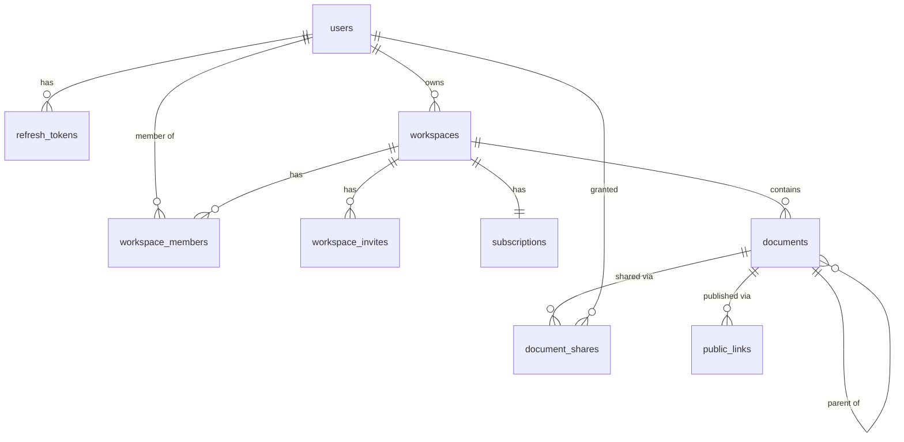

# Collab Docs

Collaborative workspace with real-time document editing: workspaces, nested documents, CRDT-based
co-editing, sharing and publishing, search, comments and billing.

> Work in progress. Sections below are filled in as the project grows.

## Architecture

pnpm monorepo:

| Path              | Purpose                                                                 |
| ----------------- | ----------------------------------------------------------------------- |
| `apps/web`        | Next.js 15 (App Router, Tailwind). Route groups `(public)` and `(app)`. |
| `apps/api`        | NestJS REST API (`GET /health`).                                        |
| `apps/collab`     | NestJS real-time collaboration server (`GET /health`).                  |
| `packages/shared` | Shared code with entry points `.`, `./content` and `./nest`.            |
| `packages/db`     | Prisma schema, migrations, seed and integration-test harness.           |

`@collab-docs/shared/nest` is server-only; ESLint forbids importing it (and `@collab-docs/db`) in
`apps/web`.

## Run

### With Docker (no setup)

Requires Docker with Compose v2. From a clean clone, without any `.env` file:

```bash
docker compose up --build --wait
```

Compose carries development-only defaults for every variable, so nothing else is needed. Copy
`.env.example` to `.env` to override values.

| Service    | URL / port                                  | Notes                                                                                    |
| ---------- | ------------------------------------------- | ---------------------------------------------------------------------------------------- |
| `web`      | http://localhost:3000                       | Next.js                                                                                  |
| `api`      | http://localhost:4000 (`/health`, `/ready`) | NestJS REST API                                                                          |
| `worker`   | -                                           | Background jobs (same image as `api`)                                                    |
| `collab`   | `localhost:4001` (`/health`)                | Public WebSocket port. Internal port `4002` is only reachable inside the compose network |
| `postgres` | `localhost:5432`                            | Database `collab`                                                                        |
| `redis`    | `localhost:6379`                            |                                                                                          |
| `minio`    | http://localhost:9000, console `:9001`      | S3 storage; bucket created by `minio-init`                                               |
| `mailpit`  | http://localhost:8025, SMTP `:1025`         | Catches outgoing email                                                                   |
| `migrate`  | -                                           | One-shot job that runs before the apps                                                   |

Host ports can be changed with `WEB_PORT`, `API_PORT`, `POSTGRES_PORT`, etc. (see `.env.example`).

MinIO's official images are no longer published, so `docker/minio/Dockerfile` builds the server and
the `mc` client from the last tagged source releases.

Only infrastructure for local development: `docker compose up -d postgres redis minio minio-init mailpit`.

### Staging profile

```bash
cp .env.staging.example .env.staging   # fill in every value
docker compose --env-file .env.staging -f docker-compose.yml -f docker-compose.staging.yml up -d
```

The override sets `APP_ENV=staging` and `NODE_ENV=production`, hides database, cache and console
ports, restarts services automatically, and requires every secret. On startup `api` and `collab`
validate their environment and refuse to run with missing values or `dev-only` placeholders.

### Without Docker

Requires Node.js >= 22.12 (see `.nvmrc`) and pnpm 10, plus the infrastructure services above.

```bash
pnpm install
pnpm dev
```

## Continuous integration

`.github/workflows/ci.yml` runs on every push to `main` and every pull request: lint and typecheck,
unit tests (with Postgres and Redis service containers), and Docker image builds for `web`, `api`,
`collab` and `minio`.

## Development

| Command                   | What it does                                 |
| ------------------------- | -------------------------------------------- |
| `pnpm lint`               | ESLint (flat config) for the whole repo      |
| `pnpm typecheck`          | `tsc --noEmit` in every package              |
| `pnpm test`               | Jest (api, collab) and Vitest (web, shared)  |
| `pnpm test:integration`   | Integration tests (needs Postgres and Redis) |
| `pnpm build`              | Builds shared libraries, then every app      |
| `pnpm format`             | Prettier                                     |
| `pnpm --filter api start` | Runs the built API                           |

Libraries in `packages/*` are built before type checking and testing (`pnpm build:libs`, run
automatically by `typecheck` and `test`).

### Module system

`jose` is ESM-only, so the choice below was verified with smoke tests in every runtime:

- `packages/shared` is a dual package (`"type": "module"`, built with tsup to ESM `.js` and CJS
  `.cjs`, with matching type declarations) exposed through conditional `exports`.
- `apps/api` and `apps/collab` stay CommonJS (NestJS). At runtime Node loads ESM-only `jose`
  through `require(esm)`, which is why Node >= 22.12 is required.
- Jest runs through `@swc/jest`; `transformIgnorePatterns` lets `jose` be transformed to CommonJS.
- Vitest (web, shared) and `next build` import the package natively as ESM.

## Data model

Postgres, managed with Prisma 7 in `packages/db` (`prisma/schema.prisma`, migrations in
`prisma/migrations`). Tables and columns are snake_case, ids are UUID v7.



Notes:

- **Documents form a tree** (`parent_id`) ordered by `position`, a fractional-indexing key. The column
  is created `COLLATE "C"` so keys compare bytewise; the database default collation would sort mixed
  case differently and break the ordering.
- **Soft delete**: `deleted_at` marks a document, `deleted_root_id` the document where the deletion
  started, so a restore brings back only that deletion's subtree.
- **`revision`** is incremented atomically on every change that derived data (search index, public
  pages) must follow.
- **Indexes**: the tree listing uses a partial index `documents_tree_idx (workspace_id, parent_id,
position) WHERE deleted_at IS NULL`; the rest are plain b-tree indexes on foreign keys and unique
  lookups (emails, slugs, token hashes, one share per user and document, one public link per document
  and mode). Partial indexes, `COLLATE "C"` and the `pg_trgm`/`unaccent` extensions are written by hand
  in the first migration; the partial index keeps the name declared in the schema, so
  `pnpm --filter @collab-docs/db db:drift` still reports no drift.
- **Foreign keys**: rows that make no sense without their parent (memberships, refresh tokens, shares,
  public links, the subscription) cascade; workspace owners, document authors and workspaces that
  still hold documents are `RESTRICT`, so content is never deleted implicitly.
- Emails are stored lower-case (normalised by the application) and are unique.

### Database commands

| Command                                    | What it does                                                                                                       |
| ------------------------------------------ | ------------------------------------------------------------------------------------------------------------------ |
| `pnpm --filter @collab-docs/db db:migrate` | Create/apply migrations in development                                                                             |
| `pnpm --filter @collab-docs/db db:deploy`  | Apply existing migrations (what the `migrate` job runs)                                                            |
| `pnpm --filter @collab-docs/db db:seed`    | Idempotent demo data (dev only): `alice`, `bob`, `carol` `@example.test`, password `password123`, workspace `acme` |
| `pnpm --filter @collab-docs/db db:reset`   | Drop, re-migrate and re-seed                                                                                       |
| `pnpm --filter @collab-docs/db db:drift`   | Fails if migrations and `schema.prisma` diverge                                                                    |
| `pnpm test:integration`                    | Integration tests against a real Postgres                                                                          |

All of them read `DATABASE_URL`. Integration tests use `createTestDb()` from
`@collab-docs/db/testing`: each Jest worker creates its own throwaway database on that server,
applies the migrations and truncates tables between tests.

## API platform

Shared by `api`, its queue worker and (later) `collab`: it lives in `@collab-docs/shared/nest`, and each
app only plugs the modules in (`PlatformModule` for HTTP services, `WorkerPlatformModule` for the worker).

- **Prefix**: routes live under `/api`; `/health`, `/ready`, `/metrics` and `/docs` are served without it.
- **Validation**: a global `ValidationPipe` (`whitelist`, `forbidNonWhitelisted`, `transform`), `ParseUuidPipe`
  for ids, and base DTOs for pagination and id params. Request/response contracts are zod schemas in
  `@collab-docs/shared`; response DTO classes `implements` the inferred types, and integration tests parse
  real responses with the same schemas, so backend and frontend cannot drift apart silently.
- **HTTP hardening**: `helmet`, a CORS allowlist (`WEB_ORIGIN` plus `CORS_ALLOWED_ORIGINS`), `cookie-parser`,
  a JSON/urlencoded body limit (`HTTP_BODY_LIMIT`, default `1mb`) and `trust proxy` restricted to
  `TRUSTED_PROXY_CIDRS` (empty means `x-forwarded-for` is never trusted).
- **Rate limiting**: `@nestjs/throttler` with a Redis store, keyed by the real client IP. A generous global
  limit (`RATE_GLOBAL_PER_MIN_IP`) applies everywhere; `RateLimit.login()`, `.register()`, `.publicLink()` and
  `.ticket()` are per-route presets whose limits come from the `RATE_*` variables. If Redis is unavailable
  the limiter fails open and logs the error.
- **OpenAPI**: Swagger UI at `/docs`, JSON at `/docs/json`. `pnpm --filter @collab-docs/api openapi:export`
  writes the committed `docs/openapi.json` (the app is built without connecting to anything).

### Error model

Every error response has the same shape, produced by one global `AllExceptionsFilter`:

```json
{
  "statusCode": 400,
  "code": "VALIDATION_FAILED",
  "message": "Request validation failed",
  "details": [
    { "field": "name", "messages": ["name must be longer than or equal to 1 characters"] }
  ],
  "correlationId": "6f1c3f0e-…"
}
```

`code` comes from the catalog in `@collab-docs/shared` (`VALIDATION_FAILED`, `UNAUTHENTICATED`, `FORBIDDEN`,
`NOT_FOUND`, `CONFLICT`, `RATE_LIMITED`, `PLAN_LIMIT_EXCEEDED`, `PAYLOAD_TOO_LARGE`, …) and clients branch on
it, never on `message`. Application code throws `AppException(code, message, { details })`. Framework and
library errors are mapped: validation errors become 400, Prisma `P2002` 409, `P2025` 404, throttling 429,
oversized or malformed bodies 413/400. Anything unrecognised is a 500 with a generic message — the real
error is logged with the correlation id but never returned.

### Logging & correlation

Logs are JSON (`nestjs-pino`). Each request gets a correlation id: the incoming `x-correlation-id` if it is a
short, log-safe token, otherwise a new UUID. It is stored in `AsyncLocalStorage`, added to every log line,
returned in the `x-correlation-id` response header and in every error body. When code enqueues a job the id
is written into the job data, and the worker restores it before running the processor, so one id follows a
change from the browser through the API into background work (and later the collab server). Secrets are
redacted from logs (`authorization`, `cookie`, `set-cookie`, passwords, tokens); business events are logged
with `logEvent('document.published', { … })`.

### Observability

- `GET /health` — liveness. `GET /ready` — readiness: pings Postgres and Redis and answers `503` with the
  per-dependency state when one is down.
- `GET /metrics` — Prometheus: default process metrics, `http_request_duration_seconds{route,method,status}`
  (labelled by route pattern, not raw URL) and queue metrics (`queue_jobs{queue,state}`,
  `queue_jobs_processed_total{queue,result}`). The endpoint is unauthenticated, so keep it off public ingress.

### Queues

BullMQ queues (`search-sync`, `public-revalidate`, `mail`, `billing-webhook`, `link-expiry`, `version-prune`)
are created through `QueueService`, with default retries (5 attempts, exponential backoff) and bounded
history. The worker runs from the same image as the API (`node dist/main.worker.js`) and shuts down
gracefully, finishing active jobs. `enqueueDebounced(queue, documentId, delayMs)` coalesces bursts of
changes into one delayed job using BullMQ deduplication; the job reads the latest state when it runs, and a
change made while it is processing schedules a new job. A fixed `jobId` per document is deliberately not
used, because BullMQ remembers finished ids and would drop later changes.

## Authentication

Own JWT auth in the API (`apps/api/src/auth`), no external identity provider.

| Endpoint                  | Purpose                                                 |
| ------------------------- | ------------------------------------------------------- |
| `POST /api/auth/register` | Create an account and sign in (409 if the email exists) |
| `POST /api/auth/login`    | Sign in                                                 |
| `POST /api/auth/refresh`  | Rotate the refresh token, issue a new access token      |
| `POST /api/auth/logout`   | Revoke the refresh-token family, clear the cookies      |
| `GET /api/auth/me`        | The signed-in user (read from the database)             |

Register, login and refresh answer `{ user, accessToken, expiresIn }` and set two cookies. The access token
is also accepted as `Authorization: Bearer` (Swagger, tests, non-browser clients).

| Cookie  | Content                       | Attributes                               |
| ------- | ----------------------------- | ---------------------------------------- |
| `cd_at` | access JWT, 15 min            | `HttpOnly; SameSite=Lax; Path=/`         |
| `cd_rt` | opaque refresh token, 30 days | `HttpOnly; SameSite=Lax; Path=/api/auth` |

Both are `Secure` when `APP_ENV=staging`. The browser reaches the API same-origin through the web app's
`/api/*` rewrite, so the cookie paths match.

For other modules: every route requires a valid access token unless it is marked `@Public()`; the user is
available through `@CurrentUser()` (`{ id, jti }`). The guard verifies the JWT locally and never touches the
database. `verifyAccessToken()` and `signAccessToken()` live in `@collab-docs/shared` and use only `jose` and
Web APIs, so Next's Edge middleware and the collab service verify tokens exactly as the API does.

### Auth design & rationale

**Why our own JWT instead of Auth.js.** The API is a separate NestJS service that also guards a WebSocket
gateway and server-to-server calls, so identity has to be verifiable outside Next. A signed access token that
any service can check with one shared secret does that; Auth.js sessions live inside the Next runtime. Owning
the flow also keeps rotation, reuse detection and rate limits in one place and testable at the HTTP level.

**Access + refresh.** The access JWT is short-lived (15 min; `sub`, `jti`, `aud=api`) and checked without a
database read. The refresh token is 256 random bits; only its SHA-256 is stored (`refresh_tokens.token_hash`),
so a database leak does not yield usable tokens. Passwords use argon2id (`@node-rs/argon2`; memory, time and
parallelism come from `ARGON2_*`, defaults follow the OWASP minimum). A wrong password and an unknown email
produce the same response and cost the same time.

**Rotation and the 30 s grace.** Each refresh replaces the token (`rotated_at`, `replaced_by`) inside one
family (`family_id`). The rotation claim is a single conditional `UPDATE ... WHERE rotated_at IS NULL`, so of
two parallel refreshes with the same token exactly one rotates. A rotated token that is presented again within
30 s (parallel requests, several tabs, a response lost on the wire) only yields a new access token and no
second rotation, so the user is not logged out by a race. Presented later, a rotated token means it was
copied: the whole family is revoked, the request gets `401`, and `auth.refresh_reuse_detected` is logged.
Logout revokes the family too.

**CSRF.** `SameSite=Lax` plus a global guard: a state-changing request authenticated by cookies (`cd_at` or
`cd_rt`, so refresh and logout included) must carry `Origin` equal to `WEB_ORIGIN`, otherwise `403
CSRF_REJECTED`. Bearer requests are exempt (browsers do not attach that header on their own), as are
requests without auth cookies such as login and webhooks.

**Rate limits.** Login: 5/min per (client IP, email) and 20/min per IP; register: 10/h per IP (`RATE_*` in
`.env.example`). Exceeding them returns `429 RATE_LIMITED` with `Retry-After`. The client IP is `req.ip`,
which honours `x-forwarded-for` only from `TRUSTED_PROXY_CIDRS`.

**HS256 vs ES256/JWKS.** HS256 with a dedicated secret (`JWT_ACCESS_SECRET`) is the simplest thing that works
for services we deploy together; every verifier holds the secret. The cost is that every verifier could also
mint tokens. To move to ES256 with a JWKS endpoint, the API would sign with a private key and publish the
public key; `signAccessToken`/`verifyAccessToken` are the only places that change, and `jose` already supports
`createRemoteJWKSet`. Rotating keys then needs only a `kid`, with no secret redistribution.

## Decisions

To be documented.

## Not done

To be documented.
