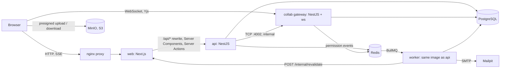
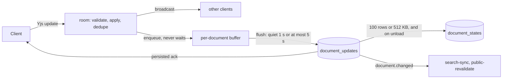

# Collab Docs

A Notion-style collaborative workspace: nested documents, a block editor with real-time co-editing over a CRDT
(Yjs), per-document sharing, publishing to a public SEO page, full-text search, comment threads with @mentions
and a mock subscription billing with plan limits.

- **Next.js 15** (App Router) for the web app: server-rendered and ISR public pages, edge middleware, streaming
  dashboards, Server Actions for forms, client components only where the browser is needed.
- **NestJS** for the REST API, a queue worker and a separate **collab gateway** (WebSocket, Yjs).
- **PostgreSQL** (Prisma) for data, the CRDT update log and full-text search; **Redis + BullMQ** for queues;
  **MinIO** (S3) for attachments; **Mailpit** for outgoing email in development.

Everything runs with one command and no configuration.

## Contents

[Quick start](#quick-start) · [Architecture](#architecture) · [Next.js primitives](#nextjs-primitives-where-and-why) ·
[CRDT persistence](#crdt-persistence-and-consistency) · [Consistency model](#consistency-model) ·
[Security](#security) · [Decisions](#decisions) · [Testing](#testing) · [Environments](#environments) ·
[Development](#development) · [Documentation](#documentation) · [Not done](#not-done)

## Quick start

Requires Docker with Compose v2. From a clean clone, with no `.env` file:

```bash
docker compose up --build --wait
```

The first build takes a few minutes. Compose carries development-only defaults for every variable, and a one-shot
`migrate` job applies the migrations and seeds demo data.

Open **http://localhost:3000** and sign in with a demo user (password `password123`), or register a new one:

| User                 | Role in workspace `acme` |
| -------------------- | ------------------------ |
| `alice@example.test` | Owner                    |
| `bob@example.test`   | Editor                   |
| `carol@example.test` | Viewer                   |

To see the product work, sign in as Alice in one browser and as Bob in another (or a private window), open the same
document and type: cursors and edits appear live on both sides. Publish the document from **Share** and open the
`/published/<slug>` address in a window where nobody is signed in.

| Service    | URL / port                                  | Notes                                                                                                                            |
| ---------- | ------------------------------------------- | -------------------------------------------------------------------------------------------------------------------------------- |
| `proxy`    | http://localhost:3000                       | nginx, the public HTTP entry point (dev also publishes the api and infrastructure ports below); sets `X-Forwarded-For` for `web` |
| `web`      | - (behind `proxy`)                          | Next.js                                                                                                                          |
| `api`      | http://localhost:4000 (`/health`, `/ready`) | NestJS REST API; **Swagger UI at http://localhost:4000/docs**                                                                    |
| `worker`   | -                                           | Background jobs (same image as `api`)                                                                                            |
| `collab`   | `localhost:4001` (`/health`)                | Public WebSocket port. Internal port `4002` is only reachable inside the compose network                                         |
| `postgres` | `localhost:5432`                            | Database `collab`                                                                                                                |
| `redis`    | `localhost:6379`                            |                                                                                                                                  |
| `minio`    | http://localhost:9000, console `:9001`      | S3 storage; bucket created by `minio-init`                                                                                       |
| `mailpit`  | http://localhost:8025, SMTP `:1025`         | Catches outgoing email (invitations, mentions)                                                                                   |
| `migrate`  | -                                           | One-shot job that runs before the apps                                                                                           |

Host ports can be changed with `WEB_PORT`, `API_PORT`, `POSTGRES_PORT`, etc. (see `.env.example`). The compose network
uses `10.89.0.0/24`, so that the proxy and web have fixed addresses the api can trust; set `NETWORK_PREFIX` if that
subnet is taken (an existing stack needs `docker compose down` once to pick up the network). MinIO's
official images are no longer published, so `docker/minio/Dockerfile` builds the server and the `mc` client from the
last tagged source releases.

Infrastructure only, for working on the code: `docker compose up -d postgres redis minio minio-init mailpit`
(see [Development](#development)).

## Architecture



A browser talks to two public endpoints only: the proxy (pages, REST and the event stream, all on one origin) and
the collab gateway (WebSocket). Document **content** is written by the gateway alone; everything else (title,
permissions, sharing, comments, billing) goes through the API. The gateway reads permissions from the database
itself, so a stale token cannot grant more than the database does.

| Path              | Purpose                                                                        |
| ----------------- | ------------------------------------------------------------------------------ |
| `apps/web`        | Next.js 15 (App Router, Tailwind). Route groups `(public)` and `(app)`.        |
| `apps/api`        | NestJS REST API and the BullMQ worker (`main.worker.ts`).                      |
| `apps/collab`     | NestJS WebSocket gateway for CRDT sessions (Yjs), plus an internal TCP API.    |
| `packages/shared` | Framework-free shared code: zod contracts, permission resolver, content model. |
| `packages/nest`   | Server-only NestJS building blocks shared by `api` and `collab`.               |
| `packages/db`     | Prisma schema, migrations, seed and integration-test harness.                  |
| `e2e`             | Playwright suite that runs against the production images.                      |

`@collab-docs/nest` is server-only; ESLint forbids importing it (and `@collab-docs/db`) in `apps/web`, and the other
package boundaries (`shared` depends on no app, apps do not import each other) are lint rules too.

### Backend modules

| Module (`apps/api/src`)          | Responsibility                                                                        | Details                                                   |
| -------------------------------- | ------------------------------------------------------------------------------------- | --------------------------------------------------------- |
| `auth`                           | Registration, login, JWT access + rotating refresh tokens, CSRF origin guard          | [auth](docs/auth.md)                                      |
| `workspaces`, `permissions`      | Workspaces, members, invites, roles; one permission resolver shared by api and collab | [permissions](docs/permissions.md)                        |
| `documents`, `versions`          | Document tree, soft delete, sharing, version history                                  | [documents](docs/documents.md)                            |
| `collab-gateway` (`apps/collab`) | WebSocket rooms, Yjs sync, presence, CRDT persistence, permission re-evaluation       | [CRDT](docs/crdt.md), [protocol](docs/collab-protocol.md) |
| `publishing`                     | Public links (view / edit), sanitised public endpoint, revalidation jobs              | [publishing](docs/publishing.md)                          |
| `search` (search-sync)           | Asynchronous full-text index and permission-aware search                              | [search](docs/search.md)                                  |
| `comments`, `notifications`      | Block threads, @mentions, in-app notifications (SSE) and email                        | [comments](docs/comments.md)                              |
| `billing`                        | Plans, limits, mock checkout, idempotent webhook                                      | [billing](docs/billing.md)                                |
| `storage`, `attachments`         | Presigned uploads, quotas, image serving                                              | [storage](docs/storage.md)                                |

The API itself (validation, error model, logging with correlation ids, `/metrics`, queues) is described in
[API platform](docs/api-platform.md); the schema in [Data model](docs/data-model.md); every endpoint in Swagger
(`/docs`, and the committed [docs/openapi.json](docs/openapi.json), which CI checks for freshness).

## Next.js primitives: where and why

**Where the Server/Client boundary goes.** Server Component is the default for anything that reads data and needs no
browser state. A Client Component exists only where one of these is true: the code needs browser APIs or state
(Yjs, ProseMirror, WebSocket, `navigator.onLine`, drag and drop), the interaction is a Radix/Sonner primitive that needs
effects, or React requires a class (error boundaries). The boundary is kept narrow: a server page reads the data and
passes **typed props** (the zod types of `@collab-docs/shared`, no `any`) to a small client island. Interactive state
that cannot be rendered on the server stays in the island; everything SEO- or data-critical stays out of it. Every client
component, with its reason, is listed in [Frontend](docs/frontend.md#server-vs-client-boundary).

| Screen                            | Primitive                                              | Why                                                                                                                                                         |
| --------------------------------- | ------------------------------------------------------ | ----------------------------------------------------------------------------------------------------------------------------------------------------------- |
| `/published/[slug]`               | **ISR** with tag `pub:<slug>` + on-demand revalidation | Many readers, rare changes, must be SEO-friendly: render once, serve from cache, drop it within seconds of a change                                         |
| `/edit-link/[token]`              | Server shell + client editor, never cached             | A personal capability URL: dynamic, `noindex`, `Referrer-Policy: no-referrer`                                                                               |
| Every route                       | **Edge middleware**                                    | Redirects anonymous visitors off private routes and refreshes an expired session; UX only, every page re-checks access                                      |
| `/workspaces/[id]` (dashboard)    | **Streaming SSR** (async RSC blocks in `Suspense`)     | Four independent data blocks; a slow or failing one never holds back the shell or the others                                                                |
| Settings, invites, billing, login | **Server Actions**                                     | Form posts that work as plain `<form action>`, also without JavaScript: the action redirects or revalidates on the server, and these pages are not streamed |
| Document tree, sharing, comments  | Client Components + REST + TanStack Query              | Optimistic updates, drag and drop and cache invalidation live in the browser                                                                                |
| Document body, presence           | Client Component + **WebSocket (Yjs)**                 | Content mutations never go through Server Actions: they need conflict-free merging, not request/response                                                    |
| Notifications, tree changes       | Client + SSE                                           | One-way push                                                                                                                                                |
| Loading / empty / error           | `loading.tsx`, `error.tsx`, empty states               | Present on every key screen; a test fails when a route lacks a loading state or an error boundary                                                           |
| Offline while editing             | Client indicator                                       | The editor shows "Offline", keeps typing in the local `Y.Doc` and merges on reconnect                                                                       |

Public pages are also kept light on purpose: client providers live in the layouts that need them, not in the root
layout, so `/published/[slug]` downloads React and Next but not the editor, Yjs or the query client (a CI job,
`web-bundle`, enforces it). Why ISR with on-demand revalidation rather than SSR, a static export or time-based ISR is
argued in [Frontend](docs/frontend.md#public-pages-why-isr--on-demand-revalidation) and
[Publishing](docs/publishing.md).

## CRDT persistence and consistency

A document is a `Y.Doc`, held in a room by the collab gateway while anyone has it open. It is stored as an
**append-only log of Yjs updates plus one compacted state**, in Postgres (`document_updates`, `document_states`), with
named snapshots in `document_versions`.



- **Concurrent edits.** Updates are commutative and idempotent, so two people typing in one block converge, and a
  repeated update changes nothing. The same two-client scenarios run in the integration tests (two `y-websocket`
  clients, a duplicated update, both offline) and in the browser (Playwright).
- **How often and where.** Updates are buffered and merged into one row per flush: after 1 s of quiet, at most 5 s
  after the first buffered update (`COLLAB_FLUSH_*`). The row is unique on `(document_id, sha256)`, so a retried flush
  cannot insert twice; the document's `revision` is bumped in the same transaction.
- **Cold start.** `load` reads the compacted state and the log rows after it in one repeatable-read transaction and
  merges them. A row that cannot be decoded is skipped, logged and counted.
- **Bounded growth.** Compaction folds state + tail into a new state at 100 rows or 512 KB and when a room unloads, under
  a per-document advisory lock (appends take it shared, compaction exclusively). Ten thousand one-character updates leave at
  most 100 rows (tested).
- **"Saved" means durable.** After each flush the server acknowledges what is stored (`persisted {sv, saved}`); the
  editor says "Saving…" until then, and **publishing waits for it**, which closes the "publish with unsaved local changes"
  edge case. The loss window after a hard kill is at most the 5 s buffer, and the author's open tab still holds it.
- **Versions.** Automatic snapshots of the state before the first change after a pause (at most every 10 min), manual
  ones on demand, and one before every restore. A
  restore is a server-made Yjs transaction applied to the live room, so connected clients converge and the restore can
  itself be undone.
- **Delete while editing.** The gateway writes its buffer, tells the clients (`deleted`) and closes the sockets with
  `4410`; the editor shows a "deleted" state with a restore button.

Full description, failure handling and the protocol: [CRDT](docs/crdt.md) and [collab protocol](docs/collab-protocol.md).

## Consistency model

| Data                                                | Model                                  | How and why                                                                                                                                                                                           |
| --------------------------------------------------- | -------------------------------------- | ----------------------------------------------------------------------------------------------------------------------------------------------------------------------------------------------------- |
| Permissions, sharing, membership                    | **Strong**                             | Resolved from Postgres on every request and on every socket re-evaluation; never cached. A leaked or stale token cannot widen access.                                                                 |
| Billing: plan, limits, invoices                     | **Strong**                             | Limit checks run under a workspace row lock; the webhook has five layers of idempotency (unique event id, job id, `FOR UPDATE` on the event, conditional session update, unique invoice per session). |
| Document title and tree structure                   | Strong, last write wins                | Plain rows changed over REST; the tree cache is invalidated by a version bump after commit.                                                                                                           |
| Document body                                       | **CRDT**: converges, no lost edits     | Yjs merge; durability acknowledged explicitly (`persisted`).                                                                                                                                          |
| Search index                                        | **Eventual** (about 5 s + job time)    | Rebuilt asynchronously from the stored document after a debounce, so typing never waits for indexing. Permissions are **not** in the index, they are evaluated in SQL on each query.                  |
| Published page (ISR)                                | **Eventual** (seconds; 1 h worst case) | Revalidated by a queue job after a debounce; the cache TTL bounds the worst case. Whether a link is live is read from Postgres on every request and never cached.                                     |
| Document tree cache, notifications, unread counters | Eventual, invalidated on write         | Versioned Redis key; SSE push with a polling fallback.                                                                                                                                                |

The rule: **anything that decides who may see or pay for something is strongly consistent; anything derived from
content (search, rendered pages) is rebuilt asynchronously**, because the editor must never wait for it and a delay of
seconds there is harmless, while a stale permission is not.

### Search index consistency

Search is Postgres full-text search (`tsvector` + GIN, a `simple` configuration with an `unaccent` wrapper). Any change
that touches searchable text queues a debounced `search-sync` job; the worker reads the **current** stored state (not the
event), and upserts `document_search` with `WHERE indexed_revision < EXCLUDED.indexed_revision`, so a duplicate, late or
out-of-order job changes nothing. The revision is read before the state on purpose, so the worst outcome of a race is one
extra run, never a skipped one. A deleted document loses its row. `search_index_lag_seconds` shows how far behind the
index is, and `reindex` rebuilds it. Details, query semantics and language behaviour: [Search](docs/search.md).

### ISR and revalidation

The worker (`public-revalidate`, debounced 3 s for content, immediate for publish / unpublish / expiry) calls the web app's
`POST /internal/revalidate` with a shared secret and the tag `pub:<slug>`. The call is retried with backoff, and after an
unpublish or expiry the job verifies the page really answers 404, because Next may store a render started before the
invalidation. Editing never waits for any of this: the editor only enqueues. The ISR cache itself is in Redis
(`apps/web/cache-handler.mjs`), so a revalidation received by one web replica holds for all of them. Details:
[Publishing](docs/publishing.md).

## Security

| Concern               | Measure                                                                                                                                                                                                                                                                                                                                                                                                               |
| --------------------- | --------------------------------------------------------------------------------------------------------------------------------------------------------------------------------------------------------------------------------------------------------------------------------------------------------------------------------------------------------------------------------------------------------------------- |
| XSS from user content | One allowlist (`@collab-docs/shared/content`) drives the editor and the server-side sanitiser; every path that shows content (public page, version preview, search, email) goes through `sanitizeContent`, and pages render React elements, never HTML strings. A hostile corpus is tested on every path.                                                                                                             |
| IDOR / privilege      | Access is resolved from the database for the id in each request. A test calls **every** API route as nine personas (outsider, viewer, editor, admin, owner, document guest, link visitors, anonymous) and compares with a policy table; a route without a policy fails the suite. Cross-tenant ids return 404.                                                                                                        |
| Viewer cannot edit    | Enforced in the API and in the gateway (updates from a read-only socket are dropped); tested through the UI, REST and a raw WebSocket.                                                                                                                                                                                                                                                                                |
| Rate limiting         | Login (per address, and per address and email), registration, public-link creation, guest tickets, search, comments, invitations and shares (each invitation is an email; an unknown share address is a 404), the mock payment actions; collab: message rate, update and document size (updates waiting for a missing one included), connections, presence. `X-Forwarded-For` is trusted from the proxy and web only. |
| CSRF, sessions        | httpOnly `SameSite=Lax` cookies, `Origin` check on cookie-authenticated writes, rotating refresh tokens with reuse detection.                                                                                                                                                                                                                                                                                         |
| Headers               | Security headers on every response. The signed-in workspace (rendered per request anyway) gets a **nonce** Content-Security-Policy with `'strict-dynamic'` from the edge middleware; static and ISR pages keep a static policy with `'unsafe-inline'`, since a nonce would make them dynamic.                                                                                                                         |
| Validation            | DTOs with `class-validator` on the API, zod schemas shared with the forms; a parity test keeps them in step.                                                                                                                                                                                                                                                                                                          |
| Secrets, dependencies | Placeholders only in templates; services refuse `dev-only` secrets in staging; `pnpm audit --prod` in CI; secrets redacted from logs, and invite and edit-link tokens masked in the request logs of the api and the proxy.                                                                                                                                                                                            |

All of it, with the tests that guard each layer: [Security](docs/security.md).

## Decisions

### Key choices and why

| Decision                | Choice                                                       | Why                                                                                                                                                                                                                                                          |
| ----------------------- | ------------------------------------------------------------ | ------------------------------------------------------------------------------------------------------------------------------------------------------------------------------------------------------------------------------------------------------------ |
| ORM                     | **Prisma**                                                   | Typed client and migrations from one schema; raw SQL (`Prisma.sql`, bound values) only where Prisma has no equivalent: row and advisory locks, full-text search.                                                                                             |
| Authentication          | **Own JWT** (access 15 min + rotating refresh) vs Auth.js    | The API is a separate service that also guards a WebSocket gateway and server-to-server calls, so identity must be verifiable outside Next. Rotation, reuse detection and rate limits stay in one testable place. See [auth](docs/auth.md).                  |
| Search                  | **Postgres full-text** vs Meilisearch                        | The data is already in Postgres, a few thousand documents per workspace, and the access check must be a join in the same statement. An engine would need access rules copied and kept in step, and a second service. The queue is the seam to add one later. |
| Collab server           | **Own gateway** (`ws` + `y-protocols`, client `y-websocket`) | Needs a persistence acknowledgement (`persisted`), permission checks from the database on every message, and re-evaluation without reconnecting; none of these is in `y-websocket`'s server.                                                                 |
| Editor                  | **Tiptap** (ProseMirror) with Yjs binding                    | Block schema as data, shared by the editor and the sanitiser.                                                                                                                                                                                                |
| Next.js version         | **15** (not 16)                                              | The assignment asks for edge middleware, which Next 16 replaces with a Node-runtime proxy.                                                                                                                                                                   |
| Collab instances        | **One**                                                      | A room lives in one process, which keeps ordering and the persistence acknowledgement simple. Scaling out and what it needs: [CRDT](docs/crdt.md#scaling-the-collab-service).                                                                                |
| Persistence of the CRDT | **Postgres log + compacted state**                           | One transactional store with the rest of the data; the revision bump and the update row commit together.                                                                                                                                                     |
| Billing                 | **Mock provider shaped like Stripe**                         | Signed webhook, checkout session, redelivery; the verifier is the only thing a real provider would change.                                                                                                                                                   |

The server side follows the NestJS documentation wherever it fits, and the places where it does not are
listed here with the reason, so that a reader does not have to rediscover them.

### Where the backend uses Nest's own building blocks

- **Configuration:** `@nestjs/config`, validated at start-up against one zod schema; the process environment
  is the only source (`.env.example`, `.env.staging.example`).
- **Dependency injection by type**, with `@Inject()` only for `Symbol` tokens. Feature modules import each
  other explicitly; only infrastructure modules are global (configuration, logger, Redis, queues, metrics,
  health, Prisma).
- **Cross-cutting code** is registered as providers: the validation pipe and the exception filter through
  `APP_PIPE` / `APP_FILTER`, rate limiting through `APP_GUARD`. Access to a document, an attachment or a
  workspace is a guard plus parameter decorators (`@DocumentAccess`, `@AttachmentAccess`,
  `@CurrentDocumentAccess`), not a check inside each service.
- **Queues:** `@nestjs/bullmq` (`@Processor`, `@InjectQueue`), with a base class that restores the correlation
  id of the job.
- **Probes:** `@nestjs/terminus` for `/health` and `/ready`.
- **Rate limiting:** `@nestjs/throttler` with Redis storage. The per-user limits (collab tickets, public links) and the per-address-and-email login limit are the same throttler with `getTracker` overridden in a route-level guard that runs after authentication.
- **Outgoing HTTP:** `@nestjs/axios` (`HttpModule`) for the worker's call to the web app's revalidation endpoint and the mock provider's webhook deliveries.
- **Access tokens:** `@nestjs/jwt` in the api.
- **Logging:** `nestjs-pino`; classes inject `PinoLogger` (`@InjectPinoLogger`).
- **Server-sent events:** `@Sse` with an `Observable`, so the heartbeat, the membership check and the cleanup
  on disconnect are part of the stream.
- **WebSocket gateway:** `@WebSocketGateway` on a subclass of `@nestjs/platform-ws`'s `WsAdapter`.
- **Internal API of the collab service:** `@nestjs/microservices` (TCP, `@MessagePattern` handlers and a
  `ClientProxy` in the api).

### Where it deliberately does not

| Area                      | What the code does                                                                                                                                                                                                                                                                                                                                                                                                                                                               | Why not the stock approach                                                                                                                                                                                                                                                                                              |
| ------------------------- | -------------------------------------------------------------------------------------------------------------------------------------------------------------------------------------------------------------------------------------------------------------------------------------------------------------------------------------------------------------------------------------------------------------------------------------------------------------------------------- | ----------------------------------------------------------------------------------------------------------------------------------------------------------------------------------------------------------------------------------------------------------------------------------------------------------------------- |
| Collab gateway            | A separate service with its own image. Its internal API (flush, restore, close) is a TCP microservice (`@MessagePattern`) of the same Nest application on port `4002`, so it shares the DI container with the WebSocket gateway; the api calls it through a `ClientProxy`.                                                                                                                                                                                                       | The assignment asks for a separate collaboration gateway. Port `4002` is never published, which is what protects `restore` and `close`. A TCP transport has no headers, so the shared secret and the correlation id travel in each message and a guard checks the secret.                                               |
| WebSocket adapter         | `CollabWsAdapter` extends `WsAdapter` and overrides three things: upgrades are routed by path prefix (`/ws/<documentId>`), message handlers are not bound, and `maxPayload` comes from the configuration.                                                                                                                                                                                                                                                                        | The stock adapter matches the exact path and parses every frame as JSON; the `y-websocket` protocol is binary and addresses the document in the path.                                                                                                                                                                   |
| Access token              | The api signs and verifies with `@nestjs/jwt`. The Next.js edge middleware and the short-lived collab ticket use `jose`. A contract test checks that tokens from either side verify on the other.                                                                                                                                                                                                                                                                                | The edge runtime cannot run `jsonwebtoken`, and the ticket has a single implementation shared by api and collab, so there is nothing to keep in step.                                                                                                                                                                   |
| CSRF                      | `SameSite=Lax` cookies plus a guard that requires `Origin` to equal `WEB_ORIGIN` on state-changing requests authenticated by cookies.                                                                                                                                                                                                                                                                                                                                            | The browser reaches the api through a same-origin rewrite, so the origin check is enough and no token endpoint, header or form field has to be added to every mutation. See [Authentication](docs/auth.md).                                                                                                             |
| Request validation        | class-validator DTOs on the api, zod schemas in `@collab-docs/shared` for the web forms.                                                                                                                                                                                                                                                                                                                                                                                         | The DTOs also produce the OpenAPI document; the schemas have to run in the browser. A parity test feeds the same payloads to both and requires the same verdict.                                                                                                                                                        |
| Data access               | The client is a provider, `PrismaService extends PrismaClient`, injected directly; transactions are passed as `tx`, and the "live document" condition lives in one helper (`LIVE_DOCUMENT`).                                                                                                                                                                                                                                                                                     | Prisma Client already is the access layer; a repository on top would repeat its API. The service connects lazily (a database that is down at start is reported by `/ready`, not by a crash) and closes the pool on shutdown, as the collab service does after its rooms have written.                                   |
| Raw SQL                   | `SELECT … FOR UPDATE` on the workspace row (plan limits) and `SKIP LOCKED` in the attachment sweeper, per-document advisory locks around the CRDT log, `UPDATE`/`DELETE … RETURNING` where a revision bump or a batch delete has to be one atomic statement, the search statement and index upsert, the notification list and the mention checks (always `Prisma.sql`, values bound; the "may this user view this document" rule is one shared fragment, `viewableDocumentSql`). | Prisma's query API has no row or advisory locks and no full-text search (`tsvector`, `to_tsquery`, `ts_headline`).                                                                                                                                                                                                      |
| Thread and comment access | Routes under `documents/:id` use `@DocumentAccess`; routes that carry a thread or comment id (`threads/:threadId/…`, `comments/:commentId`) load the row in the service and call `PermissionsService.assertDocumentAccess(…, tx)` on its document, inside the write transaction.                                                                                                                                                                                                 | A guard sees only the route, and the document is not in it; a guard that resolved thread → document would run the same lookups a second time, and the write still has to re-check inside its transaction so a revoked share cannot slip through between the two.                                                        |
| Webhook signature         | `Mock-Signature: t=…,v1=…` is built and checked in `webhook-signature.ts` with `node:crypto` (HMAC-SHA256, `timingSafeEqual`, a five-minute window); the raw body comes from `rawBody: true`, the Nest way.                                                                                                                                                                                                                                                                      | The provider is a mock, so there is no vendor SDK to call (`stripe.webhooks.constructEvent` does the same thing for Stripe). The format is Stripe's, so replacing the module with the real provider changes the verifier, not the design.                                                                               |
| Mock payment provider     | A module of its own with its own table (`mock_provider_events`) and its own queue (`billing-delivery`); the billing module sees it through the `BILLING_PROVIDER` token only.                                                                                                                                                                                                                                                                                                    | A real provider keeps its events and delivers them itself; "redeliver" and retries only make sense if the mock does the same, and keeping its state out of `webhook_events` keeps the receiving side identical to what it would be with Stripe.                                                                         |
| Tree cache                | A small service over Redis; the key carries a version that `INCR` bumps.                                                                                                                                                                                                                                                                                                                                                                                                         | `@nestjs/cache-manager` has no atomic increment, so invalidation by version would need the raw client anyway.                                                                                                                                                                                                           |
| Events between services   | `ioredis` publish/subscribe with JSON payloads (`perm.changed`, `doc.deleted`, `doc.restored`, the realtime bridge).                                                                                                                                                                                                                                                                                                                                                             | These are fire-and-forget broadcasts. The Redis transporter of `@nestjs/microservices` would wrap every message as `{ pattern, data }` and make every subscriber a microservice for the same delivery guarantees. The request/response calls between api and collab do use the microservices TCP transport (see above). |
| OpenAPI                   | `@ApiProperty` decorators are written by hand, and `docs/openapi.json` is exported and committed.                                                                                                                                                                                                                                                                                                                                                                                | The Nest CLI plugin is optional, saves decorators only, and would change the generated document silently when a type changes.                                                                                                                                                                                           |
| Metrics                   | `@prometheus-io/client` (the official successor of `prom-client`) used directly behind `GET /metrics`.                                                                                                                                                                                                                                                                                                                                                                           | The assignment asks for a metrics endpoint; the registry is the library's own, and a wrapper module is not part of the Nest documentation.                                                                                                                                                                              |
| Business event logs       | `logEvent(logger, name, fields)` over the injected logger.                                                                                                                                                                                                                                                                                                                                                                                                                       | It writes the name once as the `event` field and once as the message, so every business event has the same shape and carries the correlation id.                                                                                                                                                                        |
| Compiler settings         | `module` and `moduleResolution` are `NodeNext`, not the `commonjs` of the Nest template.                                                                                                                                                                                                                                                                                                                                                                                         | `yjs`, `lib0`, `y-protocols` and `jose` are ESM-only; see [Module system](docs/development.md#module-system).                                                                                                                                                                                                           |
| Comment markers (web)     | A ProseMirror plugin (`BlockComments`) draws widget decorations and reads its data from a small controller object.                                                                                                                                                                                                                                                                                                                                                               | Tiptap options are fixed when the extension list is built, and a new list rebuilds the editor, which loses the caret; thread counts change all the time, so they travel through an object the page updates.                                                                                                             |
| Mention menu (web)        | A plain textarea with the ARIA list-box pattern, not Tiptap's `Mention` suggestion.                                                                                                                                                                                                                                                                                                                                                                                              | Comments are plain text, not a Tiptap document; `Mention` belongs to the editor and would bring a second editor into every reply box.                                                                                                                                                                                   |
| Notification badge (web)  | Pushed over the workspace stream; refetch on window focus plus a 60 s `refetchInterval` elsewhere.                                                                                                                                                                                                                                                                                                                                                                               | The stream is per workspace and the navbar is above the workspace frame; polling is what the TanStack Query guide recommends for data without a push channel.                                                                                                                                                           |
| Tests                     | Integration tests are `*.int.spec.ts` next to the code and run with the same Jest setup (`@swc/jest`); services also have unit tests built with `Test.createTestingModule`.                                                                                                                                                                                                                                                                                                      | The name separates them from unit tests without a second directory; `@swc/jest` emits the decorator metadata that type-based injection needs.                                                                                                                                                                           |

## Testing

| Level       | Tooling                                             | Command                                                                                                     | What it covers                                                                                                                   |
| ----------- | --------------------------------------------------- | ----------------------------------------------------------------------------------------------------------- | -------------------------------------------------------------------------------------------------------------------------------- |
| Unit        | Jest (api, collab), Vitest (web, shared, nest)      | `pnpm test`                                                                                                 | Permission resolution including per-document sharing, CRDT application and merge, billing webhook idempotency, content sanitiser |
| Integration | Jest against real Postgres, Redis, MinIO            | `docker compose up -d postgres redis minio minio-init mailpit`, then `DATABASE_URL=… pnpm test:integration` | Every API route (IDOR matrix), the collab gateway with real `y-websocket` clients, queues, search, billing                       |
| End to end  | Playwright (Chromium) against the production images | `docker compose up --build --wait proxy worker`, then `pnpm test:e2e`                                       | The three flows of the assignment, plus accessibility (axe-core) on every screen, in a desktop and a phone viewport              |

The three critical flows the assignment names are covered end to end: workspace → document → invite a Viewer → the Viewer
cannot edit through the UI **or** a direct API / WebSocket call; two clients editing one document at once (also with
one or both offline) lose no change; publishing → the public page is served by ISR and shows the edited content.
Exact commands, environment variables and conventions: [Testing](docs/testing.md). CI runs lint, typecheck, unit,
integration, e2e, the Docker builds, a bundle check and `pnpm audit` on every push and pull request
(`.github/workflows/ci.yml`, [Development](docs/development.md#continuous-integration)).

## Environments

Configuration comes from the process environment only, validated at start-up against one schema: a missing or malformed
variable stops the process with the full list of problems.

| Profile     | How to run                                                                                                                                                           | Behaviour                                                                                                                                                                                                                                             |
| ----------- | -------------------------------------------------------------------------------------------------------------------------------------------------------------------- | ----------------------------------------------------------------------------------------------------------------------------------------------------------------------------------------------------------------------------------------------------- |
| **dev**     | `docker compose up --build --wait` (optionally copy `.env.example` to `.env`)                                                                                        | `APP_ENV=dev`; development-only secrets (`dev-only-…`) are built into compose; demo data is seeded; Mailpit and MinIO are published                                                                                                                   |
| **staging** | `cp .env.staging.example .env.staging`, fill in every value, then `docker compose --env-file .env.staging -f docker-compose.yml -f docker-compose.staging.yml up -d` | `APP_ENV=staging`, `NODE_ENV=production`; every secret is required; `api` and `collab` refuse missing values and `dev-only` placeholders; database, cache and console ports are not published; services restart automatically; HSTS is added; no seed |

`.env.example` lists every variable with a comment (ports, database, Redis, S3, mail, secrets, URLs, and the optional
tunables: rate limits, flush and compaction intervals, plan limits, debounce times). Variables that change the build of the
`web` image (the API rewrite target, the CSP origins) are build arguments that compose passes on.

## Development

Libraries in `packages/*` are built before type checking and testing (done automatically by the commands below).

| Command                 | What it does                                                                     |
| ----------------------- | -------------------------------------------------------------------------------- |
| `pnpm lint`             | ESLint (flat config) for the whole repo, including the package-boundary rules    |
| `pnpm typecheck`        | `tsc --noEmit` in every package and in `e2e/`                                    |
| `pnpm test`             | Unit tests                                                                       |
| `pnpm test:integration` | Integration tests (need Postgres and Redis)                                      |
| `pnpm test:e2e`         | Playwright against the compose stack                                             |
| `pnpm build`            | Builds shared libraries, then every app                                          |
| `pnpm format`           | Prettier                                                                         |
| `pnpm dev`              | Runs `web`, `api`, `collab` and the worker on the host in watch mode (see below) |

Database commands (`pnpm --filter @collab-docs/db db:migrate | db:deploy | db:seed | db:reset | db:drift`) and the search
index rebuild (`pnpm --filter @collab-docs/api reindex -- --all`) are described in [Data model](docs/data-model.md#database-commands)
and [Search](docs/search.md). After a change to a controller or DTO, `pnpm --filter @collab-docs/api openapi:export`
regenerates `docs/openapi.json` (CI fails when it is stale).

**Working on the code with live reload.** Start the infrastructure in Docker and run the apps on the host
(Node.js 24 as in `.nvmrc` and the images, at least 22.12, and pnpm 10):

```bash
docker compose up -d postgres redis minio minio-init mailpit
cp .env.local.example .env.local      # the same dev-only values, pointing at localhost
pnpm install
pnpm --filter @collab-docs/db db:deploy && pnpm --filter @collab-docs/db db:seed
pnpm dev                              # web :3000, api :4000, collab :4001 and the queue worker, with reload
```

`.env.local` is read by the `dev` scripts only; Docker Compose keeps reading `.env`. Without the worker nothing
asynchronous happens (email, search indexing, page revalidation), which is why `pnpm dev` starts it too.

## Documentation

| Document                                           | Contents                                                                                   |
| -------------------------------------------------- | ------------------------------------------------------------------------------------------ |
| [docs/auth.md](docs/auth.md)                       | JWT access + refresh, rotation and reuse detection, CSRF, rate limits, HS256 vs ES256      |
| [docs/permissions.md](docs/permissions.md)         | Workspaces, members, invites, the permission model and the resolver                        |
| [docs/documents.md](docs/documents.md)             | Document tree, soft delete, tree cache and invalidation, the content model and sanitiser   |
| [docs/crdt.md](docs/crdt.md)                       | Collab service, CRDT persistence, compaction, versions, restore, scaling                   |
| [docs/collab-protocol.md](docs/collab-protocol.md) | WebSocket protocol, close codes, room events, internal API                                 |
| [docs/publishing.md](docs/publishing.md)           | Public links, sanitisation, ISR and revalidation, expiry, guests                           |
| [docs/search.md](docs/search.md)                   | Indexing pipeline, consistency, query semantics, language behaviour, reindex               |
| [docs/comments.md](docs/comments.md)               | Threads, @mentions, notifications and email                                                |
| [docs/billing.md](docs/billing.md)                 | Plans and limits, mock checkout, webhook idempotency                                       |
| [docs/storage.md](docs/storage.md)                 | Presigned uploads, quotas, lifecycle                                                       |
| [docs/security.md](docs/security.md)               | Layers and the test behind each, CSP, IDOR matrix, rate limits                             |
| [docs/frontend.md](docs/frontend.md)               | Server/Client boundary, Server Actions vs REST vs WebSocket, editor client, error handling |
| [docs/api-platform.md](docs/api-platform.md)       | Configuration, validation, error model, logging, metrics, queues                           |
| [docs/data-model.md](docs/data-model.md)           | Schema, indexes, database commands                                                         |
| [docs/development.md](docs/development.md)         | CI jobs, image builds, module system                                                       |
| [docs/testing.md](docs/testing.md)                 | How to run every test level                                                                |
| [docs/openapi.json](docs/openapi.json)             | OpenAPI document (also served by the API at `/docs`)                                       |

## Not done

Honest list of what is missing or would be done differently. Items marked _by design_ are documented limits rather
than gaps.

**Product**

- Password reset, a change of email address and "sign out everywhere"; the access token cannot be revoked before it
  expires (15 minutes). An unconfirmed account can use the app, only sharing with it waits for the confirmation
  ([auth](docs/auth.md)).
- Mentions in the **body** of a document (only comments carry @mentions); editing and deleting one's own comment from the
  UI (the API has both); live updates of other people's replies inside an open panel; per-user notification settings and
  digests.
- Sharing is not inherited down the tree _by design_: a child copies its parent's visibility and shares when it is created and is independent
  afterwards. Deleting a document trashes its whole subtree (as in Notion), so it needs `EDIT` on every subpage; a
  page with a subpage the caller cannot edit is refused with an explanation. A guest who holds an edit link cannot
  comment.
- Billing is a mock: no renewals, proration, taxes, payment methods, dunning or refunds (a payment overtaken by a newer
  event or checkout is invoiced and logged as `billing.payment_not_applied`, not refunded). The 80 % usage warning is shown on the meters, but nothing warns before the action that would cross it.
- Search has no typo tolerance and no stemming (Postgres ships no Ukrainian dictionary); a trigram index on titles exists
  for a fuzzy fallback that is not wired up. Code blocks have no syntax highlighting; versions cannot be compared side by side.
- Not built (Could items): command palette, dark theme, transfer of workspace ownership, generated Open Graph images,
  transliterated slugs.

**Data lifecycle and scale**

- No hard purge: deleted documents and their attachments stay (soft delete only); expired invites and refresh tokens are
  not swept. The tree and the trash are not paginated. Creates, moves, deletes and restores in one workspace
  serialise on the workspace row lock, which is simple and correct but becomes the bottleneck of a very busy workspace.
- One collab instance _by design_; horizontal scaling needs consistent routing by document id or a Redis fan-out between
  instances ([CRDT](docs/crdt.md#scaling-the-collab-service)). No load test of the gateway and no Lighthouse measurements.
- Email is delivered at least once, so a retry after a crash can send an invitation twice.
- A duplicated character can appear when two people type their first character into an empty document at the same
  instant (behaviour of `@tiptap/y-tiptap`); it is a known limit, not a data loss.

**Security beyond the assignment**

- A per-user cap on WebSocket writes (messages are limited per connection and per document); rate limits on presign
  and on starting a checkout; membership is re-checked on each SSE heartbeat, not on every event.
- A published page keeps its slug for good _by design_ (it is the page's public address): publishing again after
  unpublishing brings the old URL back, and the slug (title words plus 6 hex digits) is not a secret. Invitation and
  mention emails quote names that users chose (escaped, so text only).
- `/metrics` shares the application's port and is protected by a bearer token rather than a separate internal port.
- Static and published pages keep `'unsafe-inline'` in the script CSP _by design_ (a nonce would end ISR; the
  signed-in workspace has a nonce policy, see [Security](docs/security.md)); the invite preview shows the invited email
  address.
- Access tokens are HS256 with a shared secret; a move to ES256 and a JWKS endpoint is described in [auth](docs/auth.md).
- The mock payment provider is public by design.

**Quality**

- Only Chromium is covered by the end-to-end suite (Firefox and WebKit were not run); no screen-reader session was
  done, only axe-core on every screen in desktop and phone viewports; no tests with very large documents or workspaces.
- Major dependency upgrades (Nest 12, Next 16, ESLint 10, Prisma 8 and others) are deferred. `@collab-docs/shared` is
  one package with several areas and could be split; `api` and `collab` share a bootstrap that could be a common
  skeleton; coverage is reported but has no threshold.

**What I would do differently** with more time: put the CRDT room behind a Redis fan-out from the start so that the gateway
scales out; index with an engine (Meilisearch) once the workspace size justifies a second source of truth; and give the
mock billing provider a real one's lifecycle (renewals and a reconciliation job) before the first paying customer.
