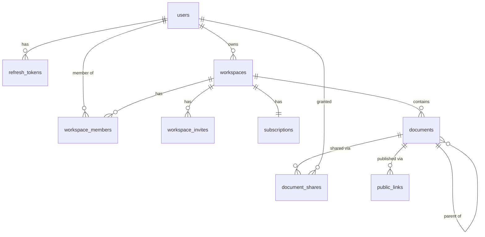
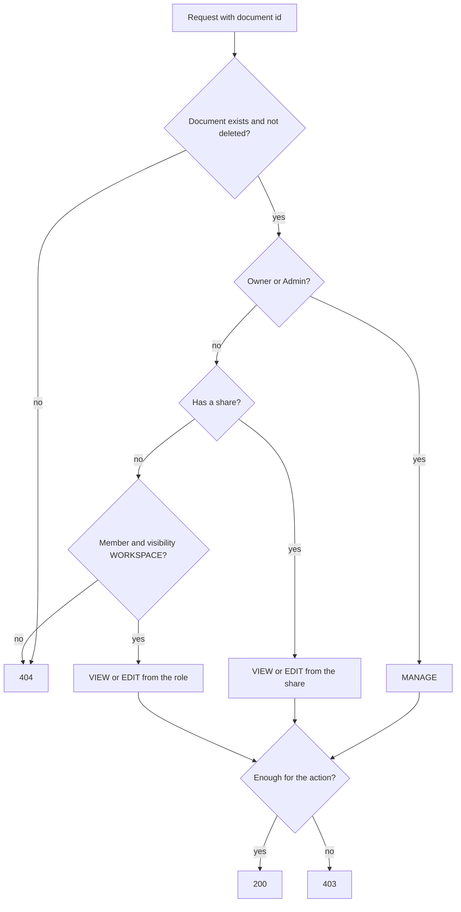

# Collab Docs

Collaborative workspace with real-time document editing: workspaces, nested documents, CRDT-based
co-editing, sharing and publishing, search, comments and billing.

> Work in progress. Sections below are filled in as the project grows.

## Architecture

pnpm monorepo:

| Path              | Purpose                                                                 |
| ----------------- | ----------------------------------------------------------------------- |
| `apps/web`        | Next.js 15 (App Router, Tailwind). Route groups `(public)` and `(app)`. |
| `apps/api`        | NestJS REST API (`GET /health`).                                        |
| `apps/collab`     | NestJS real-time collaboration server (`GET /health`).                  |
| `packages/shared` | Shared code with entry points `.`, `./content` and `./nest`.            |
| `packages/db`     | Prisma schema, migrations, seed and integration-test harness.           |

`@collab-docs/shared/nest` is server-only; ESLint forbids importing it (and `@collab-docs/db`) in
`apps/web`.

## Run

### With Docker (no setup)

Requires Docker with Compose v2. From a clean clone, without any `.env` file:

```bash
docker compose up --build --wait
```

Compose carries development-only defaults for every variable, so nothing else is needed. Copy
`.env.example` to `.env` to override values.

| Service    | URL / port                                  | Notes                                                                                    |
| ---------- | ------------------------------------------- | ---------------------------------------------------------------------------------------- |
| `proxy`    | http://localhost:3000                       | nginx, the only public HTTP entry point; sets `X-Forwarded-For` for `web`                |
| `web`      | - (behind `proxy`)                          | Next.js                                                                                  |
| `api`      | http://localhost:4000 (`/health`, `/ready`) | NestJS REST API                                                                          |
| `worker`   | -                                           | Background jobs (same image as `api`)                                                    |
| `collab`   | `localhost:4001` (`/health`)                | Public WebSocket port. Internal port `4002` is only reachable inside the compose network |
| `postgres` | `localhost:5432`                            | Database `collab`                                                                        |
| `redis`    | `localhost:6379`                            |                                                                                          |
| `minio`    | http://localhost:9000, console `:9001`      | S3 storage; bucket created by `minio-init`                                               |
| `mailpit`  | http://localhost:8025, SMTP `:1025`         | Catches outgoing email                                                                   |
| `migrate`  | -                                           | One-shot job that runs before the apps                                                   |

Host ports can be changed with `WEB_PORT`, `API_PORT`, `POSTGRES_PORT`, etc. (see `.env.example`).

MinIO's official images are no longer published, so `docker/minio/Dockerfile` builds the server and
the `mc` client from the last tagged source releases.

Only infrastructure for local development: `docker compose up -d postgres redis minio minio-init mailpit`.

### Staging profile

```bash
cp .env.staging.example .env.staging   # fill in every value
docker compose --env-file .env.staging -f docker-compose.yml -f docker-compose.staging.yml up -d
```

The override sets `APP_ENV=staging` and `NODE_ENV=production`, hides database, cache and console
ports, restarts services automatically, and requires every secret. On startup `api` and `collab`
validate their environment and refuse to run with missing values or `dev-only` placeholders.

### Without Docker

Requires Node.js >= 22.12 (see `.nvmrc`) and pnpm 10, plus the infrastructure services above.

```bash
pnpm install
pnpm dev
```

## Continuous integration

`.github/workflows/ci.yml` runs on every push to `main` and every pull request: lint and typecheck,
unit tests (with Postgres and Redis service containers), Docker image builds for `web`, `api`,
`collab` and `minio`, and the Playwright `e2e` job against the compose stack (see [Running e2e](#running-e2e)).

## Development

| Command                   | What it does                                                                                                                                  |
| ------------------------- | --------------------------------------------------------------------------------------------------------------------------------------------- |
| `pnpm lint`               | ESLint (flat config) for the whole repo                                                                                                       |
| `pnpm typecheck`          | `tsc --noEmit` in every package                                                                                                               |
| `pnpm test`               | Jest (api, collab) and Vitest (web, shared)                                                                                                   |
| `pnpm test:integration`   | Integration tests (needs Postgres and Redis; set `MAILPIT_URL=http://localhost:8025` with Mailpit running to include the email delivery test) |
| `pnpm build`              | Builds shared libraries, then every app                                                                                                       |
| `pnpm format`             | Prettier                                                                                                                                      |
| `pnpm --filter api start` | Runs the built API                                                                                                                            |

Libraries in `packages/*` are built before type checking and testing (`pnpm build:libs`, run
automatically by `typecheck` and `test`).

### Module system

`jose` is ESM-only, so the choice below was verified with smoke tests in every runtime:

- `packages/shared` is a dual package (`"type": "module"`, built with tsup to ESM `.js` and CJS
  `.cjs`, with matching type declarations) exposed through conditional `exports`.
- `apps/api` and `apps/collab` stay CommonJS (NestJS). At runtime Node loads ESM-only `jose`
  through `require(esm)`, which is why Node >= 22.12 is required.
- Jest runs through `@swc/jest`; `transformIgnorePatterns` lets `jose` be transformed to CommonJS.
- Vitest (web, shared) and `next build` import the package natively as ESM.

## Data model

Postgres, managed with Prisma 7 in `packages/db` (`prisma/schema.prisma`, migrations in
`prisma/migrations`). Tables and columns are snake_case, ids are UUID v7.



Notes:

- **Documents form a tree** (`parent_id`) ordered by `position`, a fractional-indexing key. The column
  is created `COLLATE "C"` so keys compare bytewise; the database default collation would sort mixed
  case differently and break the ordering.
- **Soft delete**: `deleted_at` marks a document, `deleted_root_id` the document where the deletion
  started, so a restore brings back only that deletion's subtree.
- **`revision`** is incremented atomically on every change that derived data (search index, public
  pages) must follow.
- **Indexes**: the tree listing uses a partial index `documents_tree_idx (workspace_id, parent_id,
position) WHERE deleted_at IS NULL`; the rest are plain b-tree indexes on foreign keys and unique
  lookups (emails, slugs, token hashes, one share per user and document, one public link per document
  and mode). Partial indexes, `COLLATE "C"` and the `pg_trgm`/`unaccent` extensions are written by hand
  in the first migration; the partial index keeps the name declared in the schema, so
  `pnpm --filter @collab-docs/db db:drift` still reports no drift.
- **Foreign keys**: rows that make no sense without their parent (memberships, refresh tokens, shares,
  public links, the subscription) cascade; workspace owners, document authors and workspaces that
  still hold documents are `RESTRICT`, so content is never deleted implicitly.
- Emails are stored lower-case (normalised by the application) and are unique.

### Database commands

| Command                                    | What it does                                                                                                       |
| ------------------------------------------ | ------------------------------------------------------------------------------------------------------------------ |
| `pnpm --filter @collab-docs/db db:migrate` | Create/apply migrations in development                                                                             |
| `pnpm --filter @collab-docs/db db:deploy`  | Apply existing migrations (what the `migrate` job runs)                                                            |
| `pnpm --filter @collab-docs/db db:seed`    | Idempotent demo data (dev only): `alice`, `bob`, `carol` `@example.test`, password `password123`, workspace `acme` |
| `pnpm --filter @collab-docs/db db:reset`   | Drop, re-migrate and re-seed                                                                                       |
| `pnpm --filter @collab-docs/db db:drift`   | Fails if migrations and `schema.prisma` diverge                                                                    |
| `pnpm test:integration`                    | Integration tests against a real Postgres                                                                          |

All of them read `DATABASE_URL`. Integration tests use `createTestDb()` from
`@collab-docs/db/testing`: each Jest worker creates its own throwaway database on that server,
applies the migrations and truncates tables between tests.

## API platform

Shared by `api`, its queue worker and (later) `collab`: it lives in `@collab-docs/shared/nest`, and each
app only plugs the modules in (`PlatformModule` for HTTP services, `WorkerPlatformModule` for the worker).

- **Prefix**: routes live under `/api`; `/health`, `/ready`, `/metrics` and `/docs` are served without it.
- **Validation**: a global `ValidationPipe` (`whitelist`, `forbidNonWhitelisted`, `transform`), `ParseUuidPipe`
  for ids, and base DTOs for pagination and id params. Request/response contracts are zod schemas in
  `@collab-docs/shared`; response DTO classes `implements` the inferred types, and integration tests parse
  real responses with the same schemas, so backend and frontend cannot drift apart silently.
- **HTTP hardening**: `helmet`, a CORS allowlist (`WEB_ORIGIN` plus `CORS_ALLOWED_ORIGINS`), `cookie-parser`,
  a JSON/urlencoded body limit (`HTTP_BODY_LIMIT`, default `1mb`) and `trust proxy` restricted to
  `TRUSTED_PROXY_CIDRS` (empty means `x-forwarded-for` is never trusted).
- **Rate limiting**: `@nestjs/throttler` with a Redis store, keyed by the real client IP. A generous global
  limit (`RATE_GLOBAL_PER_MIN_IP`) applies everywhere; `RateLimit.login()`, `.register()`, `.publicLink()` and
  `.ticket()` are per-route presets whose limits come from the `RATE_*` variables. If Redis is unavailable
  the limiter fails open and logs the error.
- **OpenAPI**: Swagger UI at `/docs`, JSON at `/docs/json`. `pnpm --filter @collab-docs/api openapi:export`
  writes the committed `docs/openapi.json` (the app is built without connecting to anything).

### Error model

Every error response has the same shape, produced by one global `AllExceptionsFilter`:

```json
{
  "statusCode": 400,
  "code": "VALIDATION_FAILED",
  "message": "Request validation failed",
  "details": [
    { "field": "name", "messages": ["name must be longer than or equal to 1 characters"] }
  ],
  "correlationId": "6f1c3f0e-…"
}
```

`code` comes from the catalog in `@collab-docs/shared` (`VALIDATION_FAILED`, `UNAUTHENTICATED`, `FORBIDDEN`,
`NOT_FOUND`, `CONFLICT`, `RATE_LIMITED`, `PLAN_LIMIT_EXCEEDED`, `PAYLOAD_TOO_LARGE`, …) and clients branch on
it, never on `message`. Application code throws `AppException(code, message, { details })`. Framework and
library errors are mapped: validation errors become 400, Prisma `P2002` 409, `P2025` 404, throttling 429,
oversized or malformed bodies 413/400. Anything unrecognised is a 500 with a generic message — the real
error is logged with the correlation id but never returned.

### Logging & correlation

Logs are JSON (`nestjs-pino`). Each request gets a correlation id: the incoming `x-correlation-id` if it is a
short, log-safe token, otherwise a new UUID. It is stored in `AsyncLocalStorage`, added to every log line,
returned in the `x-correlation-id` response header and in every error body. When code enqueues a job the id
is written into the job data, and the worker restores it before running the processor, so one id follows a
change from the browser through the API into background work (and later the collab server). Secrets are
redacted from logs (`authorization`, `cookie`, `set-cookie`, passwords, tokens); business events are logged
with `logEvent('document.published', { … })`.

### Observability

- `GET /health` — liveness. `GET /ready` — readiness: pings Postgres and Redis and answers `503` with the
  per-dependency state when one is down.
- `GET /metrics` — Prometheus: default process metrics, `http_request_duration_seconds{route,method,status}`
  (labelled by route pattern, not raw URL) and queue metrics (`queue_jobs{queue,state}`,
  `queue_jobs_processed_total{queue,result}`). The endpoint is unauthenticated, so keep it off public ingress.

### Queues

BullMQ queues (`search-sync`, `public-revalidate`, `mail`, `billing-webhook`, `link-expiry`, `version-prune`)
are created through `QueueService`, with default retries (5 attempts, exponential backoff) and bounded
history. The worker runs from the same image as the API (`node dist/main.worker.js`) and shuts down
gracefully, finishing active jobs. `enqueueDebounced(queue, documentId, delayMs)` coalesces bursts of
changes into one delayed job using BullMQ deduplication; the job reads the latest state when it runs, and a
change made while it is processing schedules a new job. A fixed `jobId` per document is deliberately not
used, because BullMQ remembers finished ids and would drop later changes.

## Authentication

Own JWT auth in the API (`apps/api/src/auth`), no external identity provider.

| Endpoint                  | Purpose                                                                                       |
| ------------------------- | --------------------------------------------------------------------------------------------- |
| `POST /api/auth/register` | Create an account and sign in (409 if the email exists)                                       |
| `POST /api/auth/login`    | Sign in                                                                                       |
| `POST /api/auth/refresh`  | Rotate the refresh token, issue a new access token                                            |
| `GET /api/auth/refresh`   | Same rotation for browser navigations; `302` to `?next=` (relative paths only) or to `/login` |
| `POST /api/auth/logout`   | Revoke the refresh-token family, clear the cookies                                            |
| `GET /api/auth/me`        | The signed-in user (read from the database)                                                   |

Register, login and refresh answer `{ user, accessToken, expiresIn }` and set two cookies. The access token
is also accepted as `Authorization: Bearer` (Swagger, tests, non-browser clients).

| Cookie  | Content                       | Attributes                               |
| ------- | ----------------------------- | ---------------------------------------- |
| `cd_at` | access JWT, 15 min            | `HttpOnly; SameSite=Lax; Path=/`         |
| `cd_rt` | opaque refresh token, 30 days | `HttpOnly; SameSite=Lax; Path=/api/auth` |

Both are `Secure` when `APP_ENV=staging`. The browser reaches the API same-origin through the web app's
`/api/*` rewrite, so the cookie paths match.

For other modules: every route requires a valid access token unless it is marked `@Public()`; the user is
available through `@CurrentUser()` (`{ id, jti }`). The guard verifies the JWT locally and never touches the
database. `verifyAccessToken()` and `signAccessToken()` live in `@collab-docs/shared` and use only `jose` and
Web APIs, so Next's Edge middleware and the collab service verify tokens exactly as the API does.

### Auth design & rationale

**Why our own JWT instead of Auth.js.** The API is a separate NestJS service that also guards a WebSocket
gateway and server-to-server calls, so identity has to be verifiable outside Next. A signed access token that
any service can check with one shared secret does that; Auth.js sessions live inside the Next runtime. Owning
the flow also keeps rotation, reuse detection and rate limits in one place and testable at the HTTP level.

**Access + refresh.** The access JWT is short-lived (15 min; `sub`, `jti`, `aud=api`) and checked without a
database read. The refresh token is 256 random bits; only its SHA-256 is stored (`refresh_tokens.token_hash`),
so a database leak does not yield usable tokens. Passwords use argon2id (`@node-rs/argon2`; memory, time and
parallelism come from `ARGON2_*`, defaults follow the OWASP minimum). A wrong password and an unknown email
produce the same response and cost the same time.

**Rotation and the 30 s grace.** Each refresh replaces the token (`rotated_at`, `replaced_by`) inside one
family (`family_id`). The rotation claim is a single conditional `UPDATE ... WHERE rotated_at IS NULL`, so of
two parallel refreshes with the same token exactly one rotates. A rotated token that is presented again within
30 s (parallel requests, several tabs, a response lost on the wire) only yields a new access token and no
second rotation, so the user is not logged out by a race. Presented later, a rotated token means it was
copied: the whole family is revoked, the request gets `401`, and `auth.refresh_reuse_detected` is logged.
Logout revokes the family too.

**CSRF.** `SameSite=Lax` plus a global guard: a state-changing request authenticated by cookies (`cd_at` or
`cd_rt`, so refresh and logout included) must carry `Origin` equal to `WEB_ORIGIN`, otherwise `403
CSRF_REJECTED`. Bearer requests are exempt (browsers do not attach that header on their own), as are
requests without auth cookies such as login and webhooks.

**Rate limits.** Login: 5/min per (client IP, email) and 20/min per IP; register: 10/h per IP (`RATE_*` in
`.env.example`). Exceeding them returns `429 RATE_LIMITED` with `Retry-After`. The client IP is `req.ip`,
which honours `x-forwarded-for` only from `TRUSTED_PROXY_CIDRS`.

**HS256 vs ES256/JWKS.** HS256 with a dedicated secret (`JWT_ACCESS_SECRET`) is the simplest thing that works
for services we deploy together; every verifier holds the secret. The cost is that every verifier could also
mint tokens. To move to ES256 with a JWKS endpoint, the API would sign with a private key and publish the
public key; `signAccessToken`/`verifyAccessToken` are the only places that change, and `jose` already supports
`createRemoteJWKSet`. Rotating keys then needs only a `kid`, with no secret redistribution.

## Workspaces, members and invites

`apps/api/src/workspaces`. A user creates a workspace and becomes its `OWNER`; the workspace starts on the
`FREE` plan. Roles: `OWNER`, `ADMIN`, `EDITOR`, `VIEWER`.

| Endpoint                                       | Minimum role | Purpose                                              |
| ---------------------------------------------- | ------------ | ---------------------------------------------------- |
| `POST /api/workspaces`                         | any user     | Create a workspace (slug is generated from the name) |
| `GET /api/workspaces`                          | any user     | Workspaces the caller belongs to                     |
| `GET /api/workspaces/:id`                      | `VIEWER`     | One workspace                                        |
| `PATCH /api/workspaces/:id`                    | `ADMIN`      | Rename                                               |
| `GET /api/workspaces/:id/usage`                | `VIEWER`     | Members, documents, storage against the plan limits  |
| `GET /api/workspaces/:id/members`              | `VIEWER`     | Members                                              |
| `PATCH /api/workspaces/:id/members/:userId`    | `ADMIN`      | Change a role                                        |
| `DELETE /api/workspaces/:id/members/:userId`   | `VIEWER`     | Leave (own id) or remove a member (`ADMIN`)          |
| `POST /api/workspaces/:id/invites`             | `ADMIN`      | Invite an email (never as `OWNER`), emailed          |
| `GET /api/workspaces/:id/invites`              | `ADMIN`      | Pending invites                                      |
| `DELETE /api/workspaces/:id/invites/:inviteId` | `ADMIN`      | Revoke                                               |
| `GET /api/invites/:token`                      | public       | Preview (workspace, email, role) for the accept page |
| `POST /api/invites/:token/accept`              | signed in    | Join; the account email must equal the invited email |

Rules enforced on the server: an admin can neither change or remove an owner nor grant `OWNER`; the last
owner can be neither demoted nor leave (`409`); a role change or removal publishes `perm.changed` on Redis
once the transaction has committed (the real-time server listens to it). Both rules run under the workspace
row lock, so two concurrent demotions cannot leave a workspace without an owner.

**Invites.** The token is 256 random bits, valid for 7 days, and only its SHA-256 is stored. Inviting an
address that already has a pending invite re-issues it (new token, new expiry, the old link stops working);
inviting an existing member is `409`. The email is sent by the `mail` queue (nodemailer to SMTP, Mailpit in
development at <http://localhost:8025>); the worker retries with exponential backoff and the HTML template
escapes every user-supplied value. The queue payload carries the accept link, so Redis holds a valid token
until the job is removed (one hour after success).

**Plan limits.** `PLAN_CATALOG` in `@collab-docs/shared` (Free 3 members / 20 documents / 100 MB, Pro
10 / 500 / 5 GB, Team 50 / unlimited / 50 GB). Members are accepted members plus pending invites; people who
only have a document shared with them (guests) do not count. Every check runs in a transaction that first
takes `SELECT ... FOR UPDATE` on the workspace row, so N parallel invites at the limit produce exactly the
allowed number of successes. Exceeding a limit returns `403` with
`{ code: 'PLAN_LIMIT_EXCEEDED', details: { kind, limit, current, plan } }`. After a downgrade, existing
members stay and new ones are blocked, including accepting an invite that was issued earlier.

## Permission model

Access is decided by pure functions in `packages/shared/src/permissions.ts`, so the API, the collab server
and the tests share one definition. `PermissionsService` (`apps/api/src/permissions`) loads the minimal
context (membership, share, visibility) and calls them. **Nothing is cached**: a revoked permission applies
to the next request. Routes declare their requirement with `@WorkspaceRole('ADMIN')` or
`@DocumentAccess('EDIT')`.

Document access, evaluated top to bottom:

| #   | Condition                                | Access                                       |
| --- | ---------------------------------------- | -------------------------------------------- |
| 1   | Document is deleted                      | `NONE` (restore: Owner/Admin, Editor-author) |
| 2   | Role is `OWNER` or `ADMIN`               | `MANAGE`                                     |
| 3   | The user has a `document_share`          | share `EDITOR` -> `EDIT`, `VIEWER` -> `VIEW` |
| 4   | Member and visibility is `WORKSPACE`     | `EDITOR` -> `EDIT`, `VIEWER` -> `VIEW`       |
| 5   | Anything else (non-member, `RESTRICTED`) | `NONE`                                       |

An explicit share overrides the workspace role in both directions. Public links are a separate path: a
`VIEW` link allows anonymous reading of the published page, a live `EDIT` link grants `EDIT` on that one
document to a guest who cannot comment.



**404 vs 403.** No access at all (not a member, `RESTRICTED` without a share, deleted, unknown id, malformed
id) gives `404`, so the response never confirms that a resource exists; access that is too low for the action
gives `403`. A member of a workspace also gets `403` where a non-member gets `404`.

Creating a document needs `EDITOR` and `EDIT` on the parent; the child copies the parent's visibility and
shares at that moment (a snapshot, not live inheritance). Moving needs `EDIT` on the document and on the new
parent, the same workspace and no cycle. Only `EDITOR` and above can comment.

## Documents & hierarchy

Documents form a tree per workspace (`documents.parent_id`); siblings are ordered by a fractional-indexing key
in `documents.position` (`COLLATE "C"`), so a reorder rewrites one row and never rebalances. Endpoints live in
`apps/api/src/documents`; every route that takes a document id declares `@DocumentAccess(...)`, and restore
(which must see deleted rows) resolves access itself.

- **Permissions are not inherited.** A child copies the parent's visibility and shares when it is created and is
  independent afterwards. The consequence is a tree with holes: `GET /workspaces/:id/documents/tree` returns a
  flat list filtered for the caller, and a visible document under a hidden parent is returned with
  `parentId: null` so the id of the hidden ancestor is never disclosed (`GET /documents/:id` does the same).
- **Move** needs `EDIT` on the document and the new parent, the same workspace, and no cycle (`409`). Creates,
  moves, deletes and restores in one workspace take the workspace row lock (`SELECT ... FOR UPDATE`), which also
  serialises the plan-limit check and makes a cycle from two racing moves impossible, including moves into the
  root where there is no parent row to lock.
- **Soft delete** marks the whole live subtree in one recursive statement and stamps every node with
  `deleted_root_id`, including descendants the caller cannot see. The trash lists the root of each deletion.
  **Restore** brings back exactly the nodes of that deletion (a child deleted earlier stays in the trash), needs
  room under the plan's document limit (`403 PLAN_LIMIT_EXCEEDED`), and returns the document to the root when its
  parent is still deleted. Only a deletion root can be restored; restoring a node that was deleted with its
  parent is `409`.
- **Sharing** is by email for registered users only (`404` for unknown addresses). A guest sees only the
  documents shared with them (`GET /me/shared-documents`), not the tree or the workspace. A share overrides the
  workspace role in both directions.
- **Recent documents** (`GET /workspaces/:id/documents/recent?limit=`, default 8, max 20) feed the dashboard:
  newest change first, visibility filtered in SQL so the limit applies to documents the caller may open.
- **Who may do what:** create `EDITOR`+ with `EDIT` on the parent; edit title/icon, move and delete `EDIT`;
  change visibility or manage shares `MANAGE` or `EDIT` as the author; restore Owner/Admin or the author.

## Caching & invalidation

The document tree is cached in Redis as `tree:{workspaceId}:{version}` (5 minute TTL as a safety net). Every
mutation that can change the tree (create, rename, move, delete, restore, visibility, share) commits first and
then increments `tree:ver:{workspaceId}`; the old entry is simply never read again. A reader that loaded the
database before a concurrent commit stores its result under the old version, so a stale tree cannot be
served after the bump. **Permissions are not cached**: the cache holds the unfiltered live rows and each request
applies the caller's role and shares (one small query) after reading it. If Redis is down the tree is read from
Postgres. Hits, misses and errors are exported as `tree_cache_lookups_total{result}`.

After the bump the api publishes on Redis:

| Channel / queue                                 | When                                     | Consumers                                 |
| ----------------------------------------------- | ---------------------------------------- | ----------------------------------------- |
| `realtime.events` -> `GET /events/stream` (SSE) | tree changed                             | browsers of that workspace                |
| `perm.changed`, `doc.deleted`, `doc.restored`   | visibility/share change, delete, restore | collab re-evaluates open sockets          |
| `public-revalidate` (3 s), `search-sync` (5 s)  | title, icon, delete, restore             | page revalidation and search (later work) |

Everything is published only **after** the transaction commits, so a rolled-back request (for example a
rejected plan limit) emits nothing. The queues are debounced with BullMQ `deduplication` keyed by document id
(never `jobId = documentId`, which would silently drop later changes); the job reads the latest state when it
runs. A failed enqueue is logged and counted (`queue_enqueue_failures_total`) but never fails the request.

`GET /events/stream?workspaceId=` is server-sent events: members only (`404` otherwise), a heartbeat every 25 s
that also re-checks membership, `Cache-Control: no-cache, no-transform` and `X-Accel-Buffering: no` so a
rewrite proxy does not buffer it. One connection per browser tab carries the workspace's `tree.changed` events
and the caller's personal events.

## Frontend

`apps/web` is a Next.js 15 App Router application (Tailwind, shadcn/ui primitives on Radix, Geist fonts
bundled through npm so builds need no network).

### Frontend: Server vs Client boundary

Server Component is the default: anything that reads data and needs no browser state. A Client Component
(`"use client"`) exists only where the browser is required, and each one is listed here with the reason:

| Client component                                                                                            | Why                                                                                                                           |
| ----------------------------------------------------------------------------------------------------------- | ----------------------------------------------------------------------------------------------------------------------------- |
| `components/providers.tsx`                                                                                  | TanStack Query provider and the toast outlet                                                                                  |
| `components/auth/login-form.tsx`, `register-form.tsx`                                                       | `useActionState` (pending state, field errors) and a zod pass before the round trip                                           |
| `components/user-menu.tsx`                                                                                  | Radix menu; the logout Server Action runs from its event handler                                                              |
| `components/workspaces/create-workspace-form`, `rename-workspace-form`, `invite-form`, `accept-invite-form` | `useActionState` (pending state, field errors, plan-limit explanation) and a zod pass before the round trip                   |
| `components/workspaces/members-table.tsx`, `pending-invites.tsx`                                            | Role selects, the remove confirmation and revoke call Server Actions from event handlers                                      |
| `components/workspaces/workspace-switcher.tsx`                                                              | Radix menu; the current workspace comes from the pathname, the list arrives as typed props                                    |
| `components/workspaces/workspace-nav.tsx`                                                                   | `usePathname` marks the active section                                                                                        |
| `components/workspaces/use-action-feedback.ts`, `use-validated-action.ts`                                   | Hooks: success toast and plan-limit event; `useActionState` that runs the zod schema in the browser before calling the action |
| `components/dashboard/block-boundary.tsx`                                                                   | Error boundaries must be class components; one per dashboard block                                                            |
| `app/(app)/w/[id]/error.tsx`                                                                                | Error boundary of the workspace segment (keeps the navbar and workspace header)                                               |
| `components/ui/dialog`, `dropdown-menu`, `label`, `sonner`                                                  | Radix/Sonner primitives that need effects and event handlers                                                                  |
| `app/error.tsx`                                                                                             | Error boundaries must be Client Components                                                                                    |

Screens and where they render (everything not listed as a client island is a Server Component):

| Screen                | Renders in                             | Why                                                                                                                                                                              |
| --------------------- | -------------------------------------- | -------------------------------------------------------------------------------------------------------------------------------------------------------------------------------- |
| `/w`                  | RSC page + client create form          | The list is a plain read; the form needs pending state and field errors. Redirects to the last opened workspace (`cd_ws` cookie, set by the middleware) unless `?all` is present |
| `/w/[id]` (dashboard) | RSC, four async RSC blocks             | Each block has its own `Suspense` + error boundary, so the shell and skeletons flush first and the blocks stream in independently                                                |
| `/w/[id]/settings`    | RSC page + client forms/tables         | Data is read on the server (admin-only, `ForbiddenState` otherwise); every mutation is a Server Action                                                                           |
| `/invite/[token]`     | RSC                                    | Previews the invite on the server and branches on the session: sign in / register links, a mismatch warning, or the accept form                                                  |
| Navbar                | RSC shell + switcher/user-menu islands | The workspace list is fetched in the layout and passed down as typed props                                                                                                       |

**Dashboard streaming.** `app/(app)/w/[id]/page.tsx` awaits nothing but the workspace the layout already loaded
(deduplicated by `React.cache`). The blocks (`components/dashboard/blocks.tsx`: recent documents, members,
plan and usage, shared with me) are async Server Components under their own `<Suspense>`, so a slow or failing
block never holds back the others. The e2e suite asserts this on the raw response: with
`DASHBOARD_BLOCK_DELAY_MS` set (ignored when `APP_ENV=staging`) the first flush contains the skeletons and not
the data, and the data arrives later in the same response.

### Server Actions vs REST vs WebSocket

| Operation                                                                                       | Channel               | Why                                                                                                                                          |
| ----------------------------------------------------------------------------------------------- | --------------------- | -------------------------------------------------------------------------------------------------------------------------------------------- |
| Create/rename workspace, invite, change role, remove member, revoke/accept invite, login/logout | **Server Actions**    | Forms that work as plain `<form action>`, cookies handled on the server, `revalidatePath` refreshes the Server Components that show the data |
| Document tree (move/create/rename/delete), comments, sharing, publishing                        | REST + TanStack Query | Interactive, optimistic UI and cache invalidation in the browser                                                                             |
| Notifications, tree changes                                                                     | SSE                   | One-way push                                                                                                                                 |
| Document content, presence                                                                      | WebSocket (Yjs)       | Conflict-free merging and awareness                                                                                                          |

Server Actions call the api through `lib/api/server.ts` (cookies, `x-forwarded-for`, correlation id), validate
their input with the zod schemas of `@collab-docs/shared` (arguments of actions that are not form posts are
validated too, since they are public endpoints), and report failures as data (`ActionState`): field errors,
a plain-language plan-limit explanation (`PLAN_LIMIT_EXCEEDED` also fires the window event the upgrade dialog
will subscribe to), or a generic message. Forms run the same schema in the browser first, inside the action
function (`use-validated-action.ts`), so field errors appear without a round trip. Authorization is always the
api's; hiding admin controls in the UI is convenience only.

**Why actions do not call `revalidatePath` or `redirect`.** The api client is never cached, so there is no server
data cache to purge; what a mutation needs is a fresh render of the current page. Calling `revalidatePath` or
`redirect` inside the action makes the action response carry that render, and on the production build (Next 15.5,
React 19.2) forms that did so intermittently stayed pending or never showed the result, with or without the nginx
proxy in front. Two things were measured: a `loading.tsx` above the workspace layouts made it much worse (6 of 16
submits of the invite form stalled, against 0 of 78 once the skeletons were scoped to their own segments, which
is why the list skeleton lives in the `app/(app)/w/(list)` route group), but revalidating actions still flaked
in the parallel e2e run (create and rename, 2 of 4 runs). So an action only returns data (`ActionState`, including
`redirectTo` after creating a workspace or accepting an invite) and the component finishes the job in
`useActionFeedback`: toast, `router.push` when asked, and `router.refresh()`, a separate GET that also re-renders the
layouts (the navbar switcher picks up a new workspace). Components that call actions from event handlers (role
select, remove, revoke) refresh the same way. The root cause inside Next/React is not identified.

Route groups keep the rendering mode of each area separate:

- `app/(public)` — landing, `/login`, `/register`, `/invite/[token]` (later `/p/[slug]`, `/e/[token]`).
- `app/(app)` — everything behind a session (`/w`, `/w/[id]`, `/w/[id]/settings`, later documents and billing).
- The root `app/layout.tsx` is static: it never calls `cookies()` or `headers()`. Only `(app)/layout.tsx`
  reads the session, so public pages stay statically renderable (the build output marks `/` as static).

Three API clients, one per rendering context (all parse responses with the zod schemas of
`@collab-docs/shared`; there is no `any` at the boundary):

| Client              | Used from                 | Behaviour                                                                                             |
| ------------------- | ------------------------- | ----------------------------------------------------------------------------------------------------- |
| `lib/api/server.ts` | Server Components/Actions | Forwards the user's cookies, `x-forwarded-for`, `x-correlation-id` and `Origin`; never cached         |
| `lib/api/public.ts` | Statically rendered pages | No cookies, no headers (reading either would opt the page out of ISR); accepts `next.revalidate/tags` |
| `lib/api/client.ts` | Browser (TanStack Query)  | Same-origin `/api/*`; on 401 one single-flight `POST /auth/refresh`, one retry, then login            |

`/api/*` is a Next rewrite to `API_INTERNAL_URL`, so the browser only ever talks to its own origin: cookies,
the CSRF `Origin` check and SSE all work without CORS. The rewrite target is compiled into the build (Next
bakes rewrites into its routes manifest; the Dockerfile exposes it as a build arg), whereas
`JWT_ACCESS_SECRET`, `API_INTERNAL_URL` and `WEB_ORIGIN` used by the middleware and Server Actions are read at
request time — an image built without them works once they are set on the container.

**Edge middleware** (`middleware.ts`) is UX routing, not a security boundary: every Server Component, Server
Action and REST call is authorized again by the API. It verifies `cd_at` with `jose`, redirects anonymous users
off private routes, bounces signed-in users off `/login` and `/register`, and stamps `x-correlation-id`. The
refresh cookie is scoped to `/api/auth`, so the browser never sends it on a page navigation, and the access
cookie expires together with its JWT (an expired session looks like a missing cookie). For a private route
without a valid access token the middleware therefore redirects to `GET /api/auth/refresh?next=…`: the API
rotates the session and redirects back, or sends anonymous visitors on to `/login?next=…`. The routing decision itself is a pure function
(`lib/auth/route-policy.ts`).

Login and registration are Server Actions: zod on the client and again on the server, field errors from
`VALIDATION_FAILED`, a `Retry-After`-aware message on 429, and the API's `Set-Cookie` headers replayed through
`cookies().set` with identical attributes. `next` is only honoured for same-origin relative paths
(`sanitizeNextPath` in `@collab-docs/shared`, also used by the API redirect).

### Client address and the proxy

The API rate-limits logins, registrations and public links per client address, taken from `X-Forwarded-For`
and honoured only from `TRUSTED_PROXY_CIDRS`. `web` forwards the header it receives, so whoever sets it
decides the address: an exposed Next server would let a client pick a new "IP" per request and defeat every
limit. Hence the compose topology `browser → proxy (nginx) → web → api`: nginx is the only published HTTP
port, replaces `X-Forwarded-For` with the peer address instead of appending to it, and passes `Host` and
`X-Forwarded-Proto`. It resolves `web` through Docker's DNS on every request (`resolver` plus a variable in `proxy_pass`), so recreating only the `web` container needs no nginx restart; the cost is a new upstream connection per request (no keepalive pool). The same holds for the staging override, which also unpublishes the api port.
If you put another load balancer or TLS terminator in front of nginx, configure nginx `real_ip` for it
(`set_real_ip_from` + `real_ip_header X-Forwarded-For`), otherwise every user shares the balancer's address.

### Error handling on the frontend

Every client turns a failed response into one `ApiError` (`status`, `code`, `message`, `correlationId`,
`fieldErrors`). Query and mutation failures pass through one handler (`lib/api/error-handler.ts`, wired into the
TanStack `QueryCache`/`MutationCache`):

| Case                  | Behaviour                                                                     |
| --------------------- | ----------------------------------------------------------------------------- |
| 401                   | Client refreshes once and retries; if that fails the user is sent to `/login` |
| 403 (query)           | No toast: the screen renders `ForbiddenState`                                 |
| 404 (query)           | No toast: the screen renders its not-found state                              |
| 403 (mutation)        | Toast "You don't have permission to do that"                                  |
| `PLAN_LIMIT_EXCEEDED` | `plan-limit-exceeded` window event for the upgrade dialog; no toast           |
| 429, network, 5xx     | Friendly toast; the correlation id is shown as a reference                    |

`app/error.tsx` and `app/not-found.tsx` cover render-time failures; `EmptyState`, `ErrorState`,
`ForbiddenState` and `LoadingState` are the shared building blocks.

### Running e2e

The Playwright suite (`e2e/`) runs against the production images, not dev servers:

```bash
docker compose up --build --wait proxy worker   # nginx plus web, api, collab, the queue worker (it sends the invitation mail) and the infrastructure
pnpm exec playwright install chromium  # first run only
RATE_REGISTER_PER_HOUR_IP=1000 RATE_LOGIN_PER_MIN_IP=1000 docker compose up -d api   # headroom: all tests share one address
pnpm test:e2e
```

Two more pieces of the stack matter to the workspace specs: Mailpit (the invitation mail is fetched from
`MAILPIT_URL`, default `http://localhost:8025`) and, for the streaming spec, `DASHBOARD_BLOCK_DELAY_MS` on the
`web` container. Set it in the shell that starts compose and keep it in the environment of `pnpm test:e2e`;
the streaming spec skips itself without it:

```bash
DASHBOARD_BLOCK_DELAY_MS=600 docker compose up --build --wait proxy worker
DASHBOARD_BLOCK_DELAY_MS=600 pnpm test:e2e
```

Every test runs from the same address (the proxy overwrites `X-Forwarded-For`), so CI raises the per-IP limits
through the `RATE_*` variables; `client-ip.spec.ts` proves that a spoofed header gets no fresh bucket. Fixtures
create users through the API and reuse the session cookies instead of logging in through the UI. Traces
and videos are kept for failed tests (`test-results/`, `playwright-report/`). CI runs the same steps in the
`e2e` job and uploads both folders as artifacts.

## Decisions

To be documented.

## Not done

To be documented.
