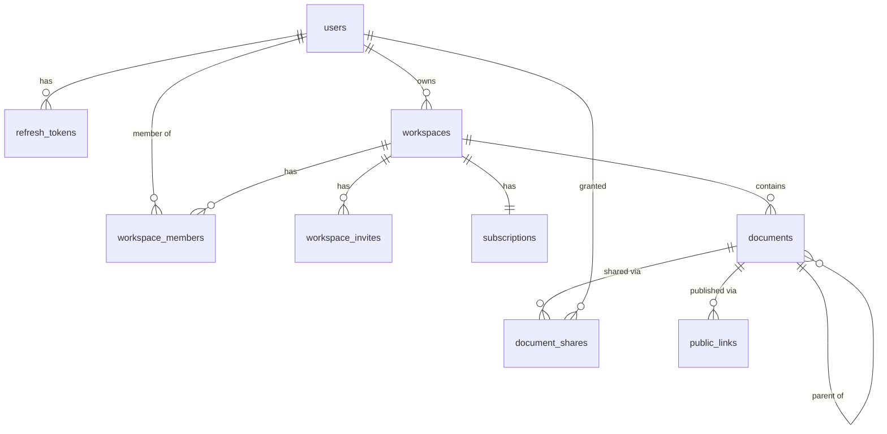

# Collab Docs

Collaborative workspace with real-time document editing: workspaces, nested documents, CRDT-based
co-editing, sharing and publishing, search, comments and billing.

> Work in progress. Sections below are filled in as the project grows.

## Architecture

pnpm monorepo:

| Path              | Purpose                                                                 |
| ----------------- | ----------------------------------------------------------------------- |
| `apps/web`        | Next.js 15 (App Router, Tailwind). Route groups `(public)` and `(app)`. |
| `apps/api`        | NestJS REST API (`GET /health`).                                        |
| `apps/collab`     | NestJS real-time collaboration server (`GET /health`).                  |
| `packages/shared` | Shared code with entry points `.`, `./content` and `./nest`.            |
| `packages/db`     | Prisma schema, migrations, seed and integration-test harness.           |

`@collab-docs/shared/nest` is server-only; ESLint forbids importing it (and `@collab-docs/db`) in
`apps/web`.

## Run

### With Docker (no setup)

Requires Docker with Compose v2. From a clean clone, without any `.env` file:

```bash
docker compose up --build --wait
```

Compose carries development-only defaults for every variable, so nothing else is needed. Copy
`.env.example` to `.env` to override values.

| Service    | URL / port                                  | Notes                                                                                    |
| ---------- | ------------------------------------------- | ---------------------------------------------------------------------------------------- |
| `web`      | http://localhost:3000                       | Next.js                                                                                  |
| `api`      | http://localhost:4000 (`/health`, `/ready`) | NestJS REST API                                                                          |
| `worker`   | -                                           | Background jobs (same image as `api`)                                                    |
| `collab`   | `localhost:4001` (`/health`)                | Public WebSocket port. Internal port `4002` is only reachable inside the compose network |
| `postgres` | `localhost:5432`                            | Database `collab`                                                                        |
| `redis`    | `localhost:6379`                            |                                                                                          |
| `minio`    | http://localhost:9000, console `:9001`      | S3 storage; bucket created by `minio-init`                                               |
| `mailpit`  | http://localhost:8025, SMTP `:1025`         | Catches outgoing email                                                                   |
| `migrate`  | -                                           | One-shot job that runs before the apps                                                   |

Host ports can be changed with `WEB_PORT`, `API_PORT`, `POSTGRES_PORT`, etc. (see `.env.example`).

MinIO's official images are no longer published, so `docker/minio/Dockerfile` builds the server and
the `mc` client from the last tagged source releases.

Only infrastructure for local development: `docker compose up -d postgres redis minio minio-init mailpit`.

### Staging profile

```bash
cp .env.staging.example .env.staging   # fill in every value
docker compose --env-file .env.staging -f docker-compose.yml -f docker-compose.staging.yml up -d
```

The override sets `APP_ENV=staging` and `NODE_ENV=production`, hides database, cache and console
ports, restarts services automatically, and requires every secret. On startup `api` and `collab`
validate their environment and refuse to run with missing values or `dev-only` placeholders.

### Without Docker

Requires Node.js >= 22.12 (see `.nvmrc`) and pnpm 10, plus the infrastructure services above.

```bash
pnpm install
pnpm dev
```

## Continuous integration

`.github/workflows/ci.yml` runs on every push to `main` and every pull request: lint and typecheck,
unit tests (with Postgres and Redis service containers), and Docker image builds for `web`, `api`,
`collab` and `minio`.

## Development

| Command                   | What it does                                |
| ------------------------- | ------------------------------------------- |
| `pnpm lint`               | ESLint (flat config) for the whole repo     |
| `pnpm typecheck`          | `tsc --noEmit` in every package             |
| `pnpm test`               | Jest (api, collab) and Vitest (web, shared) |
| `pnpm build`              | Builds shared libraries, then every app     |
| `pnpm format`             | Prettier                                    |
| `pnpm --filter api start` | Runs the built API                          |

Libraries in `packages/*` are built before type checking and testing (`pnpm build:libs`, run
automatically by `typecheck` and `test`).

### Module system

`jose` is ESM-only, so the choice below was verified with smoke tests in every runtime:

- `packages/shared` is a dual package (`"type": "module"`, built with tsup to ESM `.js` and CJS
  `.cjs`, with matching type declarations) exposed through conditional `exports`.
- `apps/api` and `apps/collab` stay CommonJS (NestJS). At runtime Node loads ESM-only `jose`
  through `require(esm)`, which is why Node >= 22.12 is required.
- Jest runs through `@swc/jest`; `transformIgnorePatterns` lets `jose` be transformed to CommonJS.
- Vitest (web, shared) and `next build` import the package natively as ESM.

## Data model

Postgres, managed with Prisma 7 in `packages/db` (`prisma/schema.prisma`, migrations in
`prisma/migrations`). Tables and columns are snake_case, ids are UUID v7.



Notes:

- **Documents form a tree** (`parent_id`) ordered by `position`, a fractional-indexing key. The column
  is created `COLLATE "C"` so keys compare bytewise; the database default collation would sort mixed
  case differently and break the ordering.
- **Soft delete**: `deleted_at` marks a document, `deleted_root_id` the document where the deletion
  started, so a restore brings back only that deletion's subtree.
- **`revision`** is incremented atomically on every change that derived data (search index, public
  pages) must follow.
- **Indexes**: the tree listing uses a partial index `documents_tree_idx (workspace_id, parent_id,
position) WHERE deleted_at IS NULL`; the rest are plain b-tree indexes on foreign keys and unique
  lookups (emails, slugs, token hashes, one share per user and document, one public link per document
  and mode). Partial indexes, `COLLATE "C"` and the `pg_trgm`/`unaccent` extensions are written by hand
  in the first migration; the partial index keeps the name declared in the schema, so
  `pnpm --filter @collab-docs/db db:drift` still reports no drift.
- **Foreign keys**: rows that make no sense without their parent (memberships, refresh tokens, shares,
  public links, the subscription) cascade; workspace owners, document authors and workspaces that
  still hold documents are `RESTRICT`, so content is never deleted implicitly.
- Emails are stored lower-case (normalised by the application) and are unique.

### Database commands

| Command                                    | What it does                                                                                                       |
| ------------------------------------------ | ------------------------------------------------------------------------------------------------------------------ |
| `pnpm --filter @collab-docs/db db:migrate` | Create/apply migrations in development                                                                             |
| `pnpm --filter @collab-docs/db db:deploy`  | Apply existing migrations (what the `migrate` job runs)                                                            |
| `pnpm --filter @collab-docs/db db:seed`    | Idempotent demo data (dev only): `alice`, `bob`, `carol` `@example.test`, password `password123`, workspace `acme` |
| `pnpm --filter @collab-docs/db db:reset`   | Drop, re-migrate and re-seed                                                                                       |
| `pnpm --filter @collab-docs/db db:drift`   | Fails if migrations and `schema.prisma` diverge                                                                    |
| `pnpm test:integration`                    | Integration tests against a real Postgres                                                                          |

All of them read `DATABASE_URL`. Integration tests use `createTestDb()` from
`@collab-docs/db/testing`: each Jest worker creates its own throwaway database on that server,
applies the migrations and truncates tables between tests.

## Decisions

To be documented.

## Not done

To be documented.
