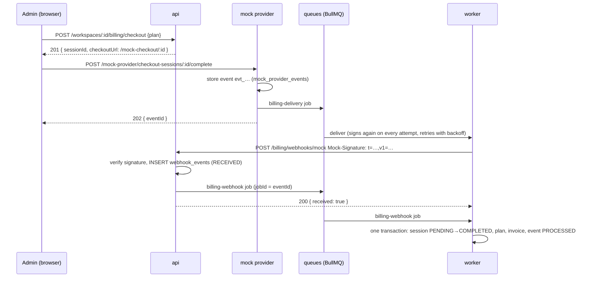

# Billing & idempotency

A workspace is on `FREE`, `PRO` or `TEAM` (limits and prices: `GET /api/billing/plans`). Paying is a mock of Stripe
Checkout: the api asks the provider to collect a payment, the provider answers with a **signed webhook event**, and
that event is the only thing that changes a plan. The mock provider is a module of its own
(`apps/api/src/billing/mock-provider`) that talks to the rest of the app only through the webhook and the
`BILLING_PROVIDER` injection token, so a real provider would replace that module and nothing else.

| Route                                                          | Who          | What it does                                                                                                                                                               |
| -------------------------------------------------------------- | ------------ | -------------------------------------------------------------------------------------------------------------------------------------------------------------------------- |
| `GET /billing/plans`                                           | signed in    | The plans: price per month in cents, member / document / storage limits (`null` documents = unlimited).                                                                    |
| `GET /workspaces/:id/billing`                                  | owner, admin | Plan, subscription status, period end, usage against the limits, the figures that are over the limit, invoices (newest first).                                             |
| `POST /workspaces/:id/billing/checkout {plan}`                 | owner, admin | Creates a `PENDING` checkout session at the price of `PRO` or `TEAM` and returns `checkoutUrl`; an earlier open session becomes `CANCELED`. `409` if already on that plan. |
| `POST /workspaces/:id/billing/cancel`                          | owner, admin | `202`: asks the provider to end the subscription. `409` on `FREE`. The plan changes when the provider's event is applied.                                                  |
| `POST /billing/webhooks/mock`                                  | the provider | Public, signed. `200 { received: true }`, or `200 { duplicate: true }`; `401 WEBHOOK_SIGNATURE_INVALID`; `503` if it could not queue.                                      |
| `GET /mock-provider/checkout-sessions/:id`                     | public       | What the payment page shows (plan, amount, status, workspace).                                                                                                             |
| `POST /mock-provider/checkout-sessions/:id/complete`, `…/fail` | public       | The customer pays / the payment is declined. `202 { eventId }`. A session has one outcome; a second call is `409`.                                                         |
| `POST /mock-provider/events/:id/redeliver`                     | public       | Delivers an issued event again (the "resend" button of a provider dashboard). An id that is not `evt_` + 32 hex characters is `404`.                                       |

The mock provider's routes are public like a hosted checkout page is: the id of a checkout session is a random
UUID v4 and is all it takes to pay for that session. `BILLING_PROVIDER=mock` (the only value, and the default in
dev and staging) selects the mock provider.

**Events.** `{ id: 'evt_<32 hex>', type, created, data }`, `created` in epoch milliseconds.
`checkout.session.completed` and `checkout.session.failed` carry `{ checkoutSessionId }`;
`customer.subscription.deleted` carries `{ workspaceId }` (what `cancel` produces). An event of another type is
stored, acknowledged and marked processed without effect.

**Signature.** `Mock-Signature: t=<unix seconds>,v1=<hex HMAC-SHA256 of "<t>.<raw body>">` with
`WEBHOOK_SIGNING_SECRET`. The receiver recomputes the HMAC over the exact bytes it received (`rawBody: true`, the
Nest way to get them), compares in constant time (`crypto.timingSafeEqual`) and refuses a timestamp more than five
minutes away from its clock, so a captured delivery cannot be replayed later. Every delivery attempt signs again,
so a retry on the fifth minute is not refused as old. A bad signature, a missing header and an old timestamp are
all `401 WEBHOOK_SIGNATURE_INVALID` with the same message (the reason is only in the log:
`webhook.signature_rejected`). The route needs no cookie, so the CSRF guard (which only looks at requests
carrying auth cookies) does not apply to it.

## Why a plan is never charged or changed twice

Deliveries are at-least-once: the queue retries, the provider can resend, and the same event can arrive twice at
the same moment. Five independent layers make the repeat harmless; any of the last four would be enough for the
database to stay right if the one before it were missing.

1. **`webhook_events.event_id` is unique.** The handler does `INSERT … ON CONFLICT DO NOTHING`. A new event is
   queued (`jobId = eventId`). A repeat of an event that is `PROCESSED` is answered `200 { duplicate: true }`, logged
   as `webhook.duplicate_delivery` and counted in `billing_webhook_deliveries_total{result="duplicate"}`.
2. **A repeat of an event that is still `RECEIVED`** (the first delivery stored it, but queueing failed or the job
   failed for good) **queues it again**. If the queue is down the delivery fails with `503` and the provider
   delivers again, so a paid event is never lost. BullMQ ignores `add` for a job id it still remembers, so a job
   that used up its attempts is retried with `job.retry()` instead.
3. **The processor locks the event row** (`SELECT … FOR UPDATE`) at the start of its transaction. Ten workers
   holding the same event run one after the other, and the nine that wait find it `PROCESSED` and do nothing.
4. **The session changes state once.** `UPDATE checkout_sessions SET status = 'COMPLETED' WHERE id = ? AND status =
'PENDING'` touches one row for the first event and none for any later one, whatever its event id. Only the
   statement that touched a row changes the plan and creates the invoice. This is what protects a session that two
   different events refer to (a double-click on "Pay" that got past the provider's own check).
5. **`invoices.checkout_session_id` is unique.** Even a bug in layers 3 and 4 could not charge a session twice;
   the insert would fail and roll the transaction back.

Everything in the processor (event lock, workspace lock, session update, subscription, invoice, `PROCESSED`) is one
transaction, so a crash in the middle leaves nothing half-applied and the retry starts clean.

**Ordering.** Deliveries can overtake each other, so each applied event stores its `created` in
`subscriptions.last_event_at` and an event older than that is ignored (`webhook.ignored`, reason `stale`): an old
cancellation arriving after a newer upgrade does not undo it. The check and the write happen under the workspace
row lock (the same `FOR UPDATE` the plan limits use). A payment that arrives stale was still collected, so it is not
ignored: its session is settled and invoiced as usual, the plan is left as the newer event set it, and
`billing.payment_not_applied` is logged with the reason, workspace, session, plan and amount (a real provider would
refund it; with the mock the log and the invoice are what an operator acts on). Here a workspace has at
most one open checkout: starting one cancels the previous (`CANCELED`, under the same row lock) and the provider refuses
to settle a canceled session, so two tabs or a repeated click never pay twice. A session the customer had already paid
when the new checkout canceled it (its event still on the way) is not lost: the event settles and invoices it, and
logs `billing.payment_not_applied` with reason `session_canceled` instead of changing the plan. The
provider locks the session row while it decides the outcome, so a payment and a decline sent at once produce one
event.

**One writer.** `SubscriptionService` is the only code that writes `subscriptions` after the row is created with
the workspace (nothing else issues `UPDATE subscriptions`), and it is only called by the event processor.

## Limits, downgrade, cancellation

`PlanLimitsService` reads the plan from `subscriptions` for the three limits (members, documents, storage), so a
plan takes effect for the very next request. A downgrade (cancel, or buying a lower plan) never removes anything:
what exceeds the new limit stays, `GET /workspaces/:id/billing` lists it under `overLimit`, and creating more is
refused with `403 { code: 'PLAN_LIMIT_EXCEEDED', details: { kind, limit, current, plan } }`, never `500`, until the
workspace is back under the limit. `cancel` ends in `plan = FREE, status = CANCELED, currentPeriodEnd = null`; a later
successful checkout makes it `ACTIVE` again. A paid period is 30 days from the event (the mock provider does not
renew), and `currentPeriodEnd` is informational: nothing downgrades a workspace when it passes.

## Observability

Logs: `plan.changed` (`workspaceId`, `from`, `to`, `eventId`, `checkoutSessionId`), `webhook.duplicate_delivery`,
`webhook.requeued`, `webhook.ignored` (reason), `billing.payment_not_applied`, `webhook.signature_rejected`, `webhook.enqueue_failed`,
`billing.event_delivered`, `billing.delivery_failed`; all carry the correlation id of the request that started the
payment, through the job data. Metrics: `billing_webhook_deliveries_total{result="new|requeued|duplicate|rejected"}`
and the queue metrics of `billing-webhook` and `billing-delivery`.

Not done: renewals, proration, taxes, payment methods, dunning and refunds (a stale payment is recorded and logged,
not refunded); only the mock provider exists.
