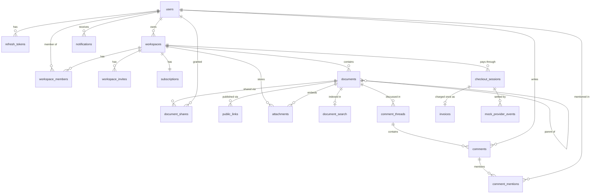

# Data model

Postgres, managed with Prisma 7 in `packages/db` (`prisma/schema.prisma`, migrations in
`prisma/migrations`). Tables and columns are snake_case, ids are UUID v7.

Notes:

- **Documents form a tree** (`parent_id`) ordered by `position`, a fractional-indexing key. The column
  is created `COLLATE "C"` so keys compare bytewise; the database default collation would sort mixed
  case differently and break the ordering.
- **Soft delete**: `deleted_at` marks a document, `deleted_root_id` the document where the deletion
  started, so a restore brings back only that deletion's subtree.
- **`revision`** is incremented atomically on every change that derived data (search index, public
  pages) must follow.
- **Indexes**: the tree listing uses a partial index `documents_tree_idx (workspace_id, parent_id,
position) WHERE deleted_at IS NULL`; the rest are plain b-tree indexes on foreign keys and unique
  lookups (emails, slugs, token hashes, one share per user and document, one public link per document
  and mode). Partial indexes, `COLLATE "C"` and the `pg_trgm`/`unaccent` extensions are written by hand
  in the first migration; the partial index keeps the name declared in the schema, so
  `pnpm --filter @collab-docs/db db:drift` still reports no drift. The search migration adds the
  `cd_unaccent` function, the generated `tsv` column of `document_search` and the `cd_headline` text search
  configuration by hand, and the schema mirrors the generated column (`dbgenerated`) for the same reason
  (see [Search](search.md)).
- **Comments and notifications**: a thread belongs to a document and anchors on a `block_id`, the id the editor
  gives the block. It is not a foreign key, because blocks live inside the CRDT state; see
  [Comments & notifications](comments.md). `notifications.dedupe_key` is unique, which is what
  makes creating a notification idempotent. Besides `(user_id, read_at, created_at)` there is an index on
  `(user_id, created_at DESC, id DESC)` that serves the newest-first list.
- **Billing**: `checkout_sessions` (a payment in progress; `PENDING` becomes `COMPLETED` or `FAILED` once),
  `webhook_events` (one row per provider event id, `RECEIVED` or `PROCESSED`, unique `event_id`), `invoices`
  (unique `checkout_session_id`: a session is charged once) and `mock_provider_events` (what the mock provider
  issued, so any event can be delivered again). `subscriptions.last_event_at` orders events; see
  [Billing & idempotency](billing.md). Billing records are `RESTRICT`, so a workspace with a payment
  history is never deleted implicitly.
- **Foreign keys**: rows that make no sense without their parent (memberships, refresh tokens, shares,
  public links, the subscription, threads, comment mentions, notifications) cascade; workspace owners, document authors and workspaces that
  still hold documents are `RESTRICT`, so content is never deleted implicitly.
- Emails are stored lower-case (normalised by the application) and are unique.

## Database commands

| Command                                    | What it does                                                                                                       |
| ------------------------------------------ | ------------------------------------------------------------------------------------------------------------------ |
| `pnpm --filter @collab-docs/db db:migrate` | Create/apply migrations in development                                                                             |
| `pnpm --filter @collab-docs/db db:deploy`  | Apply existing migrations (what the `migrate` job runs)                                                            |
| `pnpm --filter @collab-docs/db db:seed`    | Idempotent demo data (dev only): `alice`, `bob`, `carol` `@example.test`, password `password123`, workspace `acme` |
| `pnpm --filter @collab-docs/db db:reset`   | Drop, re-migrate and re-seed                                                                                       |
| `pnpm --filter @collab-docs/db db:drift`   | Fails if migrations and `schema.prisma` diverge                                                                    |
| `pnpm test:integration`                    | Integration tests against a real Postgres                                                                          |

All of them read `DATABASE_URL`. Integration tests use `createTestDb()` from
`@collab-docs/db/testing`: each Jest worker creates its own throwaway database on that server,
applies the migrations and truncates tables between tests.
