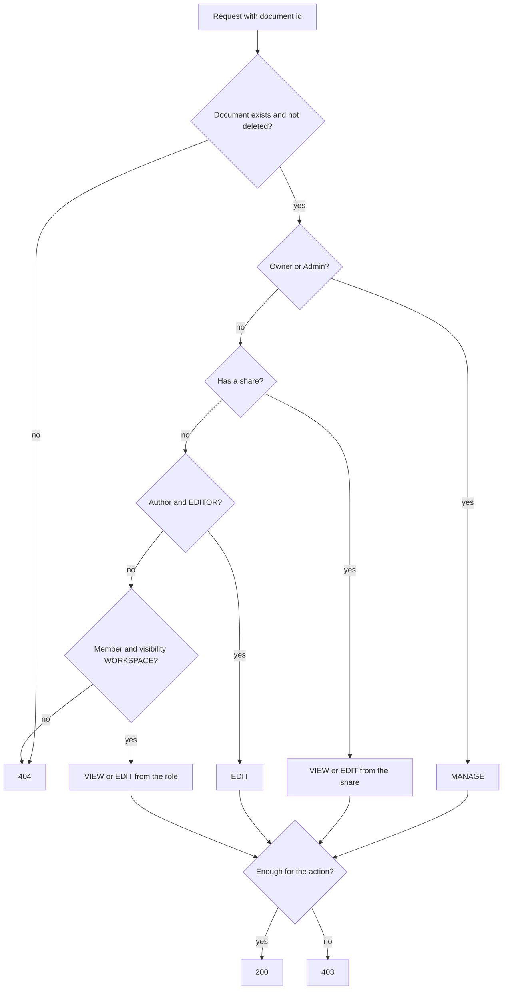

# Workspaces and permissions

## Workspaces, members and invites

`apps/api/src/workspaces`. A user creates a workspace and becomes its `OWNER`; the workspace starts on the
`FREE` plan. Roles: `OWNER`, `ADMIN`, `EDITOR`, `VIEWER`.

| Endpoint                                       | Minimum role | Purpose                                              |
| ---------------------------------------------- | ------------ | ---------------------------------------------------- |
| `POST /api/workspaces`                         | any user     | Create a workspace (slug is generated from the name) |
| `GET /api/workspaces`                          | any user     | Workspaces the caller belongs to                     |
| `GET /api/workspaces/:id`                      | `VIEWER`     | One workspace                                        |
| `PATCH /api/workspaces/:id`                    | `ADMIN`      | Rename                                               |
| `GET /api/workspaces/:id/usage`                | `VIEWER`     | Members, documents, storage against the plan limits  |
| `GET /api/workspaces/:id/members`              | `VIEWER`     | Members                                              |
| `PATCH /api/workspaces/:id/members/:userId`    | `ADMIN`      | Change a role                                        |
| `DELETE /api/workspaces/:id/members/:userId`   | `VIEWER`     | Leave (own id) or remove a member (`ADMIN`)          |
| `POST /api/workspaces/:id/invites`             | `ADMIN`      | Invite an email (never as `OWNER`), emailed          |
| `GET /api/workspaces/:id/invites`              | `ADMIN`      | Pending invites                                      |
| `DELETE /api/workspaces/:id/invites/:inviteId` | `ADMIN`      | Revoke                                               |
| `GET /api/invites/:token`                      | public       | Preview (workspace, email, role) for the accept page |
| `POST /api/invites/:token/accept`              | signed in    | Join; the account email must equal the invited email |

Rules enforced on the server: an admin can neither change or remove an owner nor grant `OWNER`; the last
owner can be neither demoted nor leave (`409`); removing a member, or leaving, also deletes their shares on the
workspace's documents in the same transaction, so a former member does not stay on as a guest of what was shared
with them; a role change or removal publishes `perm.changed` on Redis once the transaction has committed (the
real-time server listens to it and closes the sockets that lost access). Both rules run under the workspace
row lock, so two concurrent demotions cannot leave a workspace without an owner.

**Invites.** The token is 256 random bits, valid for 7 days, and only its SHA-256 is stored. Inviting an
address that already has a pending invite re-issues it (new token, new expiry, the old link stops working);
inviting an existing member is `409`. The email is sent by the `mail` queue (nodemailer to SMTP, Mailpit in
development at <http://localhost:8025>); the worker retries with exponential backoff and the HTML template
escapes every user-supplied value. The queue payload carries the accept link, so Redis holds a valid token
until the job is removed (one hour after success).

**Plan limits.** `PLAN_CATALOG` in `@collab-docs/shared` (Free 3 members / 20 documents / 100 MB, Pro
10 / 500 / 5 GB, Team 50 / unlimited / 50 GB). Members are accepted members plus pending invites; people who
only have a document shared with them (guests) do not count. Every check runs in a transaction that first
takes `SELECT ... FOR UPDATE` on the workspace row, so N parallel invites at the limit produce exactly the
allowed number of successes. Exceeding a limit returns `403` with
`{ code: 'PLAN_LIMIT_EXCEEDED', details: { kind, limit, current, plan } }`. After a downgrade, existing
members stay and new ones are blocked, including accepting an invite that was issued earlier.

## Permission model

Access is decided by pure functions in `packages/shared/src/permissions.ts`, so the API, the collab server
and the tests share one definition. `PermissionsService` (`apps/api/src/permissions`) loads the minimal
context (membership, share, visibility) and calls them. **Nothing is cached**: a revoked permission applies
to the next request. Routes declare their requirement with `@WorkspaceRole('ADMIN')` or
`@DocumentAccess('EDIT')`.

Document access, evaluated top to bottom:

| #   | Condition                                      | Access                                       |
| --- | ---------------------------------------------- | -------------------------------------------- |
| 1   | Document is deleted                            | `NONE` (restore: Owner/Admin, Editor-author) |
| 2   | Role is `OWNER` or `ADMIN`                     | `MANAGE`                                     |
| 3   | The user has a `document_share`                | share `EDITOR` -> `EDIT`, `VIEWER` -> `VIEW` |
| 4   | The user wrote the document and is an `EDITOR` | `EDIT`                                       |
| 5   | Member and visibility is `WORKSPACE`           | `EDITOR` -> `EDIT`, `VIEWER` -> `VIEW`       |
| 6   | Anything else (non-member, `RESTRICTED`)       | `NONE`                                       |

An explicit share overrides the workspace role in both directions. An `EDITOR` who wrote a document keeps
`EDIT` on it even when it is `RESTRICTED`, so the author cannot lock themselves out; a `VIEWER` author is not
upgraded. Public links are a separate path: a `VIEW` link allows anonymous reading of the published page, a live
`EDIT` link grants `EDIT` on that one document to a guest who cannot comment.

**404 vs 403.** No access at all (not a member, `RESTRICTED` without a share or authorship, deleted, unknown
id, malformed id) gives `404`, so the response never confirms that a resource exists; access that is too low for
the action gives `403`. A member of a workspace also gets `403` where a non-member gets `404`.

Creating a document needs `EDITOR` and `EDIT` on the parent; the child copies the parent's visibility and
shares at that moment (a snapshot, not live inheritance). Moving needs `EDIT` on the document and on the new
parent, the same workspace and no cycle. Commenting needs `EDIT` on the document, whatever grants it: a workspace
`VIEWER` with an editor share can comment, a reader cannot, and a guest with an edit link cannot either (comments
need an account).
