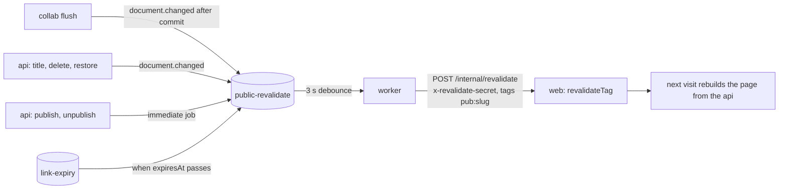

# Publishing, sanitization & ISR

A document can be shared outside the workspace in two ways, both through a row in `public_links` (one per
document and mode, see [Data model](data-model.md)):

| Mode   | Address              | Grants                                                    | Identified by                                |
| ------ | -------------------- | --------------------------------------------------------- | -------------------------------------------- |
| `VIEW` | `/published/<slug>`  | anonymous reading of the sanitised page (SSR/ISR)         | `slug`: title words and 6 hex digits, public |
| `EDIT` | `/edit-link/<token>` | `EDIT` on that one document, as a guest, without comments | a 256-bit secret; only its SHA-256 is stored |

Both can have an optional expiry (at most five years ahead). Managing links needs `MANAGE`, or `EDIT` as the
document's author, like sharing. Everything below is API; the pages that use it are described with the frontend.

| Endpoint                                     | Notes                                                                                                                                                                       |
| -------------------------------------------- | --------------------------------------------------------------------------------------------------------------------------------------------------------------------------- |
| `GET /documents/:id/public-links`            | the links with `status` (`active`, `expired`, `revoked`); never the EDIT secret                                                                                             |
| `POST /documents/:id/public-links`           | `{mode, expiresAt?}`; **10 per hour per user** (`RATE_PUBLIC_LINK_PER_HOUR_USER`). `VIEW` is idempotent, `EDIT` returns the secret once (`token`) and replaces the old link |
| `PATCH /documents/:id/public-links/:linkId`  | `{expiresAt}`, `null` removes it; a revoked link is `409`                                                                                                                   |
| `DELETE /documents/:id/public-links/:linkId` | revokes (`revoked_at`); revoking again is a no-op                                                                                                                           |
| `GET /public/documents/:slug`                | `{title, description, content, updatedAt}`; **one `404`** for never published, unpublished, expired and deleted                                                             |
| `GET /public/media/:attachmentId?slug=`      | `302` to a presigned URL (5 min) when the image belongs to the document the slug publishes                                                                                  |
| `GET /public/links/:token`                   | state of an EDIT link for `/edit-link/<token>`: `404` unknown or replaced, `410 LINK_EXPIRED` expired or revoked, `410 DOCUMENT_DELETED`                                    |
| `POST /public/links/:token/ticket`           | collab ticket for a guest (`{docId, linkId}`, no user); **30 per minute per IP** (`RATE_GUEST_TICKET_PER_MIN_IP`)                                                           |

**Life cycle of a link.** The `VIEW` slug is created once and never changes: unpublishing sets `revoked_at`,
publishing again clears it, so the address (and whatever links to it) comes back. The slug is a public address, not a
secret: an unpublished page is protected by `revoked_at`, never by the slug being hard to guess. Renaming the document does not
move the page. The `EDIT` link is the opposite: enabling it always creates a **new row with a new secret** and drops
the old one, whether the old one was live, revoked or expired. A leaked URL therefore never comes back to life, and
because collab ties a guest's socket to the link id, the sockets opened through the old URL are closed at once
(`perm.changed` with reason `link_changed`) instead of at the next 60 s check. Calling `POST` on a live `EDIT` link
is how it is regenerated.

**What the public endpoint returns.** The api reads the stored state with `DocumentStateReader` (one consistent
snapshot of state and tail), converts it with `yDocToContentJson`, and **always** passes it through
`sanitizeContent` before it leaves: only the allowlisted nodes, marks and attributes, `http`/`https`/`mailto`
links with a forced `rel`, images by `attachmentId` only, capped depth and size, no control or bidi characters
(see [Content model](documents.md#content-model)). The description for the meta tags is the first 160 characters of the text;
the title comes from `documents.title`. The response has no user id, workspace id, document id or email, and the
tests assert that for a document written by a named user in a named workspace. The web app renders this JSON with
React elements, so no HTML string is ever built from user content.

**Publishing with unsaved changes.** The page is built from what is in the database, and the editor's latest
keystrokes may not be there yet (edge case "publish with local changes"). Two layers cover it:

1. _Client contract_ (implemented with the share dialog): the Publish action is enabled only while
   `!hasUnsyncedChanges`, i.e. when the server has confirmed the latest local change as stored (see
   [CRDT persistence](crdt.md#crdt-persistence-strategy)). While the editor says "Saving…" the button waits; offline it
   explains why it is disabled.
2. _Server_: publishing a `VIEW` link first asks collab to write its buffer (`collab.flush`, 2 s limit). If collab
   is slow or down the page is published from the stored state and the response says `flushed: false`, which the
   client shows as a warning. Publishing never fails because collab is unavailable.

**On-demand revalidation without slowing the editor.** The published page is cached by Next (ISR, tag
`pub:<slug>`, one hour as the fallback). Nothing on the editing path calls the web app:

- Content, title, icon, delete and restore go through `emitDocumentChanged`, which queues a delayed job per
  document with BullMQ deduplication (`REVALIDATE_DEBOUNCE_MS`, 3 s): a burst of keystrokes becomes one call.
  Publish, unpublish and expiry are queued at once and not debounced, because a page that must disappear should
  not wait three more seconds, and a page published right after someone visited the address must not keep the
  cached "not found".
- The job looks up the document's `VIEW` link when it runs and posts the tag of that slug. Any `VIEW` link row
  counts, not only a live one: the last invalidation after an unpublish, an expiry or a delete is exactly the one
  for a link that is no longer live. Documents that were never published cost one indexed lookup.
- A failed call (network, timeout 5 s, non-2xx) throws and BullMQ retries with exponential backoff (5 attempts, 1 s
  base). Logs: `revalidate.sent` and `revalidate.failed` with the document, slug, reason and attempt. After the last
  attempt the page waits for its TTL. Enqueue failures are logged and counted, never raised to the editor.
- A page whose state must change at once is checked after the invalidation: the job asks the web app for `/published/<slug>`
  and fails, to be retried, unless the answer is 404 for a revoked, expired or deleted page, or 200 for a page that
  has just been published. Next writes a rendered page to its
  cache after it has answered, so a visit rendered just before the invalidation can store the old page after it and
  make it look fresh again; without the check an unpublished page could be served for an hour. The check looks at the
  status only: for a change of content the retry cannot tell the old page from the new one.
- Contract of `POST {WEB_INTERNAL_URL}/internal/revalidate`: header `x-revalidate-secret`, body
  `{tags: ["pub:<slug>"]}` (`revalidateRequestSchema` in `@collab-docs/shared`, up to 20 tags).
- Because the tag is derived from the slug, the web app needs nothing but the slug to cache or invalidate a page.

**Expiry.** Moving or setting `expiresAt` plans a delayed job in `link-expiry` (one per link and expiry time;
the old one is removed). When it runs it logs `public_link.expired`, then invalidates the page of a `VIEW` link or
tells collab to re-read the guests of an `EDIT` link. A job that fires after the link was changed or revoked sees a
different `expiresAt` and does nothing. The authority is always the database: `GET /public/*` and collab check
`revoked_at` and `expires_at` on every request, so a failure of the job only delays the cleanup (page TTL, 60 s
socket check).

**Guests.** `/edit-link/<token>` asks `GET /public/links/:token` and, for a live link, `POST …/ticket`. The ticket carries
`{docId, linkId}` and no user. Collab resolves the link from the database when the socket opens and on every
re-evaluation, gives the guest `EDIT` (never comments), and names them `Guest 1`, `Guest 2`, … in the presence list
in order of arrival. Revoking, replacing or expiring the link closes their sockets with `4403`.

**Logs** (all with the correlation id): `document.published`, `document.unpublished`, `public_link.created`,
`public_link.revoked`, `public_link.updated`, `public_link.expired`, `revalidate.sent`, `revalidate.failed`.

**Consistency.** The page is eventually consistent by design: a change reaches new visitors after roughly the
debounce plus the time to rebuild (a few seconds), and the TTL bounds the worst case. Who may publish and
whether a link is live are strongly consistent (read from Postgres on every request, never cached).
