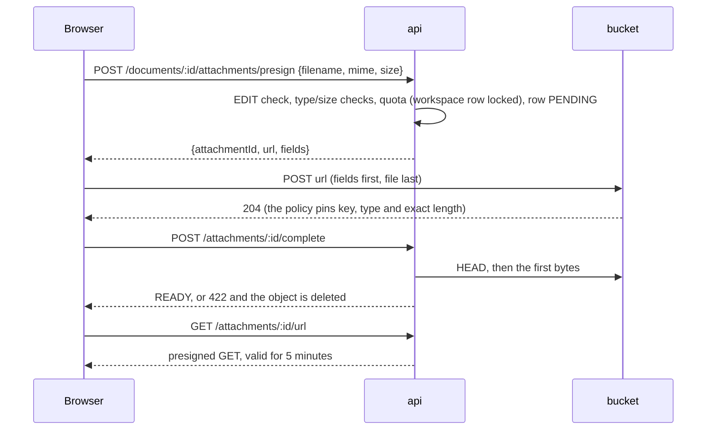

# Storage and attachments

Images live in an S3-compatible bucket (MinIO in development) and never pass through the api: the browser
uploads them with a presigned POST. A document refers to an image by `attachmentId` only (see
[Content model](documents.md#content-model)); external URLs and SVG are not part of the model.

| Endpoint                                  | Needs | Notes                                                                                                                                                               |
| ----------------------------------------- | ----- | ------------------------------------------------------------------------------------------------------------------------------------------------------------------- |
| `POST /documents/:id/attachments/presign` | EDIT  | `{filename, mime, size}` → `{attachmentId, url, fields, expiresAt}`; `413` over the per-file limit, `403 PLAN_LIMIT_EXCEEDED` with `kind: 'storage'` over the quota |
| `POST /attachments/:id/complete`          | EDIT  | idempotent; `422` with `details.reason` (`not_uploaded`, `size_mismatch`, `type_mismatch`, `content_mismatch`)                                                      |
| `GET /attachments/:id/url`                | VIEW  | only completed uploads; the access check runs on every call, so a revoked role or a deleted document stops it at once                                               |

**Three layers refuse anything that is not png, jpeg, webp or gif.**

1. _Presign_: the type is an allowlist, the file name's extension has to belong to it, the size is capped
   (`ATTACHMENT_MAX_BYTES`, 10 MB by default). `image/svg+xml`, `text/*` and the rest are `400`.
2. _Bucket policy_: the form is signed with conditions on the key, the `Content-Type` and
   `content-length-range` set to the declared size, so the bucket itself answers `EntityTooLarge`,
   `EntityTooSmall` or `403` for anything else, however the client was modified.
3. _Sniffing on completion_: the stored size and content type are compared with what was declared and the
   first bytes are checked against the magic numbers of the four formats. A text file called `fake.png`
   passes layers 1 and 2 and stops here; the object and its row are deleted.

**The checked file cannot be replaced.** The form stays valid for ten minutes, also after completion. So the browser
uploads to `uploads/{key}`, and completion copies that object to `{key}` on the server, deletes the upload and
checks the copy; the file is served from `{key}`, which no form names. Whatever is posted with the form afterwards
stays under `uploads/`, which a bucket lifecycle rule (set by `minio-init`) expires after a day. A completion that
stopped after the copy is repeated without an upload and checks the copy again.

**Quota.** `SUM(size)` over the workspace's attachments (completed and pending) has to stay within the plan
(100 MB / 5 GB / 50 GB). The check and the insert run in one transaction under `SELECT ... FOR UPDATE` on the
workspace row, the same lock the member and document limits use, so two parallel presigns cannot both take
the last bytes. `GET /workspaces/:id/usage` reports the same figure.

**Two S3 clients.** The server talks to `S3_ENDPOINT` (the compose network name, `minio:9000`); URLs given to
browsers are signed for `S3_PUBLIC_ENDPOINT` (`localhost:9000`), because a signature covers the host. The
bucket's CORS origin is `WEB_ORIGIN` (`MINIO_API_CORS_ALLOW_ORIGIN` in `docker-compose.yml`).

**Lifecycle.** Objects are stored as `ws/{workspaceId}/doc/{documentId}/{uuid}` (uploaded under the `uploads/`
prefix first). A `PENDING` row older than `ATTACHMENT_PENDING_TTL_HOURS` (24) is removed by an hourly worker job
together with its objects. The job
claims rows with `DELETE ... RETURNING` before touching the bucket, so a completion racing the sweep fails
with `404` and never leaves a `READY` row without a file. Deleting a document is a soft delete and keeps its
attachments; purging them is not done (see [Not done](../README.md#not-done)).
